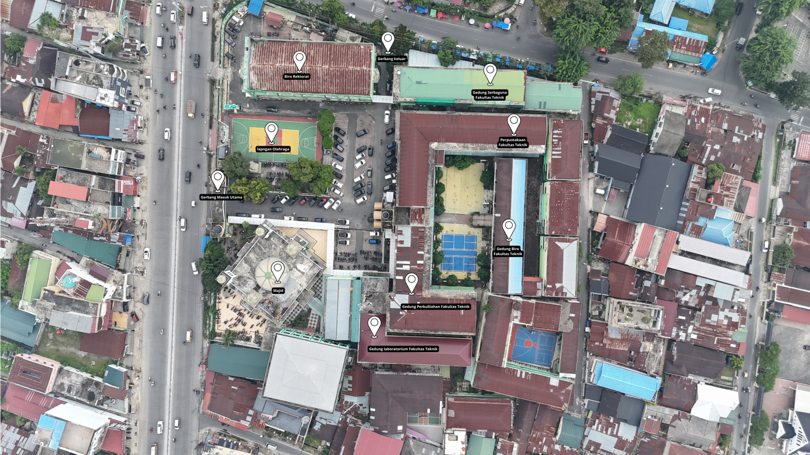
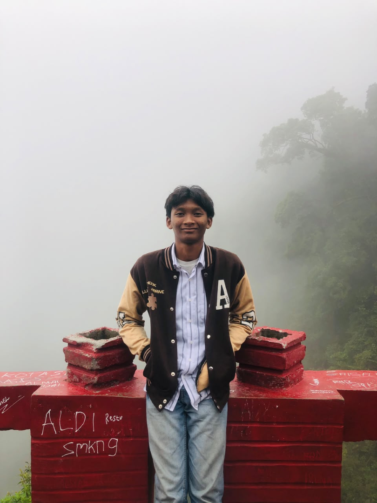

# FT UISU EXPLORER — DOKUMENTASI GABUNGAN DARI AWAL SAMPAI REVISI 9 (NO NAVIGATE)

**Status pembahasan:** 9 Oktober 2026  
**Developer:** Muhammad Arief Rachim (Acim)  
**Repository:** https://github.com/Acimm1801/ft-uisu-explorer  
**Website:** https://acimm1801.github.io/ft-uisu-explorer/  
**Baseline source dokumentasi sebelumnya:** Revisi 8 (No Navigate). **Source kerja dalam dokumen ini:** Revisi 9 (No Navigate), dengan tiga deskripsi terbaru yang diusulkan dan disertakan di `data/map-data.js`.  
**Keputusan terbaru:** AR Revisi 8 dipertahankan sementara; Direktori telah memasuki Revisi 9 (No Navigate), termasuk Tendik Ruang Serbaguna. Tiga deskripsi terbaru yang disarankan di percakapan dimasukkan dalam source konsolidasi dokumen ini; penerapan pada situs publik belum diverifikasi.

Dokumen ini mempertahankan **77 poin dari arsip awal–Revisi 44** lalu menambahkan **poin 78–113** untuk riwayat cabang **Revisi 1–8 (No Navigate)** dan keputusan terakhir. Bagian historis di bawah ini memuat beberapa pernyataan “versi terbaru” yang berlaku **pada saat arsip Revisi 44 dibuat**, bukan status saat ini; lihat Bagian II untuk status terkini. Dokumentasi ini tidak mengubah kode website.


> **Catatan status sumber:** Bagian I–II memuat sejarah keputusan sampai Revisi 8, tanpa mengubah redaksi historis di dalamnya. Bagian III menerangkan Revisi 9, bagian IV menyalin kelima file source konsolidasi **persis** sesuai folder proyek pada saat pembuatan dokumen, dan bagian akhir memuat pemeriksaan teknis. Materi yang bertuliskan "saat ini" dalam bagian historis harus ditafsirkan berdasarkan nomor revisi bagian tersebut.

## DAFTAR ISI SINGKAT

- **Bagian I — Poin 1–77:** identitas, spesifikasi, fitur utama, Revisi 1–44, database, Direktori, model 3D, dan aturan awal.
- **Bagian II — Poin 78–113:** keputusan No Navigation, perubahan Revisi 1–8, batas Tendik, WebAR, diagnosis, status terkini, serta aturan kode.
- **Akhir:** `# END OF MARKDOWN`.

---

# BAGIAN I — ARSIP HISTORIS DARI AWAL SAMPAI REVISI 44

# FT UISU EXPLORER
## Markdown Gabungan Proyek — Acuan Awal sampai Revisi 44

**Terakhir diperbarui:** 7 Oktober 2026  
**Developer:** Muhammad Arief Rachim (Acim)  
**Proyek:** Skripsi — FT UISU Explorer  
**Repository aktif:** https://github.com/Acimm1801/ft-uisu-explorer  
**Website aktif:** https://acimm1801.github.io/ft-uisu-explorer/

---

# 1. IDENTITAS PROYEK

Nama website:

**FT UISU Explorer**

Website dibuat untuk membantu mahasiswa, pengunjung, dan civitas akademik Fakultas Teknik Universitas Islam Sumatera Utara dalam:

- melihat bentuk bangunan melalui model 3D,
- menampilkan bangunan menggunakan Augmented Reality Markerless,
- mencari lokasi gedung dan ruangan,
- mendapatkan navigasi menuju gedung/ruangan,
- melihat informasi gedung dan ruangan,
- mencari civitas akademik dan tenaga kependidikan.

Proyek merupakan bagian dari skripsi:

> **Implementasi Augmented Reality Markerless menggunakan Algoritma Simultaneous Localization and Mapping (SLAM) pada Denah Fakultas Teknik Universitas Islam Sumatera Utara**

Developer website:

**Muhammad Arief Rachim (Acim)**  
Mahasiswa Teknik Informatika FT-UISU.

---

# 2. FLOW UTAMA WEBSITE

Berdasarkan rancangan flowchart proyek, website memiliki empat fitur utama:

1. **3D Objek**
2. **AR Markerless**
3. **Navigasi**
4. **Direktori**

Selain empat fitur tersebut terdapat:

- Searchbar global
- Beranda
- Bantuan
- Tentang
- Kontak developer

---

# 3. FITUR 3D OBJEK

## Konsep

User memilih gedung kemudian model ditampilkan menggunakan `<model-viewer>`.

Model dapat:

- drag,
- rotate,
- zoom,
- scroll,
- pinch,
- reset kamera.

Jika sebuah gedung mempunyai model Indoor dan Outdoor maka user dapat mengganti keduanya langsung di viewer yang sama.

Jika hanya memiliki satu model maka hanya model tersebut yang ditampilkan.

---

# 4. DAFTAR 7 MODEL 3D

Terdapat tujuh varian model utama:

### 1. Biro Fakultas Teknik UISU — Outdoor

```text
./assets/models/gedung_biro_outdoor.glb
```

### 2. Biro Fakultas Teknik UISU — Indoor

```text
./assets/models/gedung_biro_indoor.glb
```

### 3. Gedung Perkuliahan Fakultas Teknik UISU — Outdoor

```text
./assets/models/gedung_perkuliahan_outdoor.glb
```

### 4. Gedung Perkuliahan Fakultas Teknik UISU — Indoor

```text
./assets/models/gedung_perkuliahan_indoor.glb
```

### 5. Perpustakaan Fakultas Teknik UISU — Indoor

```text
./assets/models/perpustakaan_indoor.glb
```

### 6. Ruang Serbaguna Fakultas Teknik UISU — Indoor

```text
./assets/models/serbaguna_indoor.glb
```

### 7. Laboratorium Fakultas Teknik UISU — Outdoor

```text
./assets/models/laboratorium_outdoor.glb
```

---

# 5. FITUR AR MARKERLESS

Model yang digunakan untuk AR adalah model yang sama dengan menu 3D Objek.

Konsep AR yang direncanakan:

1. User memilih gedung.
2. Sistem membuka kamera.
3. Sistem mendeteksi bidang datar.
4. Model ditempatkan pada bidang datar pertama yang berhasil terdeteksi.
5. Model tidak boleh terus berpindah atau melayang.
6. Posisi model diharapkan terkunci setelah placement berhasil.

Target interaksi:

- drag,
- rotate,
- pinch,
- zoom,
- interaksi model melalui perangkat mobile.

AR menggunakan `<model-viewer>` dengan:

```html
ar
ar-placement="floor"
ar-modes="webxr scene-viewer quick-look"
```

**Status:** mekanisme penguncian bidang datar pertama menggunakan pendekatan SLAM masih merupakan pekerjaan lanjutan dan belum dianggap selesai.

---

# 6. FITUR NAVIGASI

Navigasi digunakan untuk mencari rute **outdoor** menuju gedung atau entrance gedung.

Flow:

```text
Cari Tujuan
    ↓
User Memilih Tujuan
    ↓
Denah 2D Ditampilkan
    ↓
User Menentukan Posisi
    ↓
Sistem Menghitung Jalur
    ↓
Rute Dijkstra Ditampilkan
    ↓
Button "Mulai Navigasi"
    ↓
Mode Navigasi
```

Navigasi menggunakan:

- graph node,
- graph edge,
- entrance,
- polyline,
- algoritma Dijkstra.

Rute ditampilkan sebagai garis biru.

---

# 7. GPS NAVIGASI

Kode telah memiliki mekanisme:

```javascript
navigator.geolocation.watchPosition()
```

Namun data:

```javascript
mapCalibration = []
```

masih kosong.

Akibatnya GPS real-time seperti Google Maps belum dianggap selesai.

Target ke depan:

- kalibrasi koordinat GPS ke koordinat denah,
- posisi user bergerak mengikuti GPS,
- user marker mengikuti posisi sebenarnya,
- rute tetap berdasarkan graph dan Dijkstra.

---

# 8. DIREKTORI

Direktori berisi data:

- gedung,
- ruangan,
- unit,
- informasi ruangan,
- tenaga kependidikan tertentu.

Flow umum:

```text
Gedung
   ↓
Ruangan
   ↓
Informasi / Petunjuk Arah / Tendik
```

---

# 9. SEARCHBAR

Searchbar harus dapat mencari:

- gedung,
- ruangan,
- unit,
- civitas akademik,
- data yang berada pada database website.

Search tidak hanya mencari nama gedung.

---

# 10. STRUKTUR FILE UTAMA

File utama website:

```text
index.html
style.css
script.js
data/map-data.js
sw.js
```

Asset berada pada:

```text
assets/
```

Contoh:

```text
assets/images/
assets/models/
assets/maps/
```

---

# 11. ATURAN PEMBERIAN KODE

Aturan ini WAJIB dipertahankan pada percakapan berikutnya.

Jika perubahan hanya sekitar 1–3 baris:

- boleh memberikan patch,
- jelaskan letak kode.

Jika perubahan cukup banyak:

WAJIB memberikan ulang seluruh kode dalam lima blok utuh:

1. `index.html`
2. `script.js`
3. `style.css`
4. `data/map-data.js`
5. `sw.js`

Format:

```text
index.html → satu blok kode penuh

script.js → satu blok kode penuh

style.css → satu blok kode penuh

data/map-data.js → satu blok kode penuh

sw.js → satu blok kode penuh
```

**Jangan memecah satu file menjadi banyak blok kode kecil.**

User ingin dapat langsung:

```text
copy → paste → GitHub
```

---

# 12. BASELINE AWAL

Pada tahap awal proyek pernah digunakan repository:

```text
Acimm1801/Proyek-Skripsi-Acim
```

Kemudian proyek dipindahkan ke repository baru:

```text
Acimm1801/ft-uisu-explorer
```

Repository lama hanya menjadi referensi historis.

Repository aktif sekarang:

```text
https://github.com/Acimm1801/ft-uisu-explorer
```

GitHub Pages:

```text
https://acimm1801.github.io/ft-uisu-explorer/
```

---

# 13. REVISI 1

Perubahan utama:

### Slider Home

Empat tombol pada slider Home dihapus.

### Direktori

Seluruh baris ruangan dapat diklik.

Tidak lagi menggunakan tombol:

```text
Pilih
```

Ketika ruangan diklik, muncul:

```text
Informasi
Petunjuk Arah
```

### Modal Informasi

Button:

```text
Petunjuk Arah
```

dihapus dari dalam modal informasi.

Navigasi tetap tersedia dari tombol Direktori.

### Menu 3D / AR

Urutan gedung disesuaikan.

Urutan yang disepakati:

1. Biro Fakultas Teknik
2. Ruang Perkuliahan FT
3. Laboratorium Fakultas Teknik
4. Ruang Serbaguna FT
5. Perpustakaan Fakultas Teknik

Kemudian nama-nama ini terus disempurnakan pada revisi berikutnya.

### Warna tombol

Koreksi Revisi 1:

Hanya button:

```text
Informasi
Petunjuk Arah
```

yang menggunakan:

Default:

```text
Hijau + tulisan putih
```

Hover:

```text
Putih + tulisan hijau
```

Gedung dan ruangan tidak dijadikan seluruhnya hijau.

---

# 14. PENGEMBANGAN LOGO

Konsep logo yang dipilih:

```text
Pin Lokasi
    +
Kubus 3D
    +
Monogram
```

Konsep akhir mempunyai:

- pin,
- kubus kecil di dalam pin,
- huruf A di bagian atas,
- tulisan FT pada sisi kiri kubus,
- UISU pada sisi kanan,
- gradasi hijau–biru.

Logo digunakan pada header.

File:

```text
./assets/images/logo-ft-uisu.png
```

Nama website:

```text
FT UISU Explorer
```

menggunakan warna gradasi.

---

# 15. REVISI 2

Tema button utama diseragamkan.

Default:

```text
gradasi hijau → biru
teks putih
```

Hover:

```text
background putih
teks hijau
border hijau
```

Cakupan antara lain:

- button utama,
- Informasi,
- Petunjuk Arah,
- Indoor/Outdoor aktif,
- lantai aktif,
- AR button.

---

# 16. REVISI 3–37

Riwayat perubahan detail per nomor Revisi 3 sampai 37 tidak tersedia secara lengkap dalam arsip markdown yang berhasil ditemukan.

Karena itu:

**jangan mengarang isi setiap revisi.**

Yang tersedia adalah snapshot kode hasil perkembangan yang disebut:

```text
Revisi 37.2
```

Snapshot tersebut menjadi salah satu baseline historis sebelum perubahan visual selanjutnya.

---

# 17. STATUS 37.2

Pada versi 37.2 fitur utama yang sudah ada antara lain:

- landing page,
- slider Home,
- drawer hamburger,
- 3D Model Viewer,
- AR,
- Direktori,
- Navigasi,
- Dijkstra,
- map graph,
- informasi developer.

GPS masih belum aktif sepenuhnya karena:

```javascript
mapCalibration=[]
```

---

# 18. REVISI 38

Tidak ditemukan dokumen yang secara jelas mendefinisikan implementasi bernomor **Revisi 38**.

Karena itu Revisi 38 tidak boleh direkonstruksi atau ditebak.

---

# 19. REVISI 39 — UI WEBSITE

Revisi 39 berfokus pada tampilan visual.

Logo fitur menggunakan asset PNG.

### 3D

```text
./assets/images/logo_3d.png
```

### AR

```text
./assets/images/logo_ar.png
```

### Navigasi

```text
./assets/images/logo_navigasi.png
```

### Direktori

```text
./assets/images/logo_direktori.png
```

### Header

```text
./assets/images/logo-ft-uisu.png
```

Logo dipakai pada:

- hamburger drawer,
- kartu fitur Home,
- header.

---

# 20. GRADASI REVISI 39

Gradasi:

```css
linear-gradient(
    135deg,
    #087f72,
    #1898d5
)
```

Digunakan pada:

- nama FT UISU Explorer,
- bagian tertentu heading Slider 1,
- bagian tertentu heading Slider 2,
- judul 4 feature card.

Tidak digunakan sembarangan ke seluruh teks.

---

# 21. HEADER REVISI 39

Header final mempertahankan:

```text
[logo] FT UISU Explorer
```

Menu:

```text
Beranda
Bantuan
Tentang
Hamburger
```

Logo tidak boleh glitch ketika scroll agresif.

Solusi terakhir mempertahankan logo sebagai elemen `` yang berada di dalam container crop.

---

# 22. REVISI 40 — FULLSCREEN 3D

Revisi 40 menambahkan fullscreen pada fitur:

```text
3D Objek
```

Tidak diterapkan pada:

```text
AR
```

Ketika model telah dimuat tersedia button:

```text
⛶ Fullscreen
```

Ketika fullscreen aktif tersedia:

```text
×
```

untuk keluar.

Escape juga dapat digunakan pada desktop.

Yang fullscreen adalah:

**seluruh kontainer viewer 3D**

bukan hanya canvas/model.

Artinya bagian berikut tetap berada dalam fullscreen:

- judul model,
- Indoor/Outdoor,
- Reset Kamera,
- model viewer,
- status model,
- kontrol viewer.

Berlaku untuk seluruh tujuh model.

---

# 23. REVISI 41 — MODEL LABORATORIUM

File model Laboratorium telah dimasukkan ke repository:

```text
laboratorium_outdoor.glb
```

Path final:

```javascript
"./assets/models/laboratorium_outdoor.glb"
```

Model harus digunakan pada:

- database model,
- 3D Objek,
- AR,
- preload/cache,
- slider model Home.

---

# 24. REVISI 41 — KAMERA MODEL

Pada menu **3D Objek**, masing-masing model mempunyai konfigurasi kamera default.

Database menggunakan:

```javascript
defaultCameraOrbit
defaultCameraTarget
defaultFieldOfView
```

Ketika:

```text
model pertama kali dibuka
```

atau:

```text
Reset Kamera
```

kamera kembali ke default model tersebut.

---

# 25. KEPUTUSAN FINAL SLIDER MODEL HOME

Pernah dilakukan percobaan memaksa sudut awal model slider Home menggunakan:

```html
camera-orbit
camera-target
field-of-view
```

langsung pada `<model-viewer>`.

Hasil tidak sesuai.

Pengguna kemudian meminta:

> kembalikan seperti sebelumnya

Keputusan final:

### Slider Home menggunakan model-viewer seperti sebelumnya.

Contoh:

```html
<model-viewer
    id="landingModel0"
    class="landing-model-viewer active"
    src="./assets/models/gedung_biro_outdoor.glb"
    loading="eager"
    camera-controls
    shadow-intensity="1"
    environment-image="neutral">
</model-viewer>
```

Jangan memaksakan atribut kamera tambahan ke tiga slider Home kecuali diminta lagi.

Animasi interaktif / telapak tangan bawaan tetap dipertahankan.

---

# 26. DATABASE GEDUNG FINAL

Nama gedung final:

### 1.

```text
Biro Fakultas Teknik UISU
```

### 2.

```text
Gedung Perkuliahan Fakultas Teknik UISU
```

### 3.

```text
Laboratorium Fakultas Teknik UISU
```

### 4.

```text
Ruang Serbaguna Fakultas Teknik UISU
```

### 5.

```text
Perpustakaan Fakultas Teknik UISU
```

---

# 27. BIRO FAKULTAS TEKNIK UISU

Daftar ruangan:

- Ruang Dosen
- Gudang Mini
- Program Studi Teknik Industri
- Program Studi Teknik Mesin
- Program Studi Teknik Sipil
- Program Studi Teknik Elektro
- Program Studi Teknik Informatika
- Lembaga Penjamin Mutu Fakultas (LPMF)
- Wakil Dekan Akademik dan Dakwah Islamiyah (WD-1 ADI)
- Wakil Dekan Sumber Daya dan Tata Kelola (WD-2 STK)
- Wakil Dekan Kewirausahaan, Alumni dan Kemahasiswaan (WD-3 KAK)
- Dekan
- Loket Pembayaran Mahasiswa
- KaSubBag Keuangan
- KaSubBag Akademik IT dan Kerjasama
- KaSubBag Kemahasiswaan
- KaSubBag SIAKAD
- KaSubBag Umum dan Perlengkapan Kerumahtanggaan
- Kepala Tata Usaha-KTU

---

# 28. DESKRIPSI BIRO

### Ruang Dosen

Ruang kerja dosen untuk menyiapkan kegiatan perkuliahan, berdiskusi, melakukan bimbingan, serta melayani kebutuhan akademik mahasiswa.

### Gudang Mini

Ruang penyimpanan perlengkapan dan barang penunjang kegiatan operasional Fakultas Teknik.

### Program Studi Teknik Industri

Ruang pengelolaan akademik Program Studi Teknik Industri sekaligus tempat mahasiswa mendapatkan informasi dan layanan terkait perkuliahan, kurikulum, serta kegiatan prodi.

### Program Studi Teknik Mesin

Ruang pengelolaan akademik Program Studi Teknik Mesin dan layanan mahasiswa terkait perkuliahan, kegiatan prodi, serta bidang keilmuan teknik mesin.

### Program Studi Teknik Sipil

Ruang pengelolaan akademik Program Studi Teknik Sipil dan layanan mahasiswa terkait perkuliahan, kegiatan prodi, serta bidang konstruksi dan infrastruktur.

### Program Studi Teknik Elektro

Ruang pengelolaan akademik Program Studi Teknik Elektro dan layanan mahasiswa terkait perkuliahan, kegiatan prodi, serta bidang kelistrikan dan elektronika.

### Program Studi Teknik Informatika

Ruang pengelolaan akademik Program Studi Teknik Informatika dan layanan mahasiswa terkait perkuliahan, kegiatan prodi, serta bidang komputasi dan teknologi informasi.

### Lembaga Penjamin Mutu Fakultas (LPMF)

Unit yang membantu menjaga dan meningkatkan mutu kegiatan akademik melalui pemantauan, evaluasi, dokumentasi mutu, dan persiapan akreditasi di tingkat fakultas.

### Wakil Dekan Akademik dan Dakwah Islamiyah (WD-1 ADI)

Ruang Wakil Dekan bidang Akademik dan Dakwah Islamiyah yang membantu mengoordinasikan kegiatan akademik serta pelaksanaan nilai dan kegiatan dakwah Islamiyah di lingkungan fakultas.

### Wakil Dekan Sumber Daya dan Tata Kelola (WD-2 STK)

Ruang Wakil Dekan bidang Sumber Daya dan Tata Kelola yang membantu mengelola sumber daya, administrasi, sarana, dan tata kelola fakultas.

### Wakil Dekan Kewirausahaan, Alumni dan Kemahasiswaan (WD-3 KAK)

Ruang Wakil Dekan yang menangani kegiatan mahasiswa, hubungan dengan alumni, pengembangan kewirausahaan, serta berbagai kegiatan kemahasiswaan fakultas.

### Dekan

Ruang kerja pimpinan Fakultas Teknik yang mengoordinasikan kegiatan akademik, administrasi, pengembangan fakultas, serta pelaksanaan program kerja secara keseluruhan.

### Loket Pembayaran Mahasiswa

Tempat mahasiswa memperoleh layanan dan informasi yang berkaitan dengan pembayaran serta administrasi keuangan perkuliahan.

### KaSubBag Keuangan

Ruang bagian yang menangani administrasi keuangan, anggaran, pembayaran, pencatatan, serta kebutuhan keuangan Fakultas Teknik.

### KaSubBag Akademik IT dan Kerjasama

Ruang pengelolaan layanan akademik, dukungan sistem dan teknologi informasi, serta administrasi kegiatan kerja sama fakultas.

### KaSubBag Kemahasiswaan

Ruang yang menangani administrasi dan layanan kegiatan mahasiswa, organisasi kemahasiswaan, prestasi, serta kebutuhan kemahasiswaan lainnya.

### KaSubBag SIAKAD

Ruang pengelolaan Sistem Informasi Akademik yang membantu menangani data mahasiswa, mata kuliah, nilai, jadwal, dan administrasi akademik berbasis sistem.

### KaSubBag Umum dan Perlengkapan Kerumahtanggaan

Ruang yang menangani kebutuhan umum, perlengkapan, fasilitas, inventaris, dan berbagai kebutuhan operasional Fakultas Teknik.

### Kepala Tata Usaha-KTU

Ruang Kepala Tata Usaha yang mengoordinasikan layanan administrasi, akademik, keuangan, dokumen, sarana, dan kegiatan tata usaha fakultas.

---

# 29. LABORATORIUM FAKULTAS TEKNIK UISU

Laboratorium terdiri dari:

```text
Lantai 1
Lantai 2
Lantai 3
```

---

# 30. LABORATORIUM — LANTAI 1

### Lab. Hidrolika (Teknik Sipil)

Laboratorium untuk mempelajari perilaku dan aliran air melalui praktikum seperti pengukuran debit, tekanan, saluran terbuka, dan berbagai fenomena hidrolika.

### Lab. Teknologi Mekanik (Teknik Mesin)

Laboratorium untuk praktik proses manufaktur dan pengerjaan material menggunakan berbagai mesin seperti bubut, milling, bor, dan peralatan mekanik lainnya.

Lab. Hidrolika dan Lab. Teknologi Mekanik berada pada satu lokasi/ruang fisik.

---

### Lab. Beton (Teknik Sipil)

Laboratorium untuk praktikum dan pengujian bahan beton, semen, agregat, campuran beton, serta pengujian kekuatan material konstruksi.

### Lab. Jalan Raya (Teknik Sipil)

Laboratorium untuk mempelajari serta menguji material perkerasan jalan seperti agregat dan aspal dalam kegiatan praktikum maupun penelitian.

Lab. Beton dan Lab. Jalan Raya berada pada satu lokasi/ruang fisik.

---

### Lab. Mekanika Tanah (Teknik Sipil)

Laboratorium untuk mempelajari karakteristik dan daya dukung tanah melalui pengujian kadar air, pemadatan, CBR, geser tanah, dan pengujian geoteknik lainnya.

### Lab. Ilmu Ukur Tanah (Teknik Sipil)

Laboratorium yang mendukung kegiatan survei dan pemetaan, seperti pengukuran luas, kontur, elevasi, serta penggunaan alat ukur lapangan.

Lab. Mekanika Tanah dan Lab. Ilmu Ukur Tanah berada pada satu lokasi/ruang fisik.

---

# 31. LABORATORIUM — LANTAI 2

### Ruang Kuliah 9 (Teknik Industri)

Ruang yang digunakan untuk kegiatan perkuliahan, diskusi kelas, presentasi, dan kegiatan pembelajaran mahasiswa.

### Ruang Kuliah 10 (Teknik Industri)

Ruang yang digunakan untuk kegiatan perkuliahan, diskusi kelas, presentasi, dan kegiatan pembelajaran mahasiswa.

### Lab. Fondry (Teknik Industri)

Laboratorium untuk mempelajari proses pengecoran logam, mulai dari persiapan cetakan dan material hingga proses peleburan, penuangan, dan pemeriksaan hasil cor.

### Lab. Komputasi (Fakultas Teknik)

Laboratorium berbasis komputer yang digunakan untuk praktikum, pemodelan, simulasi, pengolahan data, serta penggunaan perangkat lunak pendukung bidang teknik.

### Lab. Sistem Digital (Teknik Informatika)

Laboratorium untuk mempelajari dasar sistem digital, logika digital, rangkaian digital, serta penerapannya pada perangkat dan sistem komputasi.

Lab. Komputasi dan Lab. Sistem Digital berada pada satu tempat/ruang fisik.

---

### Lab. Terintegrasi (Teknik Industri)

Laboratorium untuk praktikum Teknik Industri yang menggabungkan beberapa bidang keilmuan dalam satu rangkaian proses perancangan, analisis, dan penyelesaian masalah industri.

### Lab. Teknik Faktor Manusia (Teknik Industri)

Laboratorium untuk mempelajari hubungan manusia dengan sistem kerja, termasuk ergonomi, antropometri, beban kerja, lingkungan kerja, dan keselamatan kerja.

### Lab. Sistem Produksi (Teknik Industri)

Laboratorium untuk mempelajari perencanaan dan pengendalian produksi, penjadwalan, tata letak fasilitas, keseimbangan lini, serta peningkatan efisiensi proses produksi.

Ketiga laboratorium tersebut berada pada satu kelompok lokasi/ruang fisik.

---

### Lab. Rangkaian Listrik (Teknik Elektro)

Laboratorium untuk memahami dasar rangkaian listrik melalui praktik pengukuran tegangan, arus, daya, serta analisis berbagai konfigurasi rangkaian.

### Lab. Dasar Sistem Telekomunikasi (Teknik Elektro)

Laboratorium untuk mempelajari dasar pengiriman dan penerimaan informasi melalui sinyal, sistem komunikasi, dan perangkat telekomunikasi.

### Lab. Pengukur Listrik (Teknik Elektro)

Laboratorium untuk mengenal dan menggunakan alat ukur listrik serta melakukan pengukuran tegangan, arus, hambatan, daya, dan besaran listrik lainnya.

### Lab. Kontrol (Teknik Elektro)

Laboratorium untuk mempelajari sistem kendali dan otomasi seperti sensor, aktuator, kontrol digital, mikrokontroler, dan penerapan sistem pengaturan otomatis.

### Lab. Dasar Elektronika (Teknik Elektro)

Laboratorium untuk mempelajari komponen dan rangkaian elektronika dasar seperti dioda, transistor, sensor, serta rangkaian analog dan digital.

### Lab. PLC (Teknik Elektro)

Laboratorium untuk mempelajari Programable Logic Controller atau PLC, penggunaan sensor dan aktuator, serta pengendalian mesin dan sistem otomasi industri.

### Lab. Instalasi (Teknik Elektro)

Laboratorium untuk praktik merancang, memasang, mengukur, dan menguji instalasi listrik seperti rangkaian penerangan, tenaga, dan kontrol.

Laboratorium Elektro di atas berada pada satu kelompok lokasi fisik berdasarkan pengelompokan database terakhir.

---

# 32. LABORATORIUM — LANTAI 3

### Ruang Kuliah 11 (Teknik Mesin, Teknik Elektro)

Ruang yang digunakan untuk kegiatan perkuliahan, diskusi kelas, presentasi, dan kegiatan pembelajaran mahasiswa.

### Ruang Kuliah 12 (Teknik Mesin, Teknik Elektro)

Ruang yang digunakan untuk kegiatan perkuliahan, diskusi kelas, presentasi, dan kegiatan pembelajaran mahasiswa.

### Ruang Kuliah 13 (Teknik Mesin, Teknik Elektro)

Ruang yang digunakan untuk kegiatan perkuliahan, diskusi kelas, presentasi, dan kegiatan pembelajaran mahasiswa.

### Lab. Fisika Dasar (Fakultas Teknik)

Laboratorium untuk memahami konsep dasar fisika melalui eksperimen seperti mekanika, listrik, gelombang, optika, pengukuran, dan termodinamika.

### Lab. Komputer Jaringan Mikro (Teknik Informatika)

Laboratorium untuk praktik jaringan komputer seperti konfigurasi jaringan, router dan switch, komunikasi data, monitoring jaringan, serta pengembangan sistem berbasis komputer.

### Lab. Menggambar (Teknik Mesin)

Laboratorium untuk mempelajari gambar teknik dan gambar kerja, baik secara manual maupun menggunakan perangkat lunak CAD sebagai dasar perancangan teknik.

---

# 33. GEDUNG PERKULIAHAN FAKULTAS TEKNIK UISU

Ruangan:

### Ruang Kuliah 1 (Teknik Sipil)

Ruang yang digunakan untuk kegiatan perkuliahan, diskusi kelas, presentasi, dan kegiatan pembelajaran mahasiswa.

### Ruang Kuliah 2 (Teknik Sipil)

Ruang yang digunakan untuk kegiatan perkuliahan, diskusi kelas, presentasi, dan kegiatan pembelajaran mahasiswa.

### Ruang Kuliah 3 (Teknik Sipil)

Ruang yang digunakan untuk kegiatan perkuliahan, diskusi kelas, presentasi, dan kegiatan pembelajaran mahasiswa.

### Ruang Kuliah 4 (Teknik Sipil)

Ruang yang digunakan untuk kegiatan perkuliahan, diskusi kelas, presentasi, dan kegiatan pembelajaran mahasiswa.

### Ruang Kuliah 5 (Teknik Informatika)

Ruang yang digunakan untuk kegiatan perkuliahan, diskusi kelas, presentasi, dan kegiatan pembelajaran mahasiswa.

### Ruang Kuliah 6 (Teknik Informatika)

Ruang yang digunakan untuk kegiatan perkuliahan, diskusi kelas, presentasi, dan kegiatan pembelajaran mahasiswa.

### Ruang Kuliah 7 (Teknik Informatika)

Ruang yang digunakan untuk kegiatan perkuliahan, diskusi kelas, presentasi, dan kegiatan pembelajaran mahasiswa.

### Ruang Kuliah 8 (Teknik Informatika)

Ruang yang digunakan untuk kegiatan perkuliahan, diskusi kelas, presentasi, dan kegiatan pembelajaran mahasiswa.

---

# 34. RUANG SERBAGUNA FAKULTAS TEKNIK UISU

### Ruang Serbaguna Fakultas Teknik UISU

Ruang yang digunakan untuk berbagai kegiatan fakultas seperti seminar, sidang, rapat, presentasi, pelatihan, kegiatan mahasiswa, dan acara akademik lainnya.

---

# 35. PERPUSTAKAAN FAKULTAS TEKNIK UISU

### Perpustakaan Fakultas Teknik UISU

Ruang belajar dan mencari referensi yang menyediakan bahan bacaan serta sumber informasi untuk mendukung perkuliahan, tugas, dan penelitian skripsi mahasiswa.

---

# 36. PENANDA UNIT RUANGAN — REVISI 42

Khusus:

- Laboratorium,
- Gedung Perkuliahan,

unit dalam tanda kurung menunjukkan unit yang rutin memakai atau bertanggung jawab atas ruangan.

Contoh:

```text
Ruang Kuliah 5 (Teknik Informatika)
Lab. Menggambar (Teknik Mesin)
```

Unit ditampilkan di website menggunakan warna berbeda.

---

# 37. WARNA UNIT

### Teknik Informatika

```text
Coklat
```

CSS:

```css
#8b4513
```

### Teknik Mesin

```text
Merah
```

CSS:

```css
#c62828
```

### Teknik Sipil

```text
Hijau
```

CSS:

```css
#2e7d32
```

### Teknik Industri

```text
Kuning
```

CSS:

```css
#b8860b
```

### Teknik Elektro

```text
Biru
```

CSS:

```css
#1565c0
```

### Fakultas Teknik

```text
Hitam
```

CSS:

```css
#111827
```

---

# 38. REVISI 42 — INFORMASI DIREKTORI

Setiap ruangan memiliki:

```text
Informasi
Petunjuk Arah
```

Khusus ruangan pada:

```text
Biro Fakultas Teknik UISU
```

ditambahkan:

```text
Tendik
```

---

# 39. DATA TENDIK

Format database disiapkan sebagai:

```javascript
tendik:[
    {
        name:"Nama Lengkap Pegawai",
        phone:"081234567890",
        photo:"./assets/images/tendik/nama-file.jpg"
    }
]
```

Jika data belum tersedia:

```javascript
tendik:[]
```

Tidak perlu mengubah sistem lagi ketika data pegawai sudah tersedia.

Cukup mengisi array tersebut.

---

# 40. DIRECT WHATSAPP

Nomor WhatsApp Tendik akan otomatis dikonversi.

Contoh database:

```text
081234567890
```

diubah menjadi:

```text
6281234567890
```

kemudian direct:

```text
https://wa.me/6281234567890
```

User dapat mengklik nomor untuk langsung membuka WhatsApp.

---

# 41. TAMPILAN MODAL TENDIK — REVISI 43

Data Tendik hanya mempunyai tiga elemen:

1. Foto
2. Nama lengkap
3. Nomor WhatsApp

**Alamat dihapus.**

Layout:

```text
[FOTO]

NAMA LENGKAP

WhatsApp
08xxxxxxxxxx
```

Nomor WhatsApp dapat diklik.

---

# 42. TENDIK PERPUSTAKAAN

Pada Revisi 43 button:

```text
Tendik
```

ditambahkan juga pada:

```text
Perpustakaan Fakultas Teknik UISU
```

Walaupun data Tendik belum tersedia.

Database telah disiapkan:

```javascript
tendik:[]
```

---

# 43. BUTTON TENDIK

Button Tendik menggunakan tema yang sama dengan button utama.

Default:

```text
gradasi hijau → biru
teks putih
```

Hover:

```text
putih
teks hijau
border hijau
```

---

# 44. REVISI 43 — NAMA GEDUNG

Nama gedung diperbarui menjadi:

```text
Biro Fakultas Teknik UISU
```

```text
Gedung Perkuliahan Fakultas Teknik UISU
```

```text
Laboratorium Fakultas Teknik UISU
```

```text
Ruang Serbaguna Fakultas Teknik UISU
```

```text
Perpustakaan Fakultas Teknik UISU
```

Nama ini menjadi acuan terbaru.

---

# 45. REVISI 43 — DIREKTORI GEDUNG

Pada daftar utama Direktori:

Deskripsi kecil di bawah nama gedung dihapus.

Sebelumnya contoh:

```text
Perpustakaan Fakultas Teknik
Ruang belajar dan mencari referensi ...
```

Sekarang:

```text
Perpustakaan Fakultas Teknik UISU
```

saja.

Ukuran nama gedung diperbesar supaya lebih balance dengan container.

---

# 46. MODAL INFORMASI GEDUNG

Tulisan kecil berwarna hijau:

```text
Fakultas Teknik UISU
```

yang sebelumnya berada di bawah nama gedung pada modal Informasi dihapus.

Modal menjadi lebih sederhana.

Contoh:

```text
INFORMASI

Biro Fakultas Teknik UISU

[deskripsi]
```

---

# 47. REVISI 44 — HAPUS PLACEHOLDER

Sebelumnya pada gedung tanpa daftar ruangan terdapat tulisan:

```text
Data ruangan akan dilengkapi kemudian.
```

Tulisan tersebut dihapus khususnya pada:

```text
Perpustakaan Fakultas Teknik UISU
```

dan:

```text
Ruang Serbaguna Fakultas Teknik UISU
```

Gedung yang tidak mempunyai daftar sub-ruangan tidak menampilkan placeholder apa pun.

---

# 48. REVISI 44 — SINGLE ACCORDION GEDUNG

Perilaku Direktori diubah.

Sebelumnya beberapa gedung dapat terbuka bersamaan.

Sekarang:

**hanya satu gedung dapat terbuka pada satu waktu.**

Contoh:

```text
Biro dibuka
↓
user klik Laboratorium
↓
Biro otomatis tertutup
↓
Laboratorium terbuka
```

Jika gedung yang sedang terbuka diklik kembali maka gedung tersebut dapat ditutup.

---

# 49. REVISI 44 — SINGLE ACCORDION RUANGAN

Hal yang sama berlaku pada ruangan.

Sebelumnya:

```text
Ruang Dosen
[Informasi] [Petunjuk Arah] [Tendik]

Program Studi Teknik Informatika
[Informasi] [Petunjuk Arah] [Tendik]
```

dapat terbuka bersamaan.

Sekarang:

```text
User buka Ruang Dosen
↓
button Ruang Dosen muncul
↓
user klik Program Studi Teknik Informatika
↓
Ruang Dosen otomatis tertutup
↓
button Program Studi Teknik Informatika muncul
```

Jadi pada satu waktu hanya ada:

```text
1 gedung aktif
```

dan:

```text
1 ruangan aktif
```

di Direktori.

---

# 50. DIREKTORI LABORATORIUM

Laboratorium mempunyai selector:

```text
Lantai 1
Lantai 2
Lantai 3
```

Ketika user mengganti lantai:

- daftar ruangan lantai sebelumnya hilang,
- ruangan terbuka sebelumnya juga harus tertutup,
- hanya ruangan lantai aktif yang ditampilkan.

---

# 51. STRUKTUR BUTTON DIREKTORI TERBARU

## Gedung biasa

```text
Informasi
Petunjuk Arah
```

## Perpustakaan

```text
Informasi
Petunjuk Arah
Tendik
```

## Ruang di Biro

```text
Informasi
Petunjuk Arah
Tendik
```

## Ruang Laboratorium

```text
Informasi
Petunjuk Arah
```

## Ruang Gedung Perkuliahan

```text
Informasi
Petunjuk Arah
```

## Ruang Serbaguna

Karena tidak memiliki cabang ruangan:

```text
Informasi
Petunjuk Arah
```

berada pada level gedung.

---

# 52. MODEL DEFAULT TERBARU

Konfigurasi model yang tersimpan pada database terakhir:

## Biro Outdoor

```javascript
defaultCameraOrbit:
    "0deg 72deg auto"

defaultCameraTarget:
    "auto auto auto"

defaultFieldOfView:
    "35deg"
```

## Biro Indoor

```javascript
defaultCameraOrbit:
    "-35deg 68deg auto"

defaultCameraTarget:
    "auto auto auto"

defaultFieldOfView:
    "35deg"
```

## Perkuliahan Outdoor

```javascript
defaultCameraOrbit:
    "0deg 72deg auto"

defaultCameraTarget:
    "auto auto auto"

defaultFieldOfView:
    "35deg"
```

## Perkuliahan Indoor

```javascript
defaultCameraOrbit:
    "0deg 75deg auto"

defaultCameraTarget:
    "auto auto auto"

defaultFieldOfView:
    "35deg"
```

## Laboratorium Outdoor

```javascript
defaultCameraOrbit:
    "32deg 66deg auto"

defaultCameraTarget:
    "auto auto auto"

defaultFieldOfView:
    "35deg"
```

## Serbaguna Indoor

```javascript
defaultCameraOrbit:
    "-12deg 70deg auto"

defaultCameraTarget:
    "auto auto auto"

defaultFieldOfView:
    "35deg"
```

## Perpustakaan Indoor

```javascript
defaultCameraOrbit:
    "-18deg 68deg auto"

defaultCameraTarget:
    "auto auto auto"

defaultFieldOfView:
    "35deg"
```

Konfigurasi tersebut berlaku pada menu 3D, bukan dipaksakan pada slider Home.

---

# 53. ENTRANCE NAVIGASI

Entrance yang saat ini berada dalam database:

### Serbaguna

```text
serbaguna-e1
```

### Perpustakaan

```text
library-e1
```

### Biro

```text
biro-main-e1
```

### Gedung Perkuliahan

```text
class-main-e1
```

### Laboratorium Utama

```text
lab-main-e1
```

### Laboratorium Barat

```text
lab-west-e1
```

### Laboratorium Selatan

```text
lab-south-e1
```

---

# 54. ENTRANCE KHUSUS LABORATORIUM

### Entrance Barat

Digunakan untuk:

```text
Lab. Hidrolika
Lab. Teknologi Mekanik
```

### Entrance Selatan

Digunakan untuk:

```text
Lab. Jalan Raya
Lab. Beton
Lab. Mekanika Tanah
Lab. Ilmu Ukur Tanah
```

### Entrance Utama

Digunakan untuk ruangan lain yang berada di Laboratorium.

---

# 55. SHARED LOCATION GROUP

Ruangan yang mempunyai beberapa nama tetapi sebenarnya berada pada satu ruangan/lokasi fisik **tetap disimpan sebagai item berbeda**.

Digunakan field:

```javascript
sharedLocationGroup
```

Contoh:

```javascript
sharedLocationGroup:
    "lab-l1-hidrolika-teknologi-mekanik"
```

Digunakan oleh:

```text
Lab. Hidrolika
Lab. Teknologi Mekanik
```

Artinya:

- dua nama tetap dapat dicari,
- dua nama tetap tampil dalam database,
- keduanya mengarah ke lokasi fisik yang sama.

Prinsip ini juga digunakan pada kelompok laboratorium lainnya.

---

# 56. SLIDER HOME

Slider Home terdiri dari dua halaman utama.

## Slider 1

Headline:

```text
Jelajahi Fakultas
Teknik UISU
dengan 3D dan AR
```

Bagian kanan menampilkan tiga model secara bergantian:

1. Biro
2. Gedung Perkuliahan
3. Laboratorium

Footer model:

```text
DRAG • ROTATE • ZOOM
```

Ada button panah untuk mengganti model.

---

# 57. SLIDER 2

Headline:

```text
Kesulitan mencari Ruangan
atau Civitas Akademik
Di Fakultas Teknik UISU?
```

Bagian kanan menampilkan denah:

```text
Informasi & Navigasi
```

Asset:

```text
./assets/maps/denah-slider-v2.jpeg
```

---

# 58. FEATURE CARD HOME

Empat kartu:

### 3D OBJEK

```text
Lihat Bangunan Fakultas Teknik melalui 3D Model Viewer
```

### AR Markerless

```text
Augmented Reality Markerless
```

### NAVIGASI

```text
Denah dan Petunjuk Arah
```

### DIREKTORI

```text
Informasi Bangunan & Civitas Akademik
```

---

# 59. MENU HAMBURGER

Drawer berisi:

```text
Searchbar
3D Objek
AR (Markerless)
Navigasi
Direktori
```

Drawer muncul dari kanan.

Backdrop gelap berada di belakang drawer.

---

# 60. MENU BANTUAN

Bantuan menjelaskan empat fitur:

```text
3D Objek
AR Markerless
Navigasi
Direktori
```

---

# 61. MENU TENTANG

Developer:

```text
Muhammad Arief Rachim
(Acim)
```

Role:

```text
Mahasiswa Teknik Informatika FT-UISU
```

Kontak:

### Email

```text
arifrahim1801@gmail.com
```

### WhatsApp

```text
081263185492
```

Direct:

```text
https://wa.me/6281263185492
```

### Instagram

```text
ar.chimm
```

---

# 62. FOOTER

```text
Created By : Acim.

© 2026 Muhammad Arief Rachim. All Rights Reserved.
```

---

# 63. SERVICE WORKER

Service worker digunakan untuk cache:

- model GLB,
- JS,
- CSS,
- image,
- map.

Model menggunakan strategi:

```text
stale-while-revalidate
```

Static file menggunakan:

```text
network-first
```

---

# 64. CACHE REVISI 44

Versi cache terakhir:

```javascript
ft-uisu-models-v44
```

dan:

```javascript
ft-uisu-static-v44
```

Referensi script/css:

```text
?v=44
```

Service Worker:

```text
./sw.js?v=44
```

Hal ini dilakukan agar browser tidak terus menggunakan kode/database dari Revisi 43.

---

# 65. KODE ACUAN TERBARU

Acuan kode terbaru setelah Revisi 44 terdiri dari:

```text
index.html
script.js
style.css
data/map-data.js
sw.js
```

Snapshot Revisi 44 merupakan baseline terbaru.

Jangan menggunakan kode Revisi 37, 39, 40, atau 41 sebagai baseline baru tanpa membawa seluruh perubahan sampai Revisi 44.

---

# 66. YANG SUDAH DIANGGAP PAS OLEH USER

Sampai akhir Revisi 44, user telah menyatakan hasil terakhir:

> sudah pas

Sehingga hal berikut tidak boleh diubah tanpa permintaan baru:

- struktur tampilan Home,
- header,
- hamburger,
- logo,
- warna gradasi,
- struktur 3D viewer,
- fullscreen 3D,
- daftar tujuh model,
- pemanggilan model Laboratorium,
- nama lima gedung,
- database ruangan yang telah dimasukkan,
- deskripsi ruangan,
- warna unit,
- button Tendik,
- modal Tendik,
- direct WhatsApp,
- penghapusan alamat Tendik,
- Tendik Perpustakaan,
- penghapusan placeholder Perpustakaan/Serbaguna,
- single accordion gedung,
- single accordion ruangan.

---

# 67. STATUS PEKERJAAN TERBUKA

Beberapa pekerjaan masih bisa dilanjutkan pada revisi berikutnya.

## GPS real-time

Belum selesai karena:

```javascript
mapCalibration=[]
```

## AR Markerless

Placement pada bidang datar pertama dan locking model masih membutuhkan penyempurnaan.

## Data Tendik

Struktur telah siap tetapi data pegawai asli belum seluruhnya dimasukkan.

Format cukup:

```javascript
tendik:[
    {
        name:"",
        phone:"",
        photo:""
    }
]
```

## Marker interior 3D

Field:

```javascript
modelMarker
```

telah disiapkan, tetapi banyak ruangan masih:

```javascript
modelMarker:null
```

Artinya posisi hotspot tiap ruangan pada model 3D masih dapat diisi kemudian.

---

# 68. PRINSIP PENGEMBANGAN SELANJUTNYA

Setiap revisi baru harus:

1. Menggunakan Revisi 44 sebagai baseline.
2. Tidak menghapus fungsi yang sudah disetujui.
3. Tidak mengubah UI tanpa instruksi.
4. Tidak membuat data kampus fiktif.
5. Tidak mengarang posisi ruangan.
6. Tidak mengarang data Tendik.
7. Mempertahankan responsive desktop dan mobile.
8. Mempertahankan model-viewer.
9. Mempertahankan tombol fullscreen 3D.
10. Mempertahankan cache/versioning agar perubahan muncul di GitHub Pages.

---

# 69. STRUKTUR DATA TENDIK YANG HARUS DIPERTAHANKAN

Contoh:

```javascript
{
    id:"ruang-dosen",
    name:"Ruang Dosen",
    buildingId:"biro-ft",
    floor:2,

    tendik:[
        {
            name:"Nama Pegawai",
            phone:"081234567890",
            photo:"./assets/images/tendik/nama.jpg"
        }
    ],

    navigationEntranceId:"biro-main-e1",

    description:
        "Ruang kerja dosen untuk menyiapkan kegiatan perkuliahan, berdiskusi, melakukan bimbingan, serta melayani kebutuhan akademik mahasiswa.",

    modelMarker:null
}
```

Tidak memakai:

```javascript
address
```

karena alamat telah dihapus dari desain Tendik.

---

# 70. FORMAT UNIT RUANGAN

Contoh:

```javascript
units:[
    "Teknik Informatika"
]
```

atau:

```javascript
units:[
    "Teknik Mesin",
    "Teknik Elektro"
]
```

Unit tidak dimasukkan ke nama utama.

Contoh benar:

```javascript
name:"Ruang Kuliah 11",
units:[
    "Teknik Mesin",
    "Teknik Elektro"
]
```

Bukan:

```javascript
name:"Ruang Kuliah 11 (Teknik Mesin, Teknik Elektro)"
```

Sehingga warna unit dapat dikontrol secara terpisah.

---

# 71. ATURAN NAMA LABORATORIUM

Pada awal Revisi 41 user meminta agar teks seperti:

```text
(MESIN)
(SIPIL)
(INFORMATIKA)
(INDUSTRI)
(ELEKTRO)
(FAKULTAS)
```

tidak dijadikan bagian nama laboratorium.

Pada Revisi 42 informasi unit kemudian ditampilkan secara terpisah menggunakan field:

```javascript
units:[]
```

Jadi nama tetap:

```text
Lab. Menggambar
```

dan label unit menjadi:

```text
(Teknik Mesin)
```

dengan warna khusus.

---

# 72. INTERAKSI DIREKTORI FINAL REVISI 44

Contoh alur final:

```text
User klik Biro Fakultas Teknik UISU

↓ Biro terbuka

User klik Ruang Dosen

↓
Informasi
Petunjuk Arah
Tendik

User klik Program Studi Teknik Informatika

↓ Ruang Dosen otomatis tertutup

Program Studi Teknik Informatika terbuka

↓
Informasi
Petunjuk Arah
Tendik

User klik Laboratorium Fakultas Teknik UISU

↓ Biro otomatis tertutup

Laboratorium terbuka
```

Ini merupakan perilaku yang harus dipertahankan.

---

# 73. PERPUSTAKAAN REVISI 44

Tampilan:

```text
02  Perpustakaan Fakultas Teknik UISU

Informasi
Petunjuk Arah
Tendik
```

Tidak ada lagi:

```text
Data ruangan akan dilengkapi kemudian.
```

---

# 74. RUANG SERBAGUNA REVISI 44

Tampilan:

```text
03  Ruang Serbaguna Fakultas Teknik UISU

Informasi
Petunjuk Arah
```

Tidak ada lagi:

```text
Data ruangan akan dilengkapi kemudian.
```

---

# 75. VERSI TERAKHIR

Baseline proyek setelah pembahasan terakhir:

# **REVISION 44**

Status:

```text
USER: SUDAH PAS
```

Kode terakhir telah mencakup:

- semua keputusan Revisi 39,
- fullscreen Revisi 40,
- model/database Revisi 41,
- informasi/unit/Tendik Revisi 42,
- penyempurnaan Direktori/Tendik Revisi 43,
- single accordion + penghapusan placeholder Revisi 44.

---

# 76. NEXT REVISION

Jika dilanjutkan:

```text
Revisi berikutnya = Revisi 45
```

Revisi 45 WAJIB dimulai dari kode Revisi 44.

Tidak boleh kembali ke baseline lama.

---

# 77. RINGKASAN FINAL VISI WEBSITE

FT UISU Explorer bukan sekadar website visualisasi gedung.

Sistem diarahkan menjadi platform informasi lokasi Fakultas Teknik UISU yang menggabungkan:

```text
3D MODEL
+
AR MARKERLESS
+
NAVIGASI DIJKSTRA
+
GPS
+
DENAH 2D
+
DIREKTORI
+
INFORMASI RUANGAN
+
DATA TENAGA KEPENDIDIKAN
+
SEARCH DATABASE
```

Target pengalaman pengguna:

```text
"Cari siapa / cari ruangan"
             ↓
      "Lihat informasinya"
             ↓
       "Lihat lokasinya"
             ↓
       "Lihat model 3D"
             ↓
       "Navigasi ke sana"
             ↓
       "Lihat lewat AR"
```

Dengan tujuan utama menjawab masalah:

> **"Ruangan A dimana ya?"**

dan:

> **"Pak/Bu B ada di ruangan mana?"**

---


---

# BAGIAN II — CABANG NO NAVIGATION (REVISI 1–8)

> **Pembaruan 9 Oktober 2026.** Bagian I (poin 1–77) adalah catatan sejarah hingga Revisi 44. Pernyataan "versi terakhir adalah Revisi 44" dan "revisi berikutnya Revisi 45" pada poin 75–76 hanya berlaku pada cabang historis tersebut. **Baseline proyek yang sekarang digunakan ialah Revisi 8 (No Navigate)**, bukan Revisi 44 maupun Revisi 45. Nomor revisi cabang No Navigate dimulai ulang dari 1 atas instruksi pengguna.

# 78. KEPUTUSAN MEMULAI CABANG NO NAVIGATION

Setelah Direktori Revisi 44 dinyatakan sesuai, diputuskan untuk menyembunyikan fitur Navigasi dari antarmuka tanpa menghapus implementasi Navigasi, algoritma Dijkstra, denah, entrance, graf, dan fungsi-fungsi terkait dari source code. Ini adalah pengaturan fitur, bukan penghapusan permanen.

- Nama cabang perkembangan: **No Navigation / No Navigate**.
- Nomor revisi dimulai lagi dari **Revisi 1 (No Navigation)**.
- Kelima source utama tetap `index.html`, `style.css`, `script.js`, `data/map-data.js`, `sw.js`.
- Database Direktori dan data Tendik hasil Revisi 44 tetap digunakan sebagai fondasi.

# 79. REVISI 1 (NO NAVIGATION) — FEATURE FLAG

Fitur Navigasi dibuat tidak dapat diakses pengguna biasa melalui kombinasi penanda antarmuka dan pengaman JavaScript, sambil mempertahankan seluruh kode fungsi untuk diaktifkan kembali pada masa depan.

Acuan pengaturan:

```javascript
const NAVIGATION_ENABLED = false;
```

Acuan penanda dokumen:

```html
<html lang="id" class="navigation-disabled">
```

Elemen yang berhubungan dengan Navigasi disembunyikan (kartu fitur Beranda, item menu hamburger, tombol Petunjuk Arah pada Direktori dan hasil pencarian, halaman Navigasi). Data graf, koordinat, rute, dan entrance **tetap berada dalam database**. Mengubah satu flag saja tidak otomatis cukup jika elemen/fungsi tambahan diubah pada revisi lain; pengaktifan kembali memerlukan pengujian UI dan fungsional.

# 80. REVISI 2 (NO NAVIGATION) — SATU SLIDER

- **Slider 2 di Beranda dihapus**, sehingga hanya ada Slider 1.
- Kontrol perpindahan antara dua hero slide tidak lagi ditampilkan.
- **Slider model 3D di dalam Slider 1 tetap dipertahankan**; panah untuk beralih antara model gedung pada kartu model bukan slider 2.
- Deskripsi Slider 1 diganti menjadi kalimat final berikut:

> Cari daftar Gedung, Ruangan atau Civitas Akademik dengan fitur "Direktori" untuk menemukan informasi lokasi / Tendik yang anda cari.

# 81. REVISI 3 (NO NAVIGATION) — PENGHAPUSAN PILIHAN OBJEK DI QUICK LOOK

Pada implementasi AR iPhone saat itu, pengguna menemukan opsi bawaan **AR / Objek** ketika Quick Look dibuka. Permintaannya: antarmuka tidak lagi menawarkan tab Objek setelah kamera AR dibuka; fokusnya langsung ke AR dan pemindaian bidang datar. Keputusan ini kemudian menjadi salah satu alasan berpindah dari Quick Look bawaan ke solusi WebAR yang antarmukanya lebih dapat dikendalikan. Permintaan fitur dicatat; keberhasilan semua perilaku pada perangkat fisik tidak disimpulkan otomatis.

# 82. REVISI 4 (NO NAVIGATION) — ARAH PEMBARUAN WEBAR

Diputuskan untuk mencoba mengganti Quick Look bawaan iPhone dengan WebAR agar pola penggunaan iPhone dan Android lebih konsisten. Target rancangan:

1. Kamera menggunakan area penuh perangkat, bukan kotak kecil.
2. Model 3D muncul pada bidang horizontal yang terlacak, bukan melayang.
3. Pengguna dapat memutar model (rotate) dan mengubah ukuran (pinch/zoom).
4. Pengguna **tidak dapat drag model untuk memindahkan posisi dunia**; perubahan sudut pengamatan dilakukan dengan menggerakkan kamera.
5. Model mempertahankan semua mesh dan material asli GLB.

Pada pengujian, pengguna sempat melaporkan objek/model gagal muncul, material tidak lengkap, dan viewport mengecil. Masalah tersebut menjadi dasar revisi berikutnya.

# 83. REVISI 5 (NO NAVIGATION) — FOKUS DIREKTORI TENDIK

Untuk sementara pembahasan AR ditunda dan pengembangan kembali berfokus ke Direktori.

- Tombol **Tendik tidak dipasang pada semua ruangan Biro**.
- Tombol hanya dipasang pada unit/ruangan yang memiliki kontak yang ditentukan berdasarkan dokumen Word data Tendik, serta Perpustakaan.
- Sumber isian adalah dokumen `ISI BUTOON -TENDIK-.docx` yang diserahkan pengguna, kemudian dibuat menjadi data pada `data/map-data.js`.
- Urutan tampilan modal: **nama unit/ruangan → jabatan (warna hijau) → foto berukuran konsisten → nama → kontak WhatsApp langsung**.
- Nilai yang belum tersedia ditampilkan sebagai tanda `-`, tanpa keterangan panjang seperti “data akan dilengkapi”.
- Data setiap pegawai memakai `jabatan`, `photo`, `name`, `phone`.

# 84. BATAS PEMASANGAN BUTTON TENDIK — REVISI 5

Ruangan Biro yang memperoleh button Tendik:

1. Dekan.
2. Wakil Dekan Akademik dan Dakwah Islamiyah (WD-1 ADI).
3. Wakil Dekan Sumber Daya dan Tata Kelola (WD-2 STK).
4. Wakil Dekan Kewirausahaan, Alumni dan Kemahasiswaan (WD-3 KAK).
5. Program Studi Teknik Elektro.
6. Program Studi Teknik Mesin.
7. Program Studi Teknik Industri.
8. Program Studi Teknik Sipil.
9. Program Studi Teknik Informatika.
10. Kepala Tata Usaha-KTU.
11. Loket Pembayaran Mahasiswa.
12. KaSubBag Keuangan.
13. KaSubBag Akademik IT dan Kerjasama.
14. KaSubBag SIAKAD.
15. KaSubBag Umum dan Perlengkapan Kerumahtanggaan.
16. Gudang Mini.

Di luar Biro, **Perpustakaan Fakultas Teknik UISU** mempunyai button Tendik. Dengan demikian ada 17 lokasi/unit dengan daftar Tendik. Ruang Dosen, LPMF dan KaSubBag Kemahasiswaan tetap tanpa button Tendik pada baseline Revisi 8 yang diperiksa.

# 85. STRUKTUR DATA TENDIK TERAKHIR

```javascript
tendik: [
    {
        jabatan: "Nama Jabatan",
        photo: "./assets/images/tendik/nama-foto.webp",
        name: "Nama Lengkap",
        phone: "081234567890"
    }
]
```

Data manual dapat diedit di `data/map-data.js`, pada `tendik` milik objek ruangan atau objek gedung Perpustakaan. Nomor yang dimulai dengan `0` dinormalisasi ke awalan Indonesia `62` ketika dibuat menjadi link `https://wa.me/...`. Foto disimpan di folder `assets/images/tendik/`. Jangan mengubah ID ruangan untuk sekadar memperbaiki foto atau nomor.

# 86. REVISI 6 (NO NAVIGATION) — LAPORAN KENDALA WEBAR

Pengujian pengguna menunjukkan:

- Di iOS, layar AR gelap dan terus menunggu pemuatan engine/model; akses kamera tidak selalu diminta atau tidak tampil.
- Di Android, video sempat hanya muncul di bagian kiri atas dan tidak memenuhi layar perangkat.
- Tracking bidang terus berlangsung tetapi model tetap tidak terlihat.

Percobaan penyempurnaan diarahkan ke perbaikan fullscreen canvas/video, izin kamera, pipeline XR, status, dan pemuatan GLB. Hasilnya **belum dianggap final**.

# 87. REVISI 7 (NO NAVIGATION) — KEMBALINYA PRATINJAU AR

Alur pratinjau model dikembalikan agar pengguna dapat meninjau model sebelum mengaktifkan kamera:

```text
Menu AR Markerless
    ↓
Pilih Gedung
    ↓
Pratinjau Model 3D
    ↓
Pilih Indoor / Outdoor (jika tersedia)
    ↓
Mulai Kamera AR
    ↓
Pemindaian / Penempatan Model
```

Gedung yang mempunyai satu varian model hanya menampilkan varian tersebut. Fitur Direktori dan No Navigation tidak berubah.

# 88. REVISI 7 — KONTROL KEMBALI DAN PULIH KAMERA

- Tombol **← Kembali** tersedia di bagian atas overlay kamera.
- Tombol **← Kembali ke Pratinjau** juga tersedia di bagian bawah.
- Tombol **Tempatkan Model**, **Ulangi Penempatan**, dan **Coba Lagi** dipakai sesuai keadaan.
- Upaya ditambahkan untuk mendeteksi frame XR gelap dan beralih ke video kamera biasa apabila engine gagal.
- Berhasil menampilkan video fallback **bukan** berarti tracking SLAM sudah bekerja.

# 89. REVISI 7 — TEMUAN PENGUJIAN

Pengguna masih menjumpai **layar hitam, tracking hilang sementara, dan objek tidak muncul** meskipun sistem pernah menunjukkan penempatan model. Oleh sebab itu, Revisi 7 **tidak dinyatakan menyelesaikan masalah AR**. Laporan ini menjadi alasan mengganti struktur renderer pada Revisi 8.

# 90. REVISI 8 (NO NAVIGATION) — ARSITEKTUR TERAKHIR

Pada Revisi 8, rancangan WebAR dipecah menjadi tiga tanggung jawab:

1. **Video kamera (`webarPreview`)**: menampilkan gambar kamera pengguna.
2. **Canvas engine XR (`webarEngineCanvas`)**: menjalankan pipeline kamera dan pelacakan SLAM.
3. **Canvas model 3D (`webarCamera`)**: menampilkan hasil Three.js transparan di atas video.

Tujuannya ialah mencegah layar model 3D menutupi video kamera ketika pemrosesan XR atau renderer bermasalah. Ini adalah **implementasi yang sedang diuji**, bukan bukti bahwa semua perangkat sudah mendukungnya.

# 91. REVISI 8 — ALUR KAMERA DAN ENGINE

```text
Pengguna menekan Mulai Kamera AR
              ↓
Browser meminta izin kamera via HTTPS
              ↓
Video kamera ditampilkan
              ↓
Dependency Three.js + GLTFLoader disiapkan
              ↓
XR8 / engine SLAM dimuat
              ↓
Canvas engine memproses pose kamera
              ↓
GLB dimuat ke scene Three.js
              ↓
Bidang horizontal dicari
              ↓
Tempatkan Model (apabila syarat terpenuhi)
```

Kebutuhan teknis termasuk izin kamera, HTTPS, sensor gerak (apabila browser meminta), berkas GLB yang valid, dan dukungan device/browser.

# 92. REVISI 8 — PENEMPATAN MODEL

- Pemindaian dibatasi pada estimasi bidang horizontal, ditujukan untuk lantai atau meja.
- Penempatan hanya ditawarkan ketika tracking dianggap normal, model sudah dimuat, video kamera siap, dan kandidat bidang dinilai cukup stabil.
- Arah dan posisi kamera dipakai untuk memperbarui penggambaran model.
- Setelah penempatan, objek berada pada anchor dunia virtual yang sama selama tracking berjalan.
- **Batasan:** pendekatan perkiraan bidang dalam kode belum sama dengan jaminan hit-test pada plane yang benar-benar tervalidasi. Model masih perlu diuji pada iPhone dan Android untuk memverifikasi kestabilan nyata.

# 93. REVISI 8 — KONTROL MODEL

- Putar model: satu jari pada layar (rotasi objek saja).
- Zoom: pinch dua jari; scroll roda mouse pada perangkat yang mendukung.
- Posisi dunia tidak dipindahkan dengan drag satu jari.
- Menggerakkan kamera akan mengubah sudut pandang terhadap objek.
- Tombol **Ulangi Penempatan** menghapus keadaan penempatan sehingga pemindaian dapat dilakukan kembali.
- Tombol **Kembali** menghentikan proses dan kembali ke pratinjau model.

# 94. REVISI 8 — MATERIAL DAN SKALA GLB

GLB diambil dari `assets/models/`, dibaca menggunakan `GLTFLoader`, dan secara prinsip mempertahankan material yang tersimpan di model. Model diberi skala relatif terhadap bounding box agar sesuai untuk penempatan AR. Karena ukuran model asli dapat berbeda, skala visual masih perlu dikalibrasi di perangkat fisik; ukuran tersebut **tidak boleh diasumsikan ukuran riil gedung** tanpa kalibrasi.

# 95. REVISI 8 — INDIKATOR DIAGNOSTIK

Antarmuka menyediakan indikator:

```text
Kamera: ... · SLAM: ... · GLB: ... · Render: ...
```

Indikator ini untuk memisahkan kegagalan pada izin/stream kamera, pelacakan, pemuatan model 3D dan renderer. **Indikator “siap” tidak dengan sendirinya membuktikan objek terlihat atau SLAM akurat.** Screenshot serta log browser dari pengujian berikutnya dapat digunakan untuk menemukan tahap yang gagal.

# 96. REVISI 8 — PENANGANAN KEGAGALAN

Jika XR gagal memulai, sistem berusaha menampilkan kembali video kamera biasa disertai pesan kesalahan dan tombol **Coba Lagi**. Video ini adalah mode pemulihan, **bukan AR markerless**. Pengguna tetap bisa keluar menggunakan **Kembali**.

# 97. KONDISI DATA BASELINE REVISI 8

Hasil pemeriksaan `data/map-data.js` Revisi 8:

| Komponen | Jumlah |
| --- | ---: |
| Gedung | 5 |
| Varian model 3D | 7 |
| Ruangan Biro | 19 |
| Ruangan Gedung Perkuliahan | 8 |
| Ruangan Laboratorium | 27 |
| **Total ruangan** | **54** |
| Entrance | 7 |
| **Entri kontak Tendik** | **22** |
| Unit/lokasi yang mempunyai kontak Tendik | 17 |

Angka 22 adalah jumlah entri kontak, **bukan jumlah orang unik yang telah diverifikasi**; seseorang bisa tercatat di lebih dari satu unit.

# 98. DAFTAR GEDUNG BASELINE REVISI 8

1. Biro Fakultas Teknik UISU.
2. Perpustakaan Fakultas Teknik UISU.
3. Ruang Serbaguna Fakultas Teknik UISU.
4. Gedung Perkuliahan Fakultas Teknik UISU.
5. Laboratorium Fakultas Teknik UISU.

Nama lengkap digunakan pada judul Direktori, informasi dan identitas model, sedangkan `shortName` disimpan untuk kebutuhan tampilan ringkas.

# 99. TABEL VARIAN MODEL 3D

| Gedung | Outdoor | Indoor |
| --- | --- | --- |
| Biro Fakultas Teknik UISU | `gedung_biro_outdoor.glb` | `gedung_biro_indoor.glb` |
| Gedung Perkuliahan Fakultas Teknik UISU | `gedung_perkuliahan_outdoor.glb` | `gedung_perkuliahan_indoor.glb` |
| Laboratorium Fakultas Teknik UISU | `laboratorium_outdoor.glb` | — |
| Ruang Serbaguna Fakultas Teknik UISU | — | `serbaguna_indoor.glb` |
| Perpustakaan Fakultas Teknik UISU | — | `perpustakaan_indoor.glb` |

Seluruh path relatif ke folder `assets/models/`. Jangan mengganti nama file tanpa memperbarui data model dalam `data/map-data.js`.

# 100. DIREKTORI YANG HARUS DIPERTAHANKAN

- Direktori menampilkan kelima gedung dan ruangan yang terdaftar.
- Kartu gedung hanya boleh satu yang terbuka dalam satu waktu (**single accordion**).
- Dalam gedung, hanya satu ruangan yang menunjukkan tombol aksi pada satu waktu.
- Laboratorium tetap mempunyai pilihan lantai 1, 2, dan 3.
- Unit/jurusan ditampilkan sebagai label berwarna, terpisah dari field `name`.
- **Tendik hanya pada unit yang memiliki data terkait**, bukan seluruh Biro.
- Perpustakaan mempunyai button Tendik.
- Ruang Serbaguna dan Perpustakaan tidak menampilkan tulisan “Data ruangan akan dilengkapi kemudian.”
- Dalam mode No Navigation, tombol Informasi/Tendik terlihat sesuai kebutuhan, sedangkan Petunjuk Arah disembunyikan.

# 101. SEARCHBAR DAN MODAL INFORMASI

Pencarian global mencakup daftar gedung, ruangan, unit/jurusan, dan item civitas yang tersedia dalam database. Modal Informasi memuat nama gedung/ruangan, label unit bila ada, dan deskripsi. Tulisan kecil tambahan “Fakultas Teknik UISU” di bawah nama gedung yang pernah diminta untuk dihapus **tidak dikembalikan**.

# 102. STRUKTUR FILE AKTIF

```text
ft-uisu-explorer/
├── index.html
├── style.css
├── script.js
├── sw.js
├── data/
│   └── map-data.js
└── assets/
    ├── models/
    │   └── *.glb
    ├── images/
    │   ├── logo-ft-uisu.png
    │   ├── logo_3d.png
    │   ├── logo_ar.png
    │   ├── logo_navigasi.png
    │   ├── logo_direktori.png
    │   ├── foto_developer.png
    │   └── tendik/
    │       └── *.webp
    └── maps/
        └── denah-v1.png
```

Struktur di atas menjelaskan referensi yang dipanggil dalam source, **bukan inventaris lengkap seluruh aset**. Lima file utama dalam Revisi 8 adalah 5.751 baris sumber (pemeriksaan lokal 9 Oktober 2026). Assets binary seperti GLB/gambar tidak disisipkan sebagai teks pada dokumen ini.

# 103. KOMPONEN TEKNIS PROYEK

- `index.html`: struktur halaman, modals, pemilih model, overlay AR, tautan CSS dan JavaScript.
- `style.css`: tata letak, tema hijau–biru, responsivitas, modal, fitur tersembunyi, fullscreen, dan lapisan WebAR.
- `script.js`: navigasi halaman, pencarian, Direktori, Tendik/WA, 3D viewer, pemilih AR, engine AR, dan kode navigasi yang disembunyikan.
- `data/map-data.js`: database gedung, ruangan, unit, Tendik, 7 model, entrance, graf, dan helper pencarian model.
- `sw.js`: caching statis dan GLB serta invalidasi cache versi sebelumnya.

Library/teknologi yang dirujuk oleh source mencakup HTML/CSS/JavaScript, `<model-viewer>`, Three.js/GLTFLoader, 8th Wall XR Engine binary, WebGL, GitHub Pages, dan Service Worker.

# 104. PERILAKU SERVICE WORKER DAN CACHE

Cache dipisahkan antara model GLB dan aset statis. Revisi 8 menggunakan nama cache yang mengandung `r8-webar`. Strategi yang dipakai untuk aset tertentu adalah **network-first** dengan fallback ke cache. Untuk pengujian revisi baru pada perangkat, pengguna dapat mencoba refresh keras, menutup tab lama, atau menghapus data situs agar service worker terdahulu tidak mengembalikan skrip sebelumnya.

# 105. KETENTUAN TAMPILAN MOBILE

- Website menyesuaikan ukuran desktop dan smartphone.
- Header dan hamburger tetap berada pada posisi yang benar seperti perbaikan Revisi 39.
- Logo tidak menggunakan efek transform/animasi yang memicu glitch ketika scroll cepat.
- Kontainer Model Viewer menyediakan mode fullscreen beserta tombol keluar.
- Overlay AR menargetkan ukuran viewport perangkat penuh, termasuk safe area iOS.
- Kamera harus terlihat dalam ukuran penuh, bukan preview kecil di kiri atas. Pencapaian pada semua perangkat masih harus dibuktikan melalui pengujian.

# 106. STATUS KUALITAS REVISI 8

Pada pemeriksaan pengembangan sebelumnya, sintaks JavaScript dan alur elemen antarmuka di browser desktop sempat diuji. Pengujian itu **tidak cukup untuk menyatakan SLAM/WebAR berhasil di Safari iPhone/iPad maupun Chrome Android**.

Status yang harus dibedakan:

- **Direktori**: dinilai sesuai oleh pengguna dan harus dipertahankan.
- **3D Objek**: fitur viewer/Indoor–Outdoor dan fullscreen dipertahankan.
- **Navigasi**: disembunyikan sementara, kode dan datanya tidak dihapus.
- **AR Markerless**: Revisi 8 merupakan percobaan terakhir yang **belum optimal**, tidak dinyatakan lulus uji lapangan.

# 107. KEPUTUSAN TERBARU: AR DI-KEEP SEMENTARA

Pada 9 Oktober 2026 pengguna menetapkan: **AR Revisi 8 di-keep untuk sekarang**; optimalisasi lanjutan dilakukan pada kesempatan berikutnya.

Artinya:

1. Tidak perlu mengubah implementasi AR saat ini hanya karena dokumen ini dibuat.
2. Jangan mengklaim layar hitam/model tidak muncul sudah pasti teratasi.
3. Jangan diam-diam mengganti teknologi AR atau membuang Indoor/Outdoor.
4. Ketika pengembangan AR dilanjutkan, mulai dari baseline **Revisi 8 (No Navigate)** dan hasil uji nyata.
5. Sementara itu, Direktori, Tendik, informasi, 3D, dan antarmuka non-AR tidak boleh mengalami regresi.

# 108. DAFTAR UJI AR UNTUK REVISI BERIKUTNYA

- Verifikasi izin kamera iOS Safari dan Android Chrome (HTTPS).
- Pastikan video kamera tampil penuh sepanjang sesi.
- Periksa event `XR8` dan status frame/pose; bedakan preview biasa dari SLAM.
- Periksa bahwa GLB termuat dengan semua mesh/material.
- Uji penempatan pada lantai bertekstur dan meja yang layak dideteksi.
- Uji skala model, orientasi, bayangan, serta kestabilan anchor ketika kamera bergerak.
- Uji rotate satu jari, pinch dua jari dan larangan drag posisi dunia.
- Uji tombol Kembali, Ulangi Penempatan, Coba Lagi dan penghentian kamera.
- Periksa log Console/performance dan indikator Kamera–SLAM–GLB–Render ketika gagal.
- Bandingkan perilaku pada perangkat iPhone, iPad, dan Android fisik; hasil desktop saja tidak cukup.

# 109. BATASAN YANG BELUM SELESAI

- Keandalan AR markerless lintas perangkat dan pembuktian permukaan datar.
- Koreksi material yang *jika masih ditemukan* berbeda antara pratinjau dan AR.
- Kalibrasi ukuran GLB dunia nyata.
- Validasi GPS real-time untuk Navigasi setelah fitur itu kelak diaktifkan; array `mapCalibration` pada baseline sekarang masih kosong.
- Penambahan/validasi foto dan nomor Tendik yang saat ini masih berupa `-` atau memerlukan koreksi manual.
- Kalibrasi titik lokasi spesifik interior model 3D jika dikembangkan lagi.

# 110. ATURAN KODE DAN KOLABORASI TERBARU

**Instruksi permanen pengguna**: bila diminta revisi kode, tampilkan **SELURUH** source code langsung di chat, **satu file satu blok utuh**. Jangan hanya memberi link ZIP, Markdown, patch, atau output Python. Urutan yang kini diinginkan pengguna:

1. `index.html` — satu blok HTML lengkap.
2. `style.css` — satu blok CSS lengkap.
3. `script.js` — satu blok JavaScript lengkap.
4. `data/map-data.js` — satu blok JavaScript lengkap, termasuk semua database.
5. `sw.js` — satu blok JavaScript lengkap.

Berkas `.md` atau `.zip` boleh menjadi **tambahan** bila diminta, **bukan pengganti kode di chat**. Jangan membuat ulang source dari ingatan jika file asli tersedia; selalu mulai dari revisi terkini dan pertahankan fungsi yang sudah diterima.

# 111. PANDUAN REVISI DAN PENAMAAN

- Cabang historis 1–44 merupakan **arsip keputusan** dan bukan source aktif.
- Cabang No Navigation adalah perkembangan 1–8 yang dipakai saat ini.
- **Jika nanti pengguna meminta revisi baru, nama berikutnya: Revisi 9 (No Navigate)**, kecuali pengguna menentukan nomenklatur lain.
- Tidak ada Revisi 9 yang dikerjakan hanya dengan penerbitan dokumen ini.
- Dokumen ini tidak memodifikasi website atau repository; ia adalah acuan pekerjaan.

# 112. SUMBER ACUAN YANG DIGABUNG

Dokumen ini disusun dari:

- Dokumen Markdown historis `FT-UISU-Explorer-Awal-sampai-Revisi-44.md` (77 poin, dipertahankan sebagai Bagian I).
- Markdown gabungan awal hingga Revisi 41 sebagai rujukan batas riwayat dan aturan fitur.
- Riwayat percakapan cabang No Navigation, Revisi 1 sampai Revisi 8.
- Lima file source aktif dalam `FT-UISU-Explorer-Rev8-No-Navigation/` dan arsip `FT-UISU-Explorer-Rev8-No-Navigation-Lengkap.zip`.

**Catatan sumber:** rinciannya untuk nomor asli Revisi 3–37 dan Revisi 38 tidak seluruhnya tersedia. Jangan menyajikan detail buatan untuk menutup kekosongan itu. Semua pernyataan status pada dokumen lama perlu dibaca menurut tanggal dan cabang revisinya.

# 113. RINGKASAN AKHIR — STATUS PROYEK

```text
FT UISU EXPLORER
│
├── Beranda: satu hero slide dengan slider model 3D
├── 3D Objek: tujuh varian, pilihan Indoor/Outdoor, fullscreen
├── AR Markerless: Revisi 8 DIPERTAHANKAN SEMENTARA
│   └── Belum final; optimasi dan uji perangkat menyusul
├── Direktori: SUDAH SESUAI — HARUS DIPERTAHANKAN
│   ├── 5 gedung
│   ├── 54 ruangan
│   ├── penanda unit/jurusan warna
│   ├── Tendik selektif + WhatsApp
│   └── single accordion gedung dan ruangan
├── Navigasi: DISEMBUNYIKAN (kode dan graf tidak dihapus)
├── Pencarian: gedung/ruangan/unit
├── Bantuan, Tentang, footer, kontak developer
└── Service Worker: cache statis dan model 3D

BASELINE SOURCE AKTIF: REVISI 8 (NO NAVIGATE)
NEXT REVISION: REVISI 9 (NO NAVIGATE), JIKA DIMINTA
```

---


---

# BAGIAN III — PEMBAHASAN REVISI 9 (NO NAVIGATE) DAN DESKRIPSI TERAKHIR

# 114. TUJUAN REVISI 9 (NO NAVIGATE)

Permintaan pengguna adalah memperbarui **hanya Direktori**, dengan tiga deskripsi modal Informasi yang lebih sesuai dan penambahan Tendik pada **Ruang Serbaguna Fakultas Teknik UISU**. Sistem AR versi Revisi 8 tetap dipertahankan untuk optimalisasi di masa depan. Navigasi masih tersembunyi menggunakan feature flag dan data graf tidak dihapus.

# 115. DESKRIPSI BIRO — KALIMAT TERAKHIR YANG DISARANKAN

> Biro Fakultas Teknik UISU merupakan pusat pelayanan administrasi dan pengelolaan akademik fakultas, yang mencakup ruang pimpinan, program studi, dan tata usaha. Biro ini berada di lantai 2, satu gedung dengan Fakultas Agama Islam dan Fakultas Sastra.

Di `data/map-data.js`, cari objek `id: "biro-ft"` dalam array `buildings`, lalu perbarui properti `description`. Deskripsi ini adalah **versi yang disarankan pada pembahasan terakhir**, bukan pernyataan telah diverifikasi di GitHub Pages.

# 116. DESKRIPSI GEDUNG PERKULIAHAN — KALIMAT TERAKHIR YANG DISARANKAN

> Gedung Perkuliahan Fakultas Teknik UISU merupakan fasilitas pembelajaran yang menyediakan ruang kelas untuk kegiatan perkuliahan, diskusi, dan aktivitas akademik mahasiswa. Area perkuliahan ini berada di lantai 3, tepat di seberang Biro Fakultas Teknik UISU.

Lokasi pengeditan: `data/map-data.js` → objek `id: "perkuliahan-ft"` → `description`.

# 117. DESKRIPSI LABORATORIUM — KALIMAT TERAKHIR YANG DISARANKAN

> Laboratorium Fakultas Teknik UISU merupakan fasilitas praktikum dan penelitian yang menunjang pengembangan keterampilan serta penerapan ilmu teknik. Gedung ini terdiri dari tiga lantai dengan berbagai laboratorium sesuai bidang keilmuan program studi Fakultas Teknik.

Lokasi pengeditan: `data/map-data.js` → objek `id: "laboratorium-ft"` → `description`.

# 118. TENDIK BARU PADA RUANG SERBAGUNA

| Jabatan | Nama | Foto | WhatsApp |
|---|---|---|---|
| Pegawai Kerumahtanggaan | M.Hatta Hasibuan | `./assets/images/tendik/gudang-mini-01.webp` (sama dengan Gudang Mini) | `-` |
| Pegawai Kerumahtanggaan | M.Apif Syahputra Hasibuan | `""` (tampil `-`) | `0831 4006 5187` → `https://wa.me/6283140065187` |

Kontak ditambahkan pada `buildings[].tendik` untuk `id: "serbaguna-ft"`. Foto M.Hatta mereferensikan file yang sama dengan kontak Gudang Mini, bukan membuat salinan baru.

# 119. PERUBAHAN LOGIKA TOMBOL TENDIK

Sebelum Revisi 9, tombol pada level gedung hanya disediakan untuk Perpustakaan. Revisi 9 menampilkan tombol **Tendik** ketika `building.id` adalah `perpustakaan-ft` **atau** `serbaguna-ft` dan array kontak tidak kosong. `openTendik()` juga menerima dua ID gedung tersebut selain ruangan Biro. Gedung Serbaguna tetap tanpa subruangan; hanya kartu gedung memiliki tombol aksi.

# 120. HAL YANG TIDAK DIUBAH DALAM REVISI 9

- Tetap ada 5 gedung, 54 ruangan, 7 model GLB, 7 entrance, dan 40 graf edge.
- Penamaan kelima gedung tidak berubah.
- Tampilan Direktori, single accordion, label unit berwarna, dan WhatsApp tetap seperti revisi yang disepakati.
- AR Markerless mengikuti engine Revisi 8 (masih belum optimal, tidak diklaim selesai).
- Fitur Navigasi disembunyikan, tetapi implementasi Dijkstra, denah, dan data entrance tetap dipertahankan.
- File aset di `assets/` tetap diperlukan walaupun lima file teks sumber disediakan di bawah.

# 121. LETAK PENGEDITAN MANUAL INFORMASI DAN TENDIK

**Informasi gedung:** buka `data/map-data.js` → `const buildings = [` → cari ID gedung dengan `Ctrl + F` → ganti nilai di antara tanda petik pada `description:` tanpa menghilangkan koma. **Nama/foto/nomor Tendik:** pada objek lokasi yang bersangkutan, ganti `tendik[].name`, `tendik[].jabatan`, `tendik[].photo`, atau `tendik[].phone`. Format nomor `08...` otomatis diproses ke `62...` untuk link WhatsApp oleh `script.js`.

# 122. STATUS BASELINE DAN VERSI SELANJUTNYA

Baseline kerja untuk dokumen ini: **Revisi 9 (No Navigate) + tiga deskripsi baru dari pembahasan terakhir**. Jika pengguna menginginkan perubahan berikutnya, namanya **Revisi 10 (No Navigate)**, setelah disepakati. Jangan mengubah kode AR tanpa instruksi baru.

**Keterbatasan verifikasi:** kelima source disusun dari arsip ZIP Revisi 9 yang sudah ada dalam sesi ini; bukan hasil pembacaan repository GitHub Pages terkini. Perubahan tiga deskripsi di file di bawah merupakan konsolidasi atas *saran* terakhir; perubahan ini belum dipastikan sudah di-push oleh pengguna.

# 123. DATA STATISTIK DAN KONTRAK KODE

| Objek | Jumlah |
|---|---:|
| Gedung | 5 |
| Model 3D | 7 |
| Ruangan Biro | 19 |
| Ruangan Perkuliahan | 8 |
| Ruangan Laboratorium | 27 |
| Ruangan keseluruhan | 54 |
| Entrance | 7 |
| Graf edge Navigasi | 40 |
| Kontak Tendik (termasuk Serbaguna) | 24 |

Kode di bawah disalin lengkap dalam urutan `index.html`, `style.css`, `script.js`, `data/map-data.js`, `sw.js`. File Markdown menyertakan setiap karakter source versi konsolidasi agar mudah disalin kembali.

---

# BAGIAN IV — SOURCE CODE LENGKAP YANG MENJADI ACUAN REVISI 9

Untuk memasang source ini pada GitHub Pages, struktur folder dan aset lain perlu dipertahankan. Jangan memindahkan `map-data.js` ke root repository karena `index.html` memanggilnya melalui `./data/map-data.js`.


## 1. `index.html` — FILE LENGKAP (REVISI 9)

```html
<!DOCTYPE html>
<!-- REVISI 9 (NO NAVIGATE) — WebAR Revisi 8 dipertahankan. -->
<html lang="id" class="navigation-disabled">
<head>
<meta charset="UTF-8">
<meta name="viewport" content="width=device-width, initial-scale=1.0, viewport-fit=cover">
<meta name="theme-color" content="#075f59">
<title>FT UISU Explorer</title>
<!-- XR Engine Binary © 2026 Niantic Spatial, Inc.
     License: https://github.com/8thwall/engine/blob/main/LICENSE -->
<!-- WebAR XR Engine dimuat sesuai kebutuhan saat tombol "Tampilkan AR" ditekan. -->
<link rel="stylesheet" href="./style.css?v=9-no-nav">
<script type="importmap">{"imports":{"three":"https://cdn.jsdelivr.net/npm/three@0.160.1/build/three.module.js","three/addons/":"https://cdn.jsdelivr.net/npm/three@0.160.1/examples/jsm/"}}</script>
<script type="module" src="https://ajax.googleapis.com/ajax/libs/model-viewer/4.1.0/model-viewer.min.js"></script>
<script defer src="./data/map-data.js?v=9-no-nav"></script>
<script defer src="./script.js?v=9-no-nav"></script>
</head>
<body>

<header class="site-header">
    <div class="header-inner">
        <button id="logoHome" class="brand" type="button"
                aria-label="Kembali ke Beranda">
            <span class="brand-icon revision39-brand-icon" aria-hidden="true">
                
            </span>
            <span class="brand-copy">
                <strong>FT UISU Explorer</strong>
            </span>
        </button>

        <nav class="header-nav">
            <button class="header-link active"
                    data-page="home"
                    type="button">Beranda</button>

            <button class="header-link"
                    data-page="help"
                    type="button">Bantuan</button>

            <button class="header-link"
                    data-page="about"
                    type="button">Tentang</button>
        </nav>

        <button id="hamburgerButton" class="hamburger" type="button"
                aria-label="Buka Menu">
            <span></span>
            <span></span>
            <span></span>
        </button>
    </div>
</header>

<div id="drawerOverlay" class="drawer-overlay"></div>

<aside id="drawer" class="drawer">
    <div class="drawer-header">
        <div>
            <small>MENU UTAMA</small>
            <h2>FT UISU Explorer</h2>
        </div>
        <button id="closeDrawer" class="close-button" type="button">×</button>
    </div>

    <div class="drawer-search-wrap">
        <label for="globalSearch">Cari Gedung / Ruangan</label>

        <div class="search-box">
            <span class="search-symbol">⌕</span>
            <input id="globalSearch"
                   type="search"
                   placeholder="Contoh: Teknik Informatika"
                   autocomplete="off">
            <button id="clearGlobalSearch" type="button">×</button>
        </div>

        <div id="globalSearchResults"
             class="search-results hidden"></div>

        <div id="globalSelected" class="global-selected hidden">
            <small>LOKASI DIPILIH</small>
            <strong id="globalSelectedName">-</strong>

            <div class="global-selected-actions">
                <button id="globalInfoButton"
                        class="button button-primary"
                        type="button">Informasi</button>

                <button id="globalNavButton"
                        class="button button-primary"
                        type="button">Petunjuk Arah</button>
            </div>
        </div>
    </div>

    <nav class="drawer-menu">
        <button id="menu3D" class="drawer-item" type="button">
            <span class="drawer-icon" aria-hidden="true">
                
            </span>
            <span>
                <strong>3D Objek</strong>
                <small>3D Model Viewer Fakultas Teknik</small>
            </span>
            <b>›</b>
        </button>

        <button id="menuAR" class="drawer-item" type="button">
            <span class="drawer-icon" aria-hidden="true">
                
            </span>
            <span>
                <strong>AR (Markerless)</strong>
                <small>Augmented Reality Markerless</small>
            </span>
            <b>›</b>
        </button>

        <button id="menuNavigation" class="drawer-item" type="button">
            <span class="drawer-icon" aria-hidden="true">
                
            </span>
            <span>
                <strong>Navigasi</strong>
                <small>Denah & Petunjuk Arah</small>
            </span>
            <b>›</b>
        </button>

        <button id="menuDirectory" class="drawer-item" type="button">
            <span class="drawer-icon directory-icon" aria-hidden="true">
                
            </span>
            <span>
                <strong>Direktori</strong>
                <small>Gedung, Ruangan, Civitas Akademik</small>
            </span>
            <b>›</b>
        </button>
    </nav>
</aside>

<main>
<section id="homePage" class="page active">
<section class="hero">
<div class="hero-inner">
<article class="hero-slide active" data-slide-index="0">
<div class="hero-copy">
<small class="hero-eyebrow">TEKNIK INFORMATIKA • FAKULTAS TEKNIK • UISU</small>
<h1 class="hero-title">
<span>Jelajahi Fakultas</span>
<span>Teknik UISU</span>
<span class="accent">dengan 3D dan AR</span>
</h1>
<p>Cari daftar Gedung, Ruangan atau Civitas Akademik dengan fitur "Direktori" untuk menemukan informasi lokasi / Tendik yang anda cari.</p>
</div>
<div class="landing-model-card">
<div class="landing-card-head">
<strong id="landingModelName">Biro Fakultas Teknik UISU</strong>
<span id="landingModelCounter" class="landing-model-counter">1 / 3</span>
</div>
<div id="landingModelStage" class="landing-model-stage">
<model-viewer id="landingModel0" class="landing-model-viewer active" src="./assets/models/gedung_biro_outdoor.glb" loading="eager" camera-controls shadow-intensity="1" environment-image="neutral" alt="Biro Fakultas Teknik UISU"></model-viewer>
<model-viewer id="landingModel1" class="landing-model-viewer" src="./assets/models/gedung_perkuliahan_outdoor.glb" loading="eager" camera-controls shadow-intensity="1" environment-image="neutral" alt="Gedung Perkuliahan Fakultas Teknik UISU"></model-viewer>
<model-viewer id="landingModel2" class="landing-model-viewer" src="./assets/models/laboratorium_outdoor.glb" loading="eager" camera-controls shadow-intensity="1" environment-image="neutral" alt="Laboratorium Fakultas Teknik UISU"></model-viewer>
</div>
<div class="landing-model-footer">
<span>DRAG • ROTATE • ZOOM</span>
<button id="landingNextModel" class="landing-next-button" type="button">→</button>
</div>
</div>
</article>

</div>
</section>

<section class="feature-section">
<div class="feature-grid">
    <button id="feature3D" class="feature-card" type="button">
        <span class="feature-icon" aria-hidden="true">
            
        </span>
        <div>
            <h3>3D OBJEK</h3>
            <p>Lihat Bangunan Fakultas Teknik melalui 3D Model Viewer yang bisa di-<em>drag</em>, <em>pinch</em> dan <em>zoom</em>.</p>
        </div>
        <strong>Buka 3D →</strong>
    </button>

    <button id="featureAR" class="feature-card" type="button">
        <span class="feature-icon" aria-hidden="true">
            
        </span>
        <div>
            <h3>AR (Markerless)</h3>
            <p>Rasakan pengalaman baru melihat objek 3D dengan Teknologi Augmented Reality Markerless.</p>
        </div>
        <strong>Buka AR →</strong>
    </button>

    <button id="featureNav" class="feature-card" type="button">
        <span class="feature-icon" aria-hidden="true">
            
        </span>
        <div>
            <h3>NAVIGASI</h3>
            <p>Dapatkan arah menuju Ruang Kelas, Laboratorium, atau Ruangan lainnya dengan memilih tujuan anda.</p>
        </div>
        <strong>Buka Navigasi →</strong>
    </button>

    <button id="featureDirectory" class="feature-card" type="button">
        <span class="feature-icon directory-feature-icon" aria-hidden="true">
            
        </span>
        <div>
            <h3>DIREKTORI</h3>
            <p>Informasi mengenai Bangunan & Civitas Akademik dilingkungan Fakultas Teknik UISU.</p>
        </div>
        <strong>Buka Direktori →</strong>
    </button>
</div>
</section>
</section>

<section id="viewerPage" class="page content-page">
<div class="content-container">
<button class="page-back-button" data-back type="button">← Kembali</button>
<div class="page-heading">
<small>3D OBJEK</small><h1>3D Model Viewer</h1>
<p>Pilih Gedung atau Ruangan Fakultas Teknik yang ingin ditampilkan.</p>
</div>
<div class="selection-card single-selection-card">
<div class="selection-field">
<label for="viewerBuildingSelect">Pilih Gedung</label>
<select id="viewerBuildingSelect"><option value="">-- Pilih Gedung --</option></select>
</div>
<button id="show3DModel" class="button button-primary" type="button">Tampilkan 3D Objek</button>
<p id="viewerMessage" class="form-message"></p>
</div>
<div id="viewerCard" class="viewer-card hidden">
<div class="viewer-toolbar">
    <div class="viewer-heading-inline">
        <strong id="viewerTitle">Model 3D</strong>
        <span id="viewerSingleModeBadge" class="model-mode-badge hidden"></span>
    </div>
    <div class="viewer-toolbar-right">
        <div id="viewerModelSwitch" class="model-mode-switch hidden"></div>
        <button id="resetCamera" class="small-button reset-camera-button"
                type="button">Reset Kamera</button>
        <button id="viewerFullscreenButton" class="viewer-fullscreen-button hidden"
                type="button" aria-controls="viewerCard"
                aria-label="Tampilkan viewer 3D dalam layar penuh">
            <span aria-hidden="true">⛶</span> Fullscreen
        </button>
        <button id="viewerFullscreenExit" class="viewer-fullscreen-exit hidden"
                type="button" aria-controls="viewerCard"
                aria-label="Keluar dari layar penuh" title="Keluar dari layar penuh">
            <span aria-hidden="true">×</span>
        </button>
    </div>
</div>
<div class="viewer-preload-info">
<div class="viewer-preload-status">
<span id="viewerLoadingDot" class="loading-dot"></span>
<small id="viewerLoadStatus">MEMUAT MODEL 3D...</small>
</div>
<h3 id="viewerCurrentModelName">Model 3D</h3>
<p id="viewerPreloadDescription">Memuat informasi model...</p>
</div>
<div id="modelViewerStage" class="model-viewer-stage">
<model-viewer id="main3DViewer" class="main-model-viewer-single" camera-controls loading="eager" shadow-intensity="0.7" shadow-softness="1" environment-image="neutral" camera-orbit="auto auto auto" camera-target="auto auto auto" min-camera-orbit="auto auto 0.01m" max-camera-orbit="auto auto auto" min-field-of-view="5deg" max-field-of-view="90deg" field-of-view="35deg" interpolation-decay="40" interaction-prompt="none" alt="Model 3D Fakultas Teknik">
<button id="destination3DHotspot" class="destination-3d-hotspot hidden" slot="hotspot-destination" data-position="0m 0m 0m" data-normal="0m 1m 0m" type="button">
<span></span><strong id="destination3DLabel">Tujuan</strong>
</button>
</model-viewer>
<div id="viewerLoadingOverlay" class="model-state-overlay hidden">
<div class="model-loader"></div><strong>Memuat Model 3D...</strong>
</div>
<div id="viewerUnavailable" class="model-state-overlay model-unavailable hidden">
<div class="unavailable-3d-icon">3D</div>
<strong>Model 3D sedang dalam tahap penyelesaian</strong>
<p>Model akan tersedia setelah proses desain selesai.</p>
</div>
</div>
<div class="viewer-interaction-info"><span>GESER</span><span>PUTAR</span><span>ZOOM</span><span>RESET</span></div>
</div>
</div>
</section>

<section id="arPage" class="page content-page">
<div class="content-container">
<button class="page-back-button" data-back type="button">← Kembali</button>
<div class="page-heading">
<small>AUGMENTED REALITY</small><h1>AR (Markerless)</h1>
<p>Pilih Gedung atau Ruangan yang ingin ditampilkan menggunakan Augmented Reality.</p>
</div>
<div class="selection-card single-selection-card">
<div class="selection-field">
<label for="arBuildingSelect">Pilih Gedung</label>
<select id="arBuildingSelect"><option value="">-- Pilih Gedung --</option></select>
</div>
<button id="prepareMainAR" class="button button-primary" type="button">Pratinjau Model</button>
<p id="arMessage" class="form-message"></p>
<p class="ar-hint">Pilih gedung, lihat pratinjau 3D dan tentukan model Indoor atau Outdoor terlebih dahulu. Setelah siap, tekan Mulai Kamera AR.</p>
</div>
<div id="arViewerCard" class="ar-viewer-card hidden">
<div class="viewer-toolbar">
<div class="viewer-heading-inline">
<strong id="arViewerTitle">AR Fakultas Teknik</strong>
<span id="arSingleModeBadge" class="model-mode-badge hidden"></span>
</div>
<div id="arModelSwitch" class="model-mode-switch hidden"></div>
</div>
<div class="viewer-preload-info">
<div class="viewer-preload-status">
<span id="arLoadingDot" class="loading-dot"></span>
<small id="arLoadStatus">MEMUAT MODEL AR...</small>
</div>
<h3 id="arCurrentModelName">Model AR</h3>
<p id="arPreloadDescription">Memuat informasi model...</p>
</div>
<div class="ar-model-stage">
<model-viewer id="mainARViewer" camera-controls loading="eager" shadow-intensity="1" environment-image="neutral" alt="AR Fakultas Teknik">

</model-viewer>
<div id="arLoadingOverlay" class="model-state-overlay hidden">
<div class="model-loader"></div><strong>Memuat Model AR...</strong>
</div>
<div id="arUnavailable" class="model-state-overlay model-unavailable hidden">
<div class="unavailable-3d-icon">AR</div>
<strong>Model 3D sedang dalam tahap penyelesaian</strong>
<p>Model AR akan aktif otomatis setelah file 3D tersedia.</p>
</div>
</div>
<div class="ar-preview-actions">
    <p>Pilih Indoor / Outdoor di atas, kemudian buka kamera dengan model yang dipilih.</p>
    <button id="launchARCamera" class="button button-primary ar-launch-button" type="button" disabled>Mulai Kamera AR</button>
</div>
</div>
</div>
</section>

<section id="navigationPage" class="page content-page">
<div class="content-container">
<button class="page-back-button" data-back type="button">← Kembali</button>
<div class="page-heading navigation-heading">
<small>NAVIGASI</small><h1>Denah dan Petunjuk Arah</h1>
<p>Cari gedung atau ruangan tujuan, lalu tandai posisi Anda pada denah.</p>
</div>
<div class="nav-progress">
<div id="stepTarget" class="nav-step active"><b>1</b><span>Tujuan</span></div><i></i>
<div id="stepPosition" class="nav-step"><b>2</b><span>Posisi</span></div><i></i>
<div id="stepRoute" class="nav-step"><b>3</b><span>Rute</span></div><i></i>
<div id="stepNavigation" class="nav-step"><b>4</b><span>Navigasi</span></div>
</div>
<div class="navigation-search-card">
<label for="navigationSearch">Cari Gedung / Ruangan Tujuan</label>
<div class="search-box">
<span class="search-symbol">⌕</span>
<input id="navigationSearch" type="search" placeholder="Contoh: Perpustakaan atau Ruang Dekan" autocomplete="off">
</div>
<div id="navigationSearchResults" class="search-results">
<div class="search-empty">Ketik nama gedung atau ruangan tujuan.</div>
</div>
<div id="selectedDestination" class="destination-card hidden">
<small>TUJUAN DIPILIH</small>
<h3 id="selectedDestinationName">-</h3>
<p id="selectedDestinationParent">-</p>
</div>
</div>
<div id="mapSection" class="map-section hidden">
<div id="mapInstructionArea" class="map-instruction">
<h2 id="mapHeadingTitle">Tap pada denah sesuai posisi Anda sekarang.</h2>
</div>
<div id="routeFoundBox" class="route-found-box hidden">
<div><h3>Rute ditemukan</h3><p>Garis biru adalah jalur tercepat yang bisa anda lalui, klik "Mulai Navigasi" untuk Navigasi selanjutnya.</p></div>
<div class="route-found-actions">
<button id="showDestination3D" class="button button-primary" type="button">Tampilkan dalam 3D</button>
<button id="startNavigation" class="button button-primary" type="button">Mulai Navigasi</button>
</div>
</div>
<div id="navigationMap" class="navigation-map">

<svg class="route-svg" viewBox="0 0 768 1024" preserveAspectRatio="none"><polyline id="activeRoute" points=""></polyline></svg>
<div id="userMarker" class="user-marker hidden"><span></span><label>Posisi Anda</label></div>
<div id="entranceMarker" class="entrance-marker hidden"><span></span></div>
</div>
<button id="resetPosition" class="reset-position-button hidden" type="button">Ulangi Posisi</button>
</div>
</div>
</section>

<section id="navigationActivePage" class="page navigation-live-page">
<div class="navigation-live-shell">
<div class="live-instruction-bar">
<div id="liveDirectionIcon" class="live-direction-icon">↑</div>
<div>
<small>PETUNJUK BERIKUTNYA</small>
<strong id="liveNextInstruction">Ikuti jalur</strong>
<span id="liveTargetName">Tujuan</span>
</div>
</div>
<div class="live-map-viewport">
<div id="liveMapContent" class="live-map-content">

<svg class="live-route-svg" viewBox="0 0 768 1024" preserveAspectRatio="none"><polyline id="liveRoute" points=""></polyline></svg>
<div id="liveBuildingMarkers" class="live-building-markers"></div>
<div id="liveUserMarker" class="live-user-marker hidden"><span></span></div>
<div id="liveDestinationMarker" class="live-destination-marker hidden">
<span></span><label id="liveDestinationMarkerLabel">Tujuan</label>
</div>
</div>
</div>
<div class="navigation-bottom-sheet">
<div class="bottom-sheet-handle"></div>
<div class="live-route-summary">
<div>
<small>MENUJU</small>
<h2 id="liveRouteDestination">Tujuan</h2>
<p id="liveRouteEntrance">Entrance tujuan</p>
</div>
</div>
<button id="toggleRouteDetail" class="route-detail-button" type="button">☷ &nbsp; Detail</button>
<div id="routeDetailPanel" class="route-detail-panel hidden"><div id="routeInstructionList"></div></div>
<button id="endRoute" class="end-route-button" type="button">Akhiri Rute</button>
</div>
</div>
</section>

<section id="directoryPage" class="page content-page">
<div class="content-container">
<button class="page-back-button" data-back type="button">← Kembali</button>
<div class="page-heading directory-heading">
<small>DAFTAR GEDUNG & RUANGAN</small><h1>Direktori Fakultas Teknik</h1>
<p id="directoryNavigationDescription">Pilih Gedung dan Ruangan untuk melihat Informasi atau membuka Petunjuk Arah.</p>
</div>
<div id="directoryContainer" class="directory"></div>
</div>
</section>

<section id="helpPage" class="page content-page">
<div class="content-container">
<button class="page-back-button" data-back type="button">← Kembali</button>
<div class="page-heading"><small>BANTUAN</small><h1>Cara Menggunakan Website</h1></div>
<div class="help-grid">
<article>
<h3>3D Objek</h3>
<ul>
<li>Pilih Gedung atau Ruangan yang ingin anda lihat.</li>
<li>Klik tombol "Tampilkan 3D Objek".</li>
<li>Sistem akan menampilkan Model 3D sesuai pilihan anda.</li>
<li>Untuk Biro dan Perkuliahan, Indoor dan Outdoor dapat diganti langsung pada viewer yang sama.</li>
<li>Model dapat di-drag, rotate, serta diperbesar atau diperkecil menggunakan scroll mouse atau pinch pada layar.</li>
</ul>
</article>
<article>
<h3>AR Markerless</h3>
<ul>
<li>Pilih Gedung atau Ruangan yang ingin anda lihat.</li>
<li>Sistem akan meminta akses izin kamera terlebih dahulu.</li>
<li>Arahkan kamera perlahan ke lantai datar yang bertekstur dan mendapat cahaya cukup.</li>
<li>Augmented Reality Model 3D sesuai pilihan akan muncul.</li>
</ul>
</article>
<article class="navigation-only">
<h3>Navigasi</h3>
<ul>
<li>Pilih tujuan dengan mengetik nama Gedung atau Ruangan.</li>
<li>Sistem akan menampilkan denah 2D UISU.</li>
<li>Tentukan posisi anda dengan mengklik denah.</li>
<li>Sistem menghitung rute outdoor menuju entrance tujuan.</li>
<li>Klik "Mulai Navigasi" untuk membuka mode navigasi.</li>
</ul>
</article>
<article>
<h3>Direktori</h3>
<ul>
<li>Pilih Gedung, Ruangan, atau Civitas Akademik.</li>
<li>Sistem menampilkan informasi lokasi.</li>
<li class="navigation-only">Pilih Petunjuk Arah jika ingin membuka Navigasi.</li>
</ul>
</article>
</div>
</div>
</section>

<section id="aboutPage" class="page content-page">
<div class="content-container">
<button class="page-back-button" data-back type="button">← Kembali</button>
<div class="developer-card">
<div class="developer-photo-wrap">

</div>
<div class="developer-content">
<small class="developer-label">DEVELOPER</small>
<h1><strong>Muhammad Arief Rachim</strong><span>(Acim)</span></h1>
<p class="developer-role">Mahasiswa Teknik Informatika FT-UISU</p>
<div class="about-text">
<p>Website ini dibuat berdasarkan hasil dari Keresahan Developer atas minimnya akses informasi mengenai Ruangan dan Civitas Akademik yang tidak hanya dialami oleh Pengunjung, juga oleh Mahasiswa.</p>
<p>Proyek berbasis Skripsi berjudul <strong>"Implementasi <em>Augmented Reality Markerless</em> menggunakan Algoritma <em>Simultaneous Localization and Mapping</em> (SLAM) pada Denah Fakultas Teknik Universitas Islam Sumatera Utara"</strong> ini, diharapkan menjadi solusi dari pertanyaan <em>"Ruangan A dimana ya?"</em>, <em>"Pak B dimana ya Ruangannya?"</em>.</p>
</div>
<div class="developer-contacts">
<a href="mailto:arifrahim1801@gmail.com" class="contact-item">
<span class="contact-icon">
<svg viewBox="0 0 24 24"><path d="M3 5h18v14H3V5zm2 2v.5l7 5 7-5V7H5zm14 10V10l-7 5-7-5v7h14z"></path></svg>
</span>
<div><small>E-mail</small><strong>arifrahim1801@gmail.com</strong></div>
</a>
<a href="https://wa.me/6281263185492" target="_blank" rel="noopener noreferrer" class="contact-item">
<span class="contact-icon">
<svg viewBox="0 0 24 24"><path d="M12 2a9.6 9.6 0 0 0-8.2 14.6L2.5 22l5.5-1.3A9.7 9.7 0 1 0 12 2zm0 17.4a7.4 7.4 0 0 1-3.8-1l-.3-.2-3.3.8.9-3.2-.2-.3A7.5 7.5 0 1 1 12 19.4zm4.1-5.6c-.2-.1-1.3-.7-1.5-.7-.2-.1-.4-.1-.6.1-.2.3-.6.8-.8.9-.1.2-.3.2-.5.1-1.4-.7-2.4-1.3-3.3-2.9-.2-.3.2-.3.6-1 .1-.2 0-.4 0-.5l-.7-1.7c-.2-.5-.4-.4-.6-.4h-.5c-.2 0-.5.1-.7.3-.2.3-.9.9-.9 2.2s.9 2.5 1.1 2.7c.1.2 1.8 2.8 4.5 3.9.6.3 1.1.4 1.5.5.6.2 1.2.2 1.7.1.5-.1 1.3-.6 1.5-1.1.2-.5.2-1 .1-1.1-.2-.2-.4-.3-.9-.4z"></path></svg>
</span>
<div><small>WhatsApp</small><strong>081263185492</strong></div>
</a>
<a href="https://instagram.com/ar.chimm" target="_blank" rel="noopener noreferrer" class="contact-item">
<span class="contact-icon">
<svg viewBox="0 0 24 24"><path d="M7 2h10a5 5 0 0 1 5 5v10a5 5 0 0 1-5 5H7a5 5 0 0 1-5-5V7a5 5 0 0 1 5-5zm0 2a3 3 0 0 0-3 3v10a3 3 0 0 0 3 3h10a3 3 0 0 0 3-3V7a3 3 0 0 0-3-3H7zm10.5 1.5a1.25 1.25 0 1 1 0 2.5 1.25 1.25 0 0 1 0-2.5zM12 7a5 5 0 1 1 0 10 5 5 0 0 1 0-10zm0 2a3 3 0 1 0 0 6 3 3 0 0 0 0-6z"></path></svg>
</span>
<div><small>Instagram</small><strong>ar.chimm</strong></div>
</a>
</div>
</div>
</div>
</div>
</section>
</main>

<footer class="site-footer">
<p><em>Created By</em> : Acim.</p>
<strong>© 2026 Muhammad Arief Rachim. All Rights Reserved.</strong>
</footer>

<div id="infoModal" class="modal hidden">
<div id="infoBackdrop" class="modal-backdrop"></div>
<div class="info-modal">
<button id="closeInfoModal" class="close-button modal-close" type="button">×</button>
<small>INFORMASI</small>
<h2 id="infoTitle">-</h2>
<div id="infoUnits" class="info-units hidden"></div>
<div id="infoDescription" class="info-description"></div>
</div>
</div>
<div id="tendikModal" class="modal hidden">
<div id="tendikBackdrop" class="modal-backdrop"></div>
<div class="tendik-modal">
<button id="closeTendikModal" class="close-button modal-close" type="button">×</button>
<small>TENAGA KEPENDIDIKAN</small>
<h2 id="tendikRoomTitle">-</h2>
<p id="tendikRoomParent">Biro Fakultas Teknik UISU</p>
<div id="tendikList" class="tendik-list"></div>
</div>
</div>


<!-- REVISI 8: pemilihan Indoor/Outdoor di pratinjau sebelum kamera. -->
<div id="webarOverlay" class="webar-overlay hidden" role="dialog"
     aria-modal="true" aria-label="Kamera AR Markerless">
    <video id="webarPreview" class="webar-preview" autoplay muted playsinline aria-hidden="true"></video>
    <canvas id="webarEngineCanvas" class="webar-engine-canvas" aria-hidden="true"></canvas>
    <canvas id="webarCamera" class="webar-camera"></canvas>
    <div class="webar-top">
        <button id="webarClose" class="webar-close" type="button" aria-label="Kembali ke pratinjau model">← Kembali</button>
        <div class="webar-heading"><strong>AR MARKERLESS</strong><span id="webarTitle">Gedung</span></div>
    </div>
    <div class="webar-center" aria-hidden="true">
        <div id="webarReticle" class="webar-reticle hidden"><span></span></div>
    </div>
    <div class="webar-bottom">
        <p id="webarStatus" class="webar-status" role="status" aria-live="polite">Memuat pelacakan bidang...</p>
        <p id="webarInstructions" class="webar-instructions">Arahkan kamera ke lantai bertekstur, lalu gerakkan perangkat perlahan.</p>
        <div class="webar-actions">
            <button id="webarBackBottom" class="webar-reset webar-back-bottom" type="button">← Kembali ke Pratinjau</button>
            <button id="webarPlace" class="webar-reset hidden" type="button">Tempatkan Model</button>
            <button id="webarMotion" class="webar-reset hidden" type="button">Izinkan Sensor Gerak</button>
            <button id="webarRetry" class="webar-reset hidden" type="button">Coba Lagi</button>
            <button id="webarReset" class="webar-reset hidden" type="button">Ulangi Penempatan</button>
        </div>
        <small id="webarDiagnostic" class="webar-diagnostic" aria-live="off">Kamera: menunggu · SLAM: mencari · GLB: memuat · Render: menunggu</small>
        <small class="webar-credit">XR Engine © 2026 Niantic Spatial, Inc.</small>
    </div>
</div>

<div id="toast" class="toast"></div>
</body>
</html>
```


## 2. `style.css` — FILE LENGKAP (REVISI 9)

```css
/* REVISI 9 (NO NAVIGATE): Style lama dipertahankan, termasuk modal Tendik. */
:root{--green:#087f72;--green-dark:#075f59;--green-soft:#e8f5f1;--blue:#1898d5;--blue-dark:#107ab1;--text:#17323d;--muted:#6d8189;--line:#dbe7e8;--white:#ffffff;--page:#f4f8f8;--shadow:0 20px 45px rgba(22,58,68,.10);--radius:20px;}
*{box-sizing:border-box;margin:0;padding:0;}
html{scroll-behavior:smooth;}
body{min-height:100vh;font-family:Arial,Helvetica,sans-serif;color:var(--text);background:var(--page);overflow-x:hidden;}
button,input,select{font:inherit;}
button{cursor:pointer;touch-action:manipulation;-webkit-tap-highlight-color:transparent;}
img{max-width:100%;display:block;}
a{color:inherit;text-decoration:none;}
.hidden{display:none !important;}

.site-header{position:sticky;z-index:100;top:0;width:100%;background:rgba(255,255,255,.96);border-bottom:1px solid rgba(215,230,231,.85);backdrop-filter:blur(16px);}
.header-inner{width:min(1180px,calc(100% - 34px));min-height:72px;margin:auto;display:flex;align-items:center;justify-content:space-between;gap:24px;}
.brand{border:0;background:none;display:flex;align-items:center;gap:11px;color:var(--text);}
.brand-icon{width:40px;height:40px;display:grid;place-items:center;flex:0 0 40px;border-radius:12px;background:linear-gradient(135deg,var(--green-dark),var(--green));color:#fff;font-weight:900;font-size:14px;}
.brand-copy strong{display:block;font-size:15px;}
.header-nav{display:flex;align-items:center;justify-content:center;gap:28px;margin-left:auto;}
.header-link{position:relative;padding:8px 0;border:0;background:none;color:#526970;font-size:12px;font-weight:700;}
.header-link::after{content:"";position:absolute;left:50%;bottom:1px;width:0;height:2px;border-radius:3px;background:var(--green);transform:translateX(-50%);transition:width .22s ease;}
.header-link:hover,.header-link.active{color:var(--green);}
.header-link:hover::after,.header-link.active::after{width:100%;}
.hamburger{width:40px;height:40px;padding:10px;border:1px solid var(--line);border-radius:11px;background:#fff;display:flex;flex-direction:column;align-items:center;justify-content:center;gap:4px;transition:border-color .2s ease,transform .2s ease;}
.hamburger:hover{transform:scale(1.04);border-color:var(--green);}
.hamburger span{width:18px;height:2px;border-radius:2px;background:var(--text);}

.drawer-overlay{position:fixed;z-index:150;inset:0;pointer-events:none;opacity:0;background:rgba(12,31,38,.35);transition:opacity .25s ease;}
.drawer-overlay.show{pointer-events:auto;opacity:1;}
.drawer{position:fixed;z-index:160;top:0;right:0;width:min(410px,92vw);height:100dvh;padding:23px;overflow-y:auto;background:#fff;box-shadow:-20px 0 60px rgba(15,44,53,.18);transform:translateX(105%);transition:transform .3s ease;}
.drawer.open{transform:translateX(0);}
.drawer-header{display:flex;align-items:flex-start;justify-content:space-between;gap:20px;margin-bottom:25px;}
.drawer-header small{color:var(--green);font-size:9px;font-weight:900;letter-spacing:1.1px;}
.drawer-header h2{margin-top:5px;font-size:19px;}
.close-button{width:36px;height:36px;border:1px solid var(--line);border-radius:10px;background:#fff;color:var(--text);font-size:22px;}
.drawer-search-wrap{margin-bottom:20px;}
.drawer-search-wrap label,.navigation-search-card label,.selection-field label{display:block;margin-bottom:8px;color:#4f666e;font-size:10px;font-weight:800;}
.search-box{min-height:45px;padding:0 12px;display:flex;align-items:center;gap:8px;border:1px solid var(--line);border-radius:12px;background:#fff;}
.search-symbol{color:var(--green);font-weight:900;}
.search-box input{width:100%;border:0;outline:none;background:transparent;color:var(--text);font-size:11px;}
.search-box button{border:0;background:none;color:#819197;font-size:18px;}
.search-results{margin-top:8px;overflow:hidden;border:1px solid var(--line);border-radius:12px;background:#fff;}
.search-result{width:100%;padding:11px 12px;border:0;border-bottom:1px solid #edf2f2;background:#fff;text-align:left;display:flex;align-items:center;justify-content:space-between;gap:15px;}
.search-result:last-child{border-bottom:0;}
.search-result:hover{background:#f1f9f7;}
.search-result strong{display:block;font-size:10px;}
.search-result small{display:block;margin-top:3px;color:var(--muted);font-size:8px;}
.search-type{padding:4px 7px;border-radius:999px;background:#e8f6f2;color:var(--green);font-size:7px;font-weight:800;}
.search-empty{padding:12px;color:var(--muted);font-size:9px;}
.global-selected{margin-top:10px;padding:12px;border-radius:13px;background:#eef8f5;}
.global-selected small{color:var(--green);font-size:7px;font-weight:900;}
.global-selected strong{display:block;margin-top:4px;font-size:10px;}
.global-selected-actions{margin-top:10px;display:flex;gap:7px;}
.drawer-menu{display:flex;flex-direction:column;gap:8px;}
.drawer-item{width:100%;min-height:67px;padding:11px 12px;display:grid;grid-template-columns:42px minmax(0,1fr) auto;align-items:center;gap:11px;border:1px solid transparent;border-radius:14px;background:#f5f9f9;color:var(--text);text-align:left;transition:border-color .2s ease,transform .2s ease,background .2s ease;}
.drawer-item:hover{border-color:var(--green);background:#fff;transform:translateX(-3px);}
.drawer-icon{width:40px;height:40px;display:grid;place-items:center;border-radius:11px;background:#e1f2ed;color:var(--green);font-size:12px;font-weight:900;}
.drawer-item strong{display:block;font-size:11px;}
.drawer-item small{display:block;margin-top:4px;color:var(--muted);font-size:8px;}
.drawer-item b{color:var(--green);font-size:18px;}

.page{display:none !important;pointer-events:none !important;}
.page.active{display:block !important;pointer-events:auto !important;}
.content-page{min-height:calc(100vh - 72px);padding:32px 0 70px;}
.content-container{width:min(1100px,calc(100% - 34px));margin:auto;}
.page-back-button{margin-bottom:22px;padding:8px 13px;border:1px solid #cfe0e1;border-radius:9px;background:#fff;color:#567078;font-size:9px;font-weight:800;transition:border-color .2s,color .2s,transform .2s;}
.page-back-button:hover{border-color:var(--green);color:var(--green);transform:translateX(-3px);}
.page-heading{max-width:720px;margin-bottom:25px;}
.page-heading > small{color:var(--green);font-size:8px;font-weight:900;letter-spacing:1px;}
.page-heading h1{margin-top:7px;font-size:clamp(27px,4vw,44px);line-height:1.1;}
.page-heading p{margin-top:10px;color:var(--muted);font-size:11px;line-height:1.7;}
.button{min-height:40px;padding:0 16px;border-radius:10px;font-size:9px;font-weight:800;transition:background .2s ease,color .2s ease,border-color .2s ease,transform .2s ease;}
.button:hover{transform:scale(1.025);}
.button-primary{border:1px solid var(--green);background:var(--green);color:#fff;}
.button-primary:hover{background:#fff;color:var(--green);}

.hero{padding:45px 0 16px;overflow:hidden;}
.hero-inner{width:min(1180px,calc(100% - 34px));margin:auto;}
.hero-slide{min-height:520px;display:none;grid-template-columns:minmax(0,1fr) minmax(430px,1fr);align-items:center;gap:55px;}
.hero-slide.active{display:grid;}
.hero-copy{min-width:0;}
.hero-eyebrow{display:block;margin-bottom:17px;color:var(--green);font-size:8px;font-weight:900;letter-spacing:1.15px;}
.hero-title{max-width:590px;display:flex;flex-direction:column;color:#18343e;font-size:clamp(35px,4.3vw,57px);line-height:1.02;letter-spacing:-2px;}
.hero-title .accent{color:var(--green);}
.hero-copy > p{max-width:580px;margin-top:19px;color:#62777f;font-size:11px;line-height:1.8;}
.hero-actions{margin-top:25px;display:flex;flex-wrap:wrap;gap:10px;}
.hero-button{border:1px solid var(--green);background:var(--green);color:#fff;}
.hero-button:hover{background:#fff;color:var(--green);}
.landing-model-card,.landing-map-card{overflow:hidden;border:1px solid #d8e5e6;border-radius:22px;background:#fff;box-shadow:var(--shadow);}
.landing-card-head{min-height:52px;padding:12px 15px;display:flex;align-items:center;justify-content:space-between;gap:12px;border-bottom:1px solid #e4ecec;}
.landing-card-head strong{font-size:10px;}
.landing-card-head small{display:block;color:var(--muted);font-size:7px;}
.landing-model-counter,.map-label{padding:5px 8px;border-radius:999px;background:#e9f6f2;color:var(--green);font-size:7px;font-weight:900;}
.landing-model-stage{position:relative;width:100%;height:clamp(330px,43vw,460px);overflow:hidden;background:#e8f0f0;}
.landing-model-viewer{position:absolute;z-index:1;inset:0;width:100%;height:100%;opacity:0;pointer-events:none;background:#e8f0f0;transition:opacity .22s ease;}
.landing-model-viewer.active{z-index:2;opacity:1;pointer-events:auto;}
.landing-model-footer,.landing-map-footer{min-height:46px;padding:9px 13px;display:flex;align-items:center;justify-content:space-between;gap:10px;color:#6f8389;font-size:7px;font-weight:800;}
.landing-next-button{width:32px;height:32px;display:grid;place-items:center;border:1px solid var(--green);border-radius:9px;background:#fff;color:var(--green);font-size:15px;transition:color .2s,background .2s,transform .2s;}
.landing-next-button:hover{background:var(--green);color:#fff;transform:scale(1.05);}
.landing-map-card img{width:100%;height:auto;max-height:420px;object-fit:contain;background:#edf4f4;}
.slider-controls{width:min(1180px,calc(100% - 34px));margin:18px auto 0;display:flex;align-items:center;justify-content:center;gap:13px;}
.slider-arrow{width:36px;height:36px;display:grid;place-items:center;border:1px solid #cddfe0;border-radius:10px;background:#fff;color:var(--green);transition:background .2s,color .2s,transform .2s,border-color .2s;}
.slider-arrow:hover{background:var(--green);color:#fff;border-color:var(--green);transform:scale(1.06);}
.slider-dots{display:flex;align-items:center;gap:7px;}
.slider-dot{width:8px;height:8px;border:0;border-radius:999px;background:#c9d8da;transition:width .2s,background .2s;}
.slider-dot.active{width:25px;background:var(--green);}

.feature-section{padding:30px 0 70px;}
.feature-grid{width:min(1180px,calc(100% - 34px));margin:auto;display:grid;grid-template-columns:repeat(4,1fr);gap:14px;}
.feature-card{min-height:230px;padding:20px;border:1px solid #dce7e8;border-radius:18px;background:#fff;display:flex;flex-direction:column;align-items:flex-start;justify-content:space-between;text-align:left;color:var(--text);box-shadow:0 10px 30px rgba(18,53,62,.05);transition:border-color .24s,box-shadow .24s,transform .24s;}
.feature-card:hover{border-color:var(--green);transform:translateY(-5px) scale(1.015);box-shadow:0 20px 42px rgba(17,88,78,.10);}
.feature-icon{min-width:43px;height:43px;padding:0 8px;display:grid;place-items:center;border-radius:12px;background:#e6f4f0;color:var(--green);font-weight:900;font-size:11px;}
.directory-feature-icon{font-size:23px;}
.feature-card h3{margin-top:19px;font-size:12px;}
.feature-card p{margin-top:9px;color:var(--muted);font-size:9px;line-height:1.65;}
.feature-card > strong{margin-top:19px;color:var(--green);font-size:8px;}

.selection-card{margin-bottom:20px;padding:17px;display:grid;grid-template-columns:minmax(0,1fr) auto;align-items:end;gap:12px;border:1px solid var(--line);border-radius:16px;background:#fff;}
.selection-field select{width:100%;min-height:42px;padding:0 12px;border:1px solid #cfdddf;border-radius:10px;outline:none;background:#fff;color:var(--text);font-size:10px;}
.selection-field select:focus{border-color:var(--green);}
.form-message{grid-column:1/-1;color:#b66d1c;font-size:9px;}
.viewer-card,.ar-viewer-card{overflow:hidden;border:1px solid #d7e5e6;border-radius:21px;background:#fff;box-shadow:var(--shadow);}
.viewer-toolbar{min-height:58px;padding:11px 14px;display:flex;align-items:center;justify-content:space-between;gap:15px;border-bottom:1px solid #e4ecec;}
.viewer-heading-inline{min-width:0;}
.viewer-heading-inline strong{display:block;font-size:11px;}
.viewer-toolbar-right{display:flex;align-items:center;justify-content:flex-end;flex-wrap:wrap;gap:8px;}
.model-mode-badge{display:inline-block;margin-top:4px;padding:4px 7px;border-radius:999px;background:#e8f5f1;color:var(--green);font-size:7px;font-weight:900;}
.small-button{min-height:31px;padding:0 10px;border:1px solid #cfdfe0;border-radius:8px;background:#fff;color:#5e747b;font-size:7px;font-weight:800;}
.small-button:hover{color:var(--green);border-color:var(--green);}
.model-mode-switch{display:flex;gap:4px;padding:3px;border:1px solid #d7e5e5;border-radius:10px;background:#f0f5f5;}
.model-switch-button{min-height:30px;padding:0 11px;border:1px solid transparent;border-radius:7px;background:transparent;color:#6d8086;font-size:8px;font-weight:900;transition:background .2s,color .2s,transform .2s;}
.model-switch-button:hover{color:var(--green);background:#fff;}
.model-switch-button.active{color:#fff;background:linear-gradient(135deg,var(--green),var(--blue));}
.viewer-preload-info{padding:17px 19px;background:linear-gradient(135deg,#f7fbfa,#f1f8fa);border-bottom:1px solid #e1eaeb;}
.viewer-preload-status{margin-bottom:7px;display:flex;align-items:center;gap:7px;}
.viewer-preload-status small{color:var(--green);font-size:7px;font-weight:900;letter-spacing:.9px;}
.viewer-preload-info h3{font-size:14px;}
.viewer-preload-info p{margin-top:6px;color:var(--muted);font-size:9px;line-height:1.6;}
.loading-dot{width:8px;height:8px;flex:0 0 8px;border-radius:50%;background:#11b898;}
.loading-dot.loading{animation:loadingPulse 1.1s infinite;}
.loading-dot.ready{background:#159b68;}
.loading-dot.error{background:#d2a232;}
@keyframes loadingPulse{
0%{box-shadow:0 0 0 0 rgba(17,184,152,.35);}
80%{box-shadow:0 0 0 9px rgba(17,184,152,0);}
100%{box-shadow:0 0 0 0 rgba(17,184,152,0);}
}
.model-viewer-stage{position:relative;width:100%;min-height:520px;overflow:hidden;background:#e6efef;}
.main-model-viewer-single{width:100%;height:520px;min-height:520px;display:block;background:#e6efef;outline:none;}
.main-model-viewer-single:focus{outline:none;}
.ar-model-stage{position:relative;min-height:520px;background:#e6efef;}
#mainARViewer{width:100%;height:min(72vh,720px);min-height:520px;display:block;background:#e6efef;}
.model-state-overlay{position:absolute;z-index:20;inset:0;padding:25px;display:flex;flex-direction:column;align-items:center;justify-content:center;gap:12px;text-align:center;background:linear-gradient(135deg,rgba(241,249,247,.97),rgba(238,247,250,.97));}
.model-state-overlay strong{font-size:12px;}
.model-state-overlay p{max-width:420px;color:var(--muted);font-size:9px;line-height:1.6;}
.model-loader{width:40px;height:40px;border:4px solid rgba(8,127,114,.14);border-top-color:var(--green);border-radius:50%;animation:loaderSpin .8s linear infinite;}
@keyframes loaderSpin{to{transform:rotate(360deg);}}
.unavailable-3d-icon{width:68px;height:68px;display:grid;place-items:center;border:2px solid #9ecdc6;border-radius:20px;background:#e2f3ee;color:var(--green);font-size:19px;font-weight:900;}
.viewer-interaction-info{min-height:46px;padding:8px 13px;display:flex;align-items:center;justify-content:center;flex-wrap:wrap;gap:6px;border-top:1px solid #e1eaeb;background:#f8fbfb;}
.viewer-interaction-info span{padding:4px 8px;border:1px solid #d9e7e8;border-radius:999px;color:#687d83;font-size:6px;font-weight:900;}
.destination-3d-hotspot{border:0;background:none;color:#fff;}
.destination-3d-hotspot > span{width:18px;height:18px;display:block;border:3px solid #fff;border-radius:50%;background:var(--blue);box-shadow:0 0 0 9px rgba(24,152,213,.18);animation:targetPulse 1.3s infinite;}
.destination-3d-hotspot strong{display:block;margin-top:7px;padding:5px 8px;border-radius:7px;background:rgba(15,46,56,.82);white-space:nowrap;font-size:8px;}
@keyframes targetPulse{
0%{box-shadow:0 0 0 3px rgba(24,152,213,.24);}
70%{box-shadow:0 0 0 13px rgba(24,152,213,0);}
100%{box-shadow:0 0 0 3px rgba(24,152,213,0);}
}
.native-ar-button{position:absolute;left:50%;bottom:20px;transform:translateX(-50%);min-height:40px;padding:0 17px;border:1px solid var(--green);border-radius:10px;background:var(--green);color:#fff;font-size:9px;font-weight:900;}

.navigation-heading h1{white-space:nowrap;}
.nav-progress{margin-bottom:18px;padding:15px;display:flex;align-items:center;justify-content:center;gap:7px;border:1px solid var(--line);border-radius:15px;background:#fff;}
.nav-step{display:flex;align-items:center;gap:6px;color:#8a999d;}
.nav-step b{width:23px;height:23px;display:grid;place-items:center;border-radius:50%;background:#e8eeee;font-size:7px;}
.nav-step span{font-size:7px;font-weight:800;}
.nav-step.active{color:var(--green);}
.nav-step.active b{color:#fff;background:var(--green);}
.nav-progress > i{width:42px;height:1px;display:block;background:#d7e2e3;}
.navigation-search-card{padding:16px;border:1px solid var(--line);border-radius:16px;background:#fff;}
.destination-card{margin-top:12px;padding:12px;border-radius:12px;background:#eef8f5;}
.destination-card small{color:var(--green);font-size:7px;font-weight:900;}
.destination-card h3{margin-top:5px;font-size:12px;}
.destination-card p{margin-top:3px;color:var(--muted);font-size:8px;}
.map-section{margin-top:18px;}
.map-instruction{margin-bottom:14px;text-align:center;}
.map-instruction h2{font-size:11px;font-weight:700;}
.route-found-box{margin-bottom:16px;padding:14px;display:flex;align-items:center;justify-content:space-between;gap:16px;border:1px solid #bfe0db;border-radius:14px;background:#eef8f5;}
.route-found-box h3{font-size:12px;}
.route-found-box p{margin-top:5px;color:var(--muted);font-size:8px;line-height:1.5;}
.route-found-actions{display:flex;flex-wrap:wrap;gap:7px;}
.navigation-map{position:relative;width:100%;overflow:hidden;border:1px solid #d5e3e4;border-radius:19px;background:#e8eeee;cursor:crosshair;}
.navigation-map > img{width:100%;height:100%;object-fit:contain;user-select:none;pointer-events:none;}
.route-svg,.live-route-svg{position:absolute;z-index:6;pointer-events:none;overflow:visible;}
.route-svg polyline,.live-route-svg polyline{fill:none;stroke:#168ed1;stroke-width:5;stroke-linecap:round;stroke-linejoin:round;vector-effect:non-scaling-stroke;}
.user-marker,.entrance-marker,.live-user-marker,.live-destination-marker,.live-building-marker{position:absolute;z-index:10;transform:translate(-50%,-50%);}
.user-marker > span,.live-user-marker > span{width:16px;height:16px;display:block;border:3px solid #fff;border-radius:50%;background:#168ed1;box-shadow:0 0 0 7px rgba(22,142,209,.18);}
.user-marker label{position:absolute;left:50%;top:23px;padding:4px 6px;border-radius:6px;background:rgba(15,49,59,.82);color:#fff;white-space:nowrap;font-size:6px;transform:translateX(-50%);}
.entrance-marker > span,.live-destination-marker > span{width:20px;height:20px;display:block;border:4px solid #fff;border-radius:50%;background:#168ed1;animation:targetPulse 1.3s infinite;}
.reset-position-button{display:block;margin:12px auto 0;min-height:30px;padding:0 10px;border:1px solid #cddddd;border-radius:8px;background:#fff;color:#60757c;font-size:7px;font-weight:800;}

.navigation-live-page{min-height:100dvh;background:#e9eeee;}
.navigation-live-shell{min-height:100dvh;}
.live-instruction-bar{position:relative;z-index:20;min-height:78px;padding:14px 18px;display:flex;align-items:center;gap:13px;background:#fff;box-shadow:0 3px 14px rgba(15,47,56,.09);}
.live-direction-icon{width:48px;height:48px;display:grid;place-items:center;border-radius:14px;background:var(--green);color:#fff;font-size:24px;}
.live-instruction-bar small{display:block;color:var(--green);font-size:6px;font-weight:900;}
.live-instruction-bar strong{display:block;margin-top:3px;font-size:11px;}
.live-instruction-bar span{display:block;margin-top:2px;color:var(--muted);font-size:8px;}
.live-map-viewport{min-height:500px;display:flex;justify-content:center;overflow:hidden;background:#dfe7e7;}
.live-map-content{position:relative;width:min(900px,100%);overflow:hidden;}
.live-map-background{width:100%;height:100%;object-fit:contain;user-select:none;pointer-events:none;}
.live-building-marker > span{width:7px;height:7px;display:block;margin:auto;border-radius:50%;background:var(--green);}
.live-building-marker label{display:block;max-width:100px;margin-top:4px;padding:3px 5px;border-radius:5px;background:rgba(255,255,255,.90);color:#39535c;text-align:center;font-size:5px;font-weight:800;}
.live-destination-marker label{position:absolute;left:50%;top:27px;padding:5px 7px;border-radius:6px;background:rgba(15,47,57,.84);color:#fff;white-space:nowrap;font-size:6px;transform:translateX(-50%);}
.navigation-bottom-sheet{position:relative;z-index:30;margin-top:-18px;padding:11px 17px 25px;border-radius:21px 21px 0 0;background:#fff;box-shadow:0 -10px 30px rgba(13,42,51,.08);}
.bottom-sheet-handle{width:45px;height:4px;margin:0 auto 14px;border-radius:999px;background:#d6e0e1;}
.live-route-summary small{color:var(--green);font-size:6px;font-weight:900;}
.live-route-summary h2{margin-top:3px;font-size:16px;}
.live-route-summary p{margin-top:4px;color:var(--muted);font-size:8px;}
.route-detail-button,.end-route-button{width:100%;min-height:40px;margin-top:12px;border-radius:10px;font-size:8px;font-weight:900;}
.route-detail-button{border:1px solid var(--green);background:#fff;color:var(--green);}
.end-route-button{border:1px solid #ce5252;background:#ce5252;color:#fff;}
.route-detail-panel{margin-top:11px;}
.route-instruction-item{padding:10px 0;display:flex;align-items:center;gap:10px;border-bottom:1px solid #e7eeee;}
.route-step-icon{width:35px;height:35px;flex:0 0 35px;display:grid;place-items:center;border-radius:10px;background:#e7f5f1;color:var(--green);font-size:15px;}
.route-step-copy strong{display:block;font-size:9px;}
.route-step-copy span{display:block;margin-top:3px;color:var(--muted);font-size:7px;}

.directory{display:flex;flex-direction:column;gap:10px;}
.building-card{overflow:hidden;border:1px solid var(--line);border-radius:15px;background:var(--white);}
.building-button{width:100%;min-height:74px;padding:12px 15px;display:grid;grid-template-columns:auto minmax(0,1fr) auto;align-items:center;gap:12px;border:0;background:var(--white);color:var(--text);text-align:left;transition:background .2s;}
.building-number{width:34px;height:34px;display:grid;place-items:center;border-radius:10px;background:#e7f4f0;color:var(--green);font-size:8px;font-weight:900;}
.building-button strong{font-size:10px;}
.building-button p{margin-top:4px;color:var(--muted);font-size:7px;line-height:1.5;}
.building-content{display:none;padding:0 14px 15px;border-top:1px solid var(--line);}
.building-card.open .building-content{display:block;}
.building-actions{padding:12px 0;display:flex;flex-wrap:wrap;gap:7px;}
.room-grid{display:grid;grid-template-columns:repeat(2,minmax(0,1fr));align-items:start;gap:7px;}
.room-item{min-width:0;overflow:hidden;border:1px solid #e1eaeb;border-radius:10px;background:#f9fbfb;}
.room-row{width:100%;min-height:44px;padding:10px;display:flex;align-items:center;justify-content:space-between;gap:9px;border:0;background:transparent;color:var(--text);text-align:left;}
.room-row > span{font-size:8px;font-weight:700;}
.room-name{min-width:0;overflow-wrap:anywhere;}
.room-chevron{flex-shrink:0;transition:transform .2s;}
.room-item.open .room-chevron{transform:rotate(90deg);}
.room-info,.room-nav,.room-tendik,.floor-button{min-height:27px;padding:0 8px;border:1px solid var(--green);border-radius:7px;font-size:6px;font-weight:900;}
.directory .building-info,.directory .building-nav,.directory .building-tendik,.directory .room-info,.directory .room-nav,.directory .room-tendik{background:var(--green);color:var(--white);transition:background .2s,color .2s;}
@media (hover:hover){
.directory .building-info:hover,.directory .building-nav:hover,.directory .building-tendik:hover,.directory .room-info:hover,.directory .room-nav:hover,.directory .room-tendik:hover{background:var(--white);color:var(--green);}
.directory .building-button:hover{background:#f1f9f7;}
.directory .floor-button:hover{background:var(--green);color:var(--white);}
}
.directory .floor-button{background:var(--white);color:var(--green);transition:background .2s,color .2s;}
.directory button:focus-visible{outline:2px solid var(--green-dark);outline-offset:-3px;}
.directory .floor-button.active{background:var(--green);color:var(--white);}
.room-actions{padding:8px 10px 10px;display:flex;flex-wrap:wrap;gap:5px;}
.floor-buttons{margin:12px 0 9px;display:flex;flex-wrap:wrap;gap:6px;}
@media (pointer:coarse){
.directory .building-info,.directory .building-nav,.directory .building-tendik,.directory .room-info,.directory .room-nav,.directory .room-tendik,.directory .floor-button{min-height:44px;}
}

.help-grid{display:grid;grid-template-columns:repeat(2,1fr);gap:14px;}
.help-grid article{padding:20px;border:1px solid var(--line);border-radius:17px;background:#fff;}
.help-grid h3{margin-bottom:14px;color:var(--green);font-size:13px;}
.help-grid ul{padding-left:18px;display:flex;flex-direction:column;gap:8px;}
.help-grid li{color:#60757c;font-size:9px;line-height:1.6;}
.developer-card{display:grid;grid-template-columns:minmax(240px,340px) minmax(0,1fr);gap:35px;align-items:start;}
.developer-photo-wrap{aspect-ratio:1/1;overflow:hidden;border-radius:20px;background:#e6eeee;box-shadow:var(--shadow);}
.developer-photo-wrap img{width:100%;height:100%;object-fit:cover;}
.developer-label{color:var(--green);font-size:8px;font-weight:900;letter-spacing:1px;}
.developer-content h1{margin-top:13px;display:flex;flex-wrap:wrap;align-items:baseline;gap:7px;font-size:clamp(27px,4vw,42px);line-height:1.1;}
.developer-content h1 span{font-weight:400;}
.developer-role{margin-top:14px;color:var(--green);font-size:10px;font-weight:700;}
.about-text{margin-top:26px;display:flex;flex-direction:column;gap:15px;}
.about-text p{color:#60747b;font-size:10px;line-height:1.8;}
.developer-contacts{margin-top:26px;display:grid;gap:8px;}
.contact-item{padding:10px 12px;display:flex;align-items:center;gap:10px;border:1px solid var(--line);border-radius:12px;background:#fff;transition:transform .2s,border-color .2s;}
.contact-item:hover{transform:translateX(3px);border-color:var(--green);}
.contact-icon{width:34px;height:34px;flex:0 0 34px;display:grid;place-items:center;border-radius:9px;background:#e8f5f1;}
.contact-icon svg{width:18px;height:18px;fill:var(--green);}
.contact-item small{display:block;color:var(--muted);font-size:7px;}
.contact-item strong{display:block;margin-top:2px;font-size:8px;}
.site-footer{padding:25px 17px;border-top:1px solid #dce7e8;background:#fff;text-align:center;}
.site-footer p{color:#667b82;font-size:8px;}
.site-footer strong{display:block;margin-top:5px;font-size:8px;}

.modal{position:fixed;z-index:300;inset:0;display:grid;place-items:center;padding:20px;}
.modal-backdrop{position:absolute;inset:0;background:rgba(13,35,43,.5);}
.info-modal{position:relative;z-index:2;width:min(500px,100%);padding:22px;border-radius:18px;background:#fff;box-shadow:var(--shadow);}
.modal-close{position:absolute;top:12px;right:12px;}
.info-modal > small{color:var(--green);font-size:7px;font-weight:900;}
.info-modal h2{margin-top:8px;padding-right:40px;font-size:20px;}
.info-modal > p{margin-top:4px;color:var(--green);font-size:8px;}
.info-description{margin:17px 0;color:#61767d;font-size:9px;line-height:1.7;}
.toast{position:fixed;z-index:400;left:50%;bottom:25px;max-width:calc(100% - 30px);padding:10px 14px;border-radius:10px;background:rgba(13,43,52,.94);color:#fff;font-size:8px;opacity:0;pointer-events:none;transform:translate(-50%,15px);transition:opacity .2s,transform .2s;}
.toast.show{opacity:1;transform:translate(-50%,0);}

@media (max-width:900px){
.hero-slide{grid-template-columns:1fr;gap:30px;}
.hero-copy{text-align:center;}
.hero-title,.hero-copy > p{margin-left:auto;margin-right:auto;}
.hero-actions{justify-content:center;}
.feature-grid{grid-template-columns:repeat(2,1fr);}
.developer-card{grid-template-columns:minmax(210px,290px) minmax(0,1fr);gap:25px;}
}

@media (max-width:640px){
.header-inner{width:calc(100% - 22px);min-height:63px;gap:8px;}
.brand{flex:1;}
.brand-icon{width:34px;height:34px;flex-basis:34px;border-radius:10px;font-size:11px;}
.brand-copy strong{font-size:10px;}
.header-nav{flex:0 1 auto;gap:clamp(8px,3vw,16px);margin-left:0;}
.header-link{font-size:8px;}
.hamburger{width:35px;height:35px;padding:8px;}
.content-container,.hero-inner,.feature-grid,.slider-controls{width:calc(100% - 22px);}
.hero{padding-top:30px;}
.hero-slide{min-height:0;gap:23px;}
.hero-eyebrow{margin-bottom:13px;font-size:6px;}
.hero-title{font-size:clamp(29px,9.2vw,38px);letter-spacing:-1.3px;}
.slider-two-title{font-size:clamp(25px,7.7vw,34px);}
.hero-copy > p{margin-top:14px;font-size:9px;line-height:1.65;}
.hero-actions{margin-top:17px;display:grid;grid-template-columns:1fr;gap:8px;}
.hero-button{width:100%;}
.landing-model-stage{height:clamp(290px,92vw,380px);}
.landing-map-card img{max-height:340px;}
.slider-controls{margin-top:14px;}
.feature-section{padding-top:24px;}
.feature-grid{grid-template-columns:1fr;}
.feature-card{min-height:190px;}
.selection-card{grid-template-columns:1fr;}
.viewer-toolbar{align-items:flex-start;flex-direction:column;}
.viewer-toolbar-right{width:100%;justify-content:space-between;}
.model-mode-switch{flex:1;}
.model-switch-button{flex:1;}
.viewer-preload-info{padding:14px;}
.viewer-preload-info h3{font-size:12px;}
.model-viewer-stage{min-height:390px;}
.main-model-viewer-single{height:390px;min-height:390px;}
.ar-model-stage{min-height:390px;}
#mainARViewer{min-height:390px;height:58vh;}
.navigation-heading h1{font-size:23px;white-space:nowrap;}
.nav-progress{padding:11px 7px;gap:4px;}
.nav-progress > i{width:15px;}
.nav-step{gap:3px;}
.nav-step span{font-size:5px;}
.nav-step b{width:19px;height:19px;font-size:6px;}
.route-found-box{flex-direction:column;align-items:stretch;}
.route-found-actions{display:grid;grid-template-columns:1fr;}
.room-grid{grid-template-columns:1fr;}
.directory-heading h1{font-size:22px;white-space:nowrap;}
.help-grid{grid-template-columns:1fr;}
.developer-card{grid-template-columns:1fr;}
.developer-photo-wrap{width:min(100%,310px);margin:auto;}
.developer-content{text-align:left;}
.developer-content h1{margin-top:15px;font-size:27px;}
.developer-role{margin-top:14px;}
.live-map-viewport{min-height:440px;}
}

.brand-copy strong{font-family:inherit;background:linear-gradient(135deg,#087f72,#1898d5);-webkit-background-clip:text;background-clip:text;-webkit-text-fill-color:transparent;color:transparent;}
:is(.button-primary,.hero-button,.native-ar-button,.room-info,.room-nav,.model-switch-button.active,.directory .floor-button.active){background:linear-gradient(135deg,var(--green),var(--blue));color:var(--white);}
@media (hover:hover){
:is(.button-primary,.hero-button,.native-ar-button,.room-info,.room-nav,.model-switch-button.active,.directory .floor-button.active):hover{background:var(--white);color:var(--green);border-color:var(--green);}
}

/* FT UISU Explorer — Revisi 39.
   Sudah digabung di style.css; nama gambar sesuai repository ft-uisu-explorer. */

:root {
    --r39-title-gradient: linear-gradient(135deg, #087f72, #1898d5);
}

/* Hanya nama website, dua judul slider, dan empat judul kartu Home. */
.brand-copy strong,
.hero-slide[data-slide-index="0"] .hero-title > span:not(.accent),
.hero-slide[data-slide-index="1"] .hero-title > span:not(.accent),
#feature3D h3,
#featureAR h3,
#featureNav h3,
#featureDirectory h3 {
    background-image: var(--r39-title-gradient);
    -webkit-background-clip: text;
    background-clip: text;
    -webkit-text-fill-color: transparent;
    color: transparent;
}

/* Ukuran dan posisi dihitung dari area objek, termasuk margin transparan.
   Logo AR sedikit lebih lebar agar kubus beserta bidangnya tetap terbaca. */
#menu3D,
#feature3D {
    --r39-logo-image: url("./assets/images/logo_3d.png?v=39-fix1");
    --r39-logo-size: 309.794% auto;
    --r39-logo-position: 52.077% 50.109%;
}

#menuAR,
#featureAR {
    --r39-logo-image: url("./assets/images/logo_ar.png?v=39-fix1");
    --r39-logo-size: 198.330% auto;
    --r39-logo-position: 52.836% 119.249%;
}

#menuNavigation,
#featureNav {
    --r39-logo-image: url("./assets/images/logo_navigasi.png?v=39-fix1");
    --r39-logo-size: 97.950% auto;
    --r39-logo-position: 50% 169.444%;
}

#menuDirectory,
#featureDirectory {
    --r39-logo-image: url("./assets/images/logo_direktori.png?v=39-fix1");
    --r39-logo-size: 92.017% auto;
    --r39-logo-position: 66.546% 79.414%;
}

/* Mengganti simbol lama tanpa mengubah tombol, deskripsi, dan hover. */
:is(#menu3D, #menuAR, #menuNavigation, #menuDirectory) > .drawer-icon,
:is(#feature3D, #featureAR, #featureNav, #featureDirectory) > .feature-icon,
#logoHome > .revision39-brand-icon {
    padding: 0;
    border-radius: 0;
    background-color: transparent;
    background-image: var(--r39-logo-image);
    background-size: var(--r39-logo-size);
    background-position: var(--r39-logo-position);
    background-repeat: no-repeat;
    color: transparent;
    font-size: 0;
    flex-shrink: 0;
}

:is(#menu3D, #menuAR, #menuNavigation, #menuDirectory) > .drawer-icon {
    width: 40px;
    min-width: 40px;
    height: 40px;
}

:is(#feature3D, #featureAR, #featureNav, #featureDirectory) > .feature-icon {
    width: 43px;
    min-width: 43px;
    height: 43px;
}

/* Logo kelima untuk header; ukuran desktop/mobile mengikuti CSS utama. */
#logoHome > .revision39-brand-icon {
    --r39-logo-image: url("./assets/images/logo-ft-uisu.png?v=39-fix1");
    --r39-logo-size: 118.681% auto;
    --r39-logo-position: 56.088% 50.529%;
}

/* Warna judul tetap terbaca ketika sistem memaksa palet kontras tinggi. */
@media (forced-colors: active) {
    .brand-copy strong,
    .hero-slide[data-slide-index="0"] .hero-title > span:not(.accent),
    .hero-slide[data-slide-index="1"] .hero-title > span:not(.accent),
    #feature3D h3,
    #featureAR h3,
    #featureNav h3,
    #featureDirectory h3 {
        background-image: none;
        -webkit-text-fill-color: CanvasText;
        color: CanvasText;
    }
}
:is(#menu3D,#feature3D){--r39-logo-size:280.976% auto;--r39-logo-position:52.183% 50.126%;}
.hero-title,.slider-two-title{font-size:clamp(28px,3.6vw,46px);line-height:1.22;letter-spacing:0;gap:6px;}
.brand{gap:7px;}
.slider-two-title{font-size:clamp(18px,2.7vw,36px);line-height:1.24;letter-spacing:0;gap:6px;white-space:nowrap;}
@media(max-width:900px){.slider-two-title{font-size:clamp(18px,6.3vw,36px);}}
.drawer-header h2{width:fit-content;max-width:100%;background:linear-gradient(135deg,#087f72,#1898d5);-webkit-background-clip:text;background-clip:text;-webkit-text-fill-color:transparent;color:transparent;}
/* Revisi 39 fix5: logo menggunakan elemen gambar */
.site-header {
    background: #fff;
    -webkit-backdrop-filter: none;
    backdrop-filter: none;
}

#logoHome > .revision39-brand-icon,
:is(#menu3D, #menuAR, #menuNavigation, #menuDirectory) > .drawer-icon,
:is(#feature3D, #featureAR, #featureNav, #featureDirectory) > .feature-icon {
    position: relative;
    display: block;
    overflow: hidden;
    padding: 0;
    background: none;
    transform: none;
    will-change: auto;
}

.r39-logo-img {
    position: absolute;
    display: block;
    width: var(--r39-img-width);
    max-width: none;
    height: auto;
    left: var(--r39-img-left);
    top: var(--r39-img-top);
    pointer-events: none;
    user-select: none;
}

#menu3D,
#feature3D {
    --r39-img-width: 280.976%;
    --r39-img-left: -94.438706%;
    --r39-img-top: -29.097642%;
}

#menuAR,
#featureAR {
    --r39-img-width: 198.330%;
    --r39-img-left: -51.953639%;
    --r39-img-top: -13.785930%;
}

#menuNavigation,
#featureNav {
    --r39-img-width: 97.950%;
    --r39-img-left: 1.025000%;
    --r39-img-top: 3.473602%;
}

#menuDirectory,
#featureDirectory {
    --r39-img-width: 92.017%;
    --r39-img-left: 5.312367%;
    --r39-img-top: 6.339620%;
}

#logoHome {
    --r39-img-width: 118.681%;
    --r39-img-left: -10.477799%;
    --r39-img-top: -9.439322%;
}

/* Revisi 40: kontrol fullscreen khusus 3D Objek. */
#viewerCard .viewer-fullscreen-button,
#viewerCard .viewer-fullscreen-exit {
    min-height: 36px;
    display: inline-flex;
    align-items: center;
    justify-content: center;
    border: 1px solid var(--green);
    border-radius: 9px;
    font-weight: 800;
}

#viewerCard .viewer-fullscreen-button {
    gap: 6px;
    padding: 0 12px;
    background: linear-gradient(135deg, var(--green), var(--blue));
    color: #fff;
    font-size: 9px;
}

#viewerCard .viewer-fullscreen-button span { font-size: 18px; }
#viewerCard .viewer-fullscreen-exit {
    width: 36px;
    padding: 0;
    background: #fff;
    color: var(--green);
    font-size: 20px;
}

#viewerCard .viewer-fullscreen-button:hover { background: #fff; color: var(--green); }
#viewerCard .viewer-fullscreen-exit:hover { background: var(--green); color: #fff; }
#viewerCard .viewer-fullscreen-button:focus-visible,
#viewerCard .viewer-fullscreen-exit:focus-visible {
    outline: 2px solid var(--blue);
    outline-offset: 3px;
}

html.viewer-fullscreen-open { overflow: hidden !important; }
html.viewer-fullscreen-open body {
    position: fixed;
    top: var(--viewer-fullscreen-scroll-top, 0px);
    left: 0;
    width: 100%;
    overflow: hidden !important;
}

#viewerCard.viewer-is-fullscreen {
    position: fixed;
    inset: 0;
    z-index: 1000;
    width: 100%;
    max-width: none;
    height: 100vh;
    height: 100dvh;
    margin: 0;
    padding: env(safe-area-inset-top, 0px) env(safe-area-inset-right, 0px)
             env(safe-area-inset-bottom, 0px) env(safe-area-inset-left, 0px);
    display: flex;
    flex-direction: column;
    border: 0;
    border-radius: 0;
    background: #fff;
}

#viewerCard.viewer-is-fullscreen .viewer-toolbar {
    flex: 0 0 auto;
    flex-direction: row;
    flex-wrap: wrap;
    align-items: center;
    gap: 10px;
}

#viewerCard.viewer-is-fullscreen .viewer-toolbar-right {
    width: auto;
    max-width: 100%;
    margin-left: auto;
}

#viewerCard.viewer-is-fullscreen .viewer-preload-info,
#viewerCard.viewer-is-fullscreen .viewer-interaction-info { flex: 0 0 auto; }
#viewerCard.viewer-is-fullscreen #modelViewerStage {
    flex: 1 1 0;
    min-height: 0;
    height: auto;
}

#viewerCard.viewer-is-fullscreen #main3DViewer {
    width: 100%;
    height: 100%;
    min-height: 0;
}


/* Revisi 41: tidak ada perubahan visual CSS. Kamera default 7 model dan database Laboratorium dikendalikan melalui script.js + data/map-data.js. */


/* =========================================================
   REVISI 42 - UNIT RUANGAN + TENDIK BIRO
========================================================= */

.room-name-wrap{min-width:0;display:flex;flex-wrap:wrap;align-items:baseline;gap:4px;}
.room-unit-slot:empty{display:none;}
.room-unit-group{display:inline-flex;flex-wrap:wrap;align-items:baseline;gap:0;font-size:8px;font-weight:800;}
.room-unit-punctuation{color:var(--muted);font-weight:700;}
.room-unit{font-weight:900;}
.room-unit-informatika{color:#8b4513;}
.room-unit-mesin{color:#c62828;}
.room-unit-sipil{color:#2e7d32;}
.room-unit-industri{color:#b8860b;}
.room-unit-elektro{color:#1565c0;}
.room-unit-fakultas{color:#111827;}
.search-result-title{display:flex!important;flex-wrap:wrap;align-items:baseline;gap:4px;}
.search-result-title .room-unit-group{font-size:8px;}
.info-units{margin-top:7px;}
.info-units .room-unit-group{font-size:9px;}
.tendik-modal{position:relative;z-index:2;width:min(560px,100%);max-height:min(78vh,720px);overflow:auto;padding:22px;border-radius:18px;background:#fff;box-shadow:var(--shadow);}
.tendik-modal > small{color:var(--green);font-size:7px;font-weight:900;letter-spacing:.8px;}
.tendik-modal h2{margin-top:8px;padding-right:40px;font-size:20px;}
.tendik-modal > p{margin-top:4px;color:var(--green);font-size:8px;}
.tendik-list{margin-top:17px;display:grid;gap:10px;}
.tendik-empty{padding:14px;border:1px dashed #cbdcde;border-radius:12px;background:#f8fbfb;color:var(--muted);font-size:9px;line-height:1.6;}
.tendik-card{padding:14px;border:1px solid var(--line);border-radius:13px;background:#f9fbfb;}
.tendik-card h3{font-size:11px;}
.tendik-detail{margin-top:10px;display:grid;gap:7px;}
.tendik-detail-row{display:grid;grid-template-columns:105px minmax(0,1fr);gap:8px;align-items:start;color:#5e737b;font-size:8px;line-height:1.55;}
.tendik-detail-row strong{color:var(--text);font-size:8px;}
.tendik-whatsapp{width:max-content;min-height:34px;margin-top:11px;padding:0 12px;display:inline-flex;align-items:center;justify-content:center;border:1px solid var(--green);border-radius:9px;background:linear-gradient(135deg,var(--green),var(--blue));color:#fff;font-size:8px;font-weight:900;transition:background .2s,color .2s,border-color .2s;}
.tendik-whatsapp:hover{background:#fff;color:var(--green);border-color:var(--green);}
.tendik-whatsapp[aria-disabled="true"]{pointer-events:none;opacity:.48;}
@media(max-width:640px){.tendik-detail-row{grid-template-columns:1fr;gap:2px;}}


/* =========================================================
   REVISI 43
========================================================= */

/* Direktori: nama gedung tanpa deskripsi, diperbesar agar balance. */
.directory .building-button{
    min-height:72px;
}

.directory .building-button strong{
    font-size:13px;
    line-height:1.35;
    font-weight:800;
}

/* Tombol Tendik sama seperti tombol utama: gradasi hijau-biru. */
.directory .room-tendik,
.directory .building-tendik{
    border-color:var(--green);
    background:linear-gradient(135deg,var(--green),var(--blue));
    color:var(--white);
}

@media (hover:hover){
    .directory .room-tendik:hover,
    .directory .building-tendik:hover{
        background:var(--white);
        color:var(--green);
        border-color:var(--green);
    }
}

/* Modal Tendik: foto -> nama -> nomor WhatsApp direct. */
.tendik-card{
    padding:16px;
    display:flex;
    flex-direction:column;
    align-items:center;
    text-align:center;
    gap:12px;
}

.tendik-photo-wrap{
    width:120px;
    height:120px;
    overflow:hidden;
    display:grid;
    place-items:center;
    border:1px solid var(--line);
    border-radius:18px;
    background:#edf5f4;
    box-shadow:0 10px 24px rgba(18,53,62,.08);
}

.tendik-photo{
    width:100%;
    height:100%;
    object-fit:cover;
}

.tendik-photo-placeholder{
    background:linear-gradient(135deg,rgba(8,127,114,.12),rgba(24,152,213,.14));
    color:var(--green);
}

.tendik-photo-placeholder span{
    font-size:34px;
    font-weight:900;
}

.tendik-card-copy{
    width:100%;
    display:flex;
    flex-direction:column;
    align-items:center;
}

.tendik-card-copy h3{
    font-size:12px;
    line-height:1.4;
}

.tendik-whatsapp{
    width:min(100%,280px);
    min-height:42px;
    margin-top:10px;
    padding:8px 14px;
    display:flex;
    flex-direction:column;
    align-items:center;
    justify-content:center;
    gap:2px;
    border:1px solid var(--green);
    border-radius:10px;
    background:linear-gradient(135deg,var(--green),var(--blue));
    color:#fff;
    text-align:center;
    line-height:1.25;
}

.tendik-whatsapp-label{
    font-size:7px;
    font-weight:800;
    opacity:.9;
}

.tendik-whatsapp strong{
    font-size:9px;
    font-weight:900;
}

.tendik-whatsapp:hover{
    background:#fff;
    color:var(--green);
}

@media(max-width:640px){
    .directory .building-button strong{
        font-size:11px;
    }

    .tendik-photo-wrap{
        width:108px;
        height:108px;
    }
}


/* =========================================================
   REVISI 44

   Interaksi accordion Direktori dikendalikan melalui script.js:
   - Hanya satu gedung dapat terbuka dalam satu waktu.
   - Hanya satu ruangan dapat menampilkan tombol aksi dalam satu waktu.
   - Perpustakaan dan Ruang Serbaguna tidak lagi menampilkan
     teks placeholder data ruangan.
========================================================= */


/* =========================================================
   REVISI 1 — NO NAVIGATION
   HANYA mengatur tampilan ketika class navigation-disabled aktif.
   Semua kode dan halaman Navigasi Revisi 44 tetap tersimpan.
========================================================= */
.navigation-disabled :is(
    #menuNavigation,
    #featureNav,
    #globalNavButton,
    .room-nav,
    .building-nav,
    .navigation-only,
    #navigationPage,
    #navigationActivePage
){
    display:none !important;
    pointer-events:none !important;
}

/* Tiga kartu Home tetap memenuhi lebar grid secara seimbang. */
.navigation-disabled .feature-grid{
    grid-template-columns:repeat(3,minmax(0,1fr));
}

@media(max-width:900px){
    .navigation-disabled .feature-grid{
        grid-template-columns:repeat(2,minmax(0,1fr));
    }
}

@media(max-width:640px){
    .navigation-disabled .feature-grid{
        grid-template-columns:1fr;
    }
}

/* REVISI 2 (NO NAVIGATION): Slider 2 dihapus dari index.html.
   Slider 1 dan carousel tiga model 3D tetap menggunakan styling lama. */


/* =========================================================
   REVISI 4 (NO NAVIGATION) — WEBAR ANDROID & IPHONE
   Model dipasang pada satu posisi dunia nyata (SLAM).
========================================================= */
.ar-hint{grid-column:1/-1;color:#6c8087;font-size:10px;line-height:1.6;}
.webar-overlay{position:fixed;inset:0;z-index:1500;width:100%;height:100vh;height:100dvh;overflow:hidden;background:#10191b;color:white;touch-action:none;overscroll-behavior:contain;}
.webar-overlay.hidden{display:none!important;}
.webar-camera{position:absolute;inset:0;width:100%;height:100%;display:block;touch-action:none;}
.webar-top,.webar-bottom{position:absolute;z-index:4;left:0;right:0;pointer-events:none;}
.webar-top{top:0;padding:calc(12px + env(safe-area-inset-top,0px)) 16px 16px;display:flex;align-items:center;gap:12px;background:linear-gradient(to bottom,rgba(8,22,28,.66),transparent);}
.webar-top>*{pointer-events:auto;}
.webar-close{width:45px;height:45px;flex:0 0 45px;border:1px solid rgba(255,255,255,.40);border-radius:13px;background:rgba(13,31,40,.66);color:#fff;font-size:30px;line-height:1;}
.webar-heading{min-width:0;display:flex;flex-direction:column;gap:4px;}
.webar-heading strong{font-size:11px;letter-spacing:.08em;}
.webar-heading span{font-size:10px;color:#e3eff2;overflow:hidden;text-overflow:ellipsis;white-space:nowrap;}
.webar-center{position:absolute;inset:0;pointer-events:none;display:grid;place-items:center;z-index:3;}
.webar-reticle{width:62px;height:62px;display:grid;place-items:center;border:2px solid #39ddc0;border-radius:50%;box-shadow:0 0 0 6px rgba(12,156,136,.1),0 0 32px rgba(13,214,174,.3);}
.webar-reticle span{width:9px;height:9px;border-radius:50%;background:#39ddc0;}
.webar-bottom{bottom:0;display:flex;flex-direction:column;align-items:center;gap:10px;padding:16px 15px calc(18px + env(safe-area-inset-bottom,0px));background:linear-gradient(to top,rgba(8,20,26,.86),rgba(8,20,26,0));text-align:center;}
.webar-status{max-width:560px;font-size:13px;font-weight:900;line-height:1.45;text-shadow:0 2px 5px rgba(0,0,0,.6);}
.webar-instructions{max-width:550px;font-size:10px;line-height:1.55;color:#e8f7f7;}
.webar-actions{pointer-events:auto;display:flex;gap:9px;justify-content:center;}
.webar-reset{min-height:42px;padding:0 17px;border:1px solid #7be9d1;border-radius:11px;color:#fff;font-size:10px;font-weight:800;background:linear-gradient(135deg,#087f72,#1898d5);}
.webar-reset:hover{background:#fff;color:#087f72;}
.webar-credit{font-size:7px;opacity:.66;}
html.webar-open,html.webar-open body{overflow:hidden!important;}
@media(max-width:640px){.webar-status{font-size:12px;}.webar-bottom{gap:8px;}.webar-heading span{max-width:68vw;}}


/* =========================================================
   REVISI 5 (NO NAVIGATION) — DIREKTORI / TENDIK
   UNIT -> JABATAN -> FOTO -> NAMA -> KONTAK
========================================================= */
.tendik-modal > #tendikRoomParent{display:none!important;}
.tendik-list{display:grid;grid-template-columns:1fr;gap:14px;margin-top:14px;}
.tendik-card{display:flex;flex-direction:column;align-items:center;gap:12px;padding:16px 12px 18px;text-align:center;}
.tendik-jabatan{order:0;color:var(--green);font-size:12px;font-weight:800;line-height:1.5;text-align:center;}
.tendik-photo-wrap{order:1;width:148px;height:168px;flex:0 0 auto;display:grid;place-items:center;overflow:hidden;border:1px solid var(--line);border-radius:12px;background:#f2f5f5;box-shadow:none;}
.tendik-photo{width:100%;height:100%;object-fit:contain;object-position:center;display:block;}
.tendik-photo-empty{font-size:22px;font-weight:750;color:var(--muted);}
.tendik-photo-empty:empty::after{content:"-";display:block;}
.tendik-name{order:2;font-size:13px!important;font-weight:800;line-height:1.45;overflow-wrap:anywhere;}
.tendik-whatsapp{order:3;margin-top:0;max-width:280px;min-height:46px;}
.tendik-contact-empty{background:#f5f7f7!important;color:var(--text)!important;border-color:var(--line)!important;pointer-events:none;}
@media(max-width:640px){.tendik-photo-wrap{width:132px;height:154px;}}


/* =========================================================
   REVISI 6 — LAYAR WEBAR RESPONSIF
   CSS hanya memengaruhi overlay AR, tidak Direktori.
========================================================= */
#webarOverlay.webar-overlay{
  position:fixed!important; inset:0!important; left:0!important; top:0!important;
  width:100vw!important; height:100vh!important; height:100dvh!important;
  max-width:none!important; max-height:none!important; padding:0!important; margin:0!important;
  overflow:hidden!important; isolation:isolate; z-index:2147483000!important;
  background:#0e191a; touch-action:none; contain:layout paint;
}
#webarOverlay .webar-preview,
#webarOverlay .webar-camera{
  position:absolute!important; inset:0!important; display:block!important;
  width:100%!important; height:100%!important; max-width:none!important; max-height:none!important;
  margin:0!important; padding:0!important; border:0!important;
  object-fit:cover!important; transform:none!important; touch-action:none!important;
}
#webarOverlay .webar-preview{ z-index:0; background:#0e191a; }
#webarOverlay .webar-camera{ z-index:1; background:transparent!important; }
#webarOverlay .webar-camera.webar-waiting{ visibility:hidden; }
#webarOverlay .webar-top,#webarOverlay .webar-bottom{ z-index:5; }
#webarOverlay .webar-center{ z-index:4; }
#webarOverlay .webar-actions{display:flex;align-items:center;justify-content:center;gap:8px;flex-wrap:wrap;}
#webarOverlay .webar-status,#webarOverlay .webar-instructions{
  max-width:min(560px,calc(100vw - 36px)); overflow-wrap:anywhere;
}
#webarOverlay .webar-reset{min-width:112px;min-height:42px;}
html.webar-open, html.webar-open body{overscroll-behavior:none!important;}
@supports (height:100svh){
  #webarOverlay.webar-overlay{min-height:100svh!important;}
}

/* =========================================================
   REVISI 7 NO NAVIGATE — PRATINJAU & KAMERA WEBAR
   Semua aturan lama Direktori/Tendik tetap disimpan.
========================================================= */
.ar-preview-actions{padding:16px;display:flex;flex-wrap:wrap;align-items:center;justify-content:space-between;gap:12px;background:#fff;border-top:1px solid var(--line)}
.ar-preview-actions p{flex:1;min-width:170px;font-size:10px;color:var(--muted);line-height:1.6}
.ar-launch-button{min-height:44px;font-size:11px}
.ar-launch-button:disabled{opacity:.52;cursor:wait;transform:none}
#webarOverlay .webar-close{width:auto;min-width:105px;max-width:45vw;height:45px;padding:0 14px;flex:0 0 auto;white-space:nowrap;border:1px solid rgba(255,255,255,.6);font-size:12px;font-weight:900;border-radius:12px;background:rgba(13,31,40,.84)}
#webarOverlay .webar-close:focus-visible,#webarOverlay .webar-actions button:focus-visible{outline:3px solid #41dabc;outline-offset:3px}
#webarOverlay .webar-back-bottom{background:rgba(12,27,31,.85);border-color:rgba(255,255,255,.5)}
#webarOverlay .webar-preview{display:block;object-fit:cover;background:#0e191a}
#webarOverlay .webar-camera{pointer-events:auto}
#webarOverlay .webar-camera.webar-waiting{visibility:hidden!important}
#webarOverlay .webar-camera.webar-live{visibility:visible!important}
@media(max-width:640px){.ar-preview-actions{flex-direction:column;align-items:stretch}.ar-launch-button{width:100%}#webarOverlay .webar-back-bottom{min-height:38px}}


/* REV 8: independent camera + tracker + 3D renderer */
#webarOverlay .webar-preview {
  position:absolute!important;inset:0!important;width:100%!important;height:100%!important;
  object-fit:cover!important;display:block!important;z-index:0!important;background:#102025;
}
#webarOverlay .webar-engine-canvas {
  position:absolute!important;inset:0!important;width:100%!important;height:100%!important;
  opacity:0!important;pointer-events:none!important;z-index:1!important;
}
#webarOverlay .webar-camera {
  position:absolute!important;inset:0!important;width:100%!important;height:100%!important;
  display:block!important;background:transparent!important;visibility:visible!important;
  z-index:2!important;touch-action:none!important;
}
#webarOverlay .webar-top,#webarOverlay .webar-bottom{z-index:6!important;}
#webarOverlay .webar-center{z-index:5!important;}
#webarOverlay .webar-diagnostic{font-size:8px;color:#bce5e2;opacity:.90;line-height:1.4;}
@media(max-width:640px){#webarOverlay .webar-diagnostic{font-size:7px;}}
```


## 3. `script.js` — FILE LENGKAP (REVISI 9)

```javascript
/* REVISI 9 (NO NAVIGATE): Direktori Serbaguna + deskripsi, WebAR tetap versi Revisi 8. */
(function(){
"use strict";

/* =========================================================
   REVISI 4 (NO NAVIGATION)
   false : navigasi tersembunyi tetapi seluruh kode tetap ada.
   true  : navigasi kembali berfungsi seperti Revisi 44.
========================================================= */
const NAVIGATION_ENABLED=false;

const DATA=window.FT_DATA||{};
const MAP_WIDTH=DATA.MAP_WIDTH||768;
const MAP_HEIGHT=DATA.MAP_HEIGHT||1024;
const buildings=Array.isArray(DATA.buildings)?DATA.buildings:[];
const rooms=Array.isArray(DATA.rooms)?DATA.rooms:[];
const people=Array.isArray(DATA.people)?DATA.people:[];
const entrances=Array.isArray(DATA.entrances)?DATA.entrances:[];
const mapNodes=DATA.mapNodes||{};
const mapEdges=Array.isArray(DATA.mapEdges)?DATA.mapEdges:[];
const mapCalibration=Array.isArray(DATA.mapCalibration)?DATA.mapCalibration:[];

function byId(id){return document.getElementById(id);}
function all(selector){return Array.from(document.querySelectorAll(selector));}
function on(id,eventName,handler,options){
const element=byId(id);
if(!element){return;}
element.addEventListener(eventName,handler,options);
}
function show(id){const element=byId(id);if(element){element.classList.remove("hidden");}}
function hide(id){const element=byId(id);if(element){element.classList.add("hidden");}}
function setText(id,value){const element=byId(id);if(element){element.textContent=value??"";}}

function applyFeatureVisibility(){
    // Class awal pada <html> mencegah tombol tampil sesaat sebelum JS siap.
    document.documentElement.classList.toggle("navigation-disabled",!NAVIGATION_ENABLED);

    // UI lama tetap ada. Hanya tampil dan bisa diklik jika navigasi aktif.
    const selectors="#menuNavigation,#featureNav,#globalNavButton,.room-nav,.building-nav";
    document.querySelectorAll(selectors).forEach(element=>{
        element.disabled=!NAVIGATION_ENABLED;
        if(NAVIGATION_ENABLED){element.removeAttribute("aria-hidden");}
        else{element.setAttribute("aria-hidden","true");}
    });

    // Slider 2 tetap tampil; hanya referensi fitur yang belum aktif diganti.
    const copy={
        landingNavigationDescription:"Lihat daftar gedung dan ruangan melalui fitur Direktori untuk menemukan informasi lokasi yang Anda cari.",
        landingNavigationHeading:"Informasi Gedung & Ruangan",
        landingNavigationFooter:"Cari Gedung • Ruangan • Informasi",
        directoryNavigationDescription:"Pilih gedung dan ruangan untuk melihat informasi atau data tenaga kependidikan."
    };
    Object.entries(copy).forEach(([id,disabledText])=>{
        const element=byId(id);
        if(!element){return;}
        if(!element.dataset.navigationEnabledText){
            element.dataset.navigationEnabledText=element.textContent;
        }
        element.textContent=NAVIGATION_ENABLED?element.dataset.navigationEnabledText:disabledText;
    });
}

const state={
currentPage:"home",pageHistory:[],currentSlide:0,landingModelIndex:0,
globalSelection:null,infoLocation:null,destination:null,clickedPosition:null,
routeResult:null,liveInstructions:[],gpsWatchId:null,viewerBuildingId:null,
viewerModelId:null,arBuildingId:null,arModelId:null,pending3DMarker:null
};

function getBuildingById(id){
if(typeof DATA.getBuildingById==="function"){return DATA.getBuildingById(id);}
return buildings.find(building=>building.id===id)||null;
}
function getEntranceById(id){
if(typeof DATA.getEntranceById==="function"){return DATA.getEntranceById(id);}
return entrances.find(entrance=>entrance.id===id)||null;
}
function getBuildingModels(buildingId){
if(typeof DATA.getBuildingModels==="function"){return DATA.getBuildingModels(buildingId);}
const building=getBuildingById(buildingId);
return building?building.models||[]:[];
}
function getModelVariant(buildingId,modelId){
if(typeof DATA.getModelVariant==="function"){return DATA.getModelVariant(buildingId,modelId);}
return getBuildingModels(buildingId).find(model=>model.id===modelId)||null;
}
function getDefaultModelVariant(buildingId){
if(typeof DATA.getDefaultModelVariant==="function"){return DATA.getDefaultModelVariant(buildingId);}
const building=getBuildingById(buildingId);
if(!building){return null;}
return getModelVariant(building.id,building.defaultModel)||building.models?.[0]||null;
}
function getNavigationEntrance(location){
if(typeof DATA.getNavigationEntranceForLocation==="function"){
return DATA.getNavigationEntranceForLocation(location);
}
if(!location){return null;}
if(location.type==="room"&&location.navigationEntranceId){
return getEntranceById(location.navigationEntranceId);
}
const building=getBuildingById(location.buildingId||location.id);
if(!building){return null;}
return getEntranceById(building.defaultEntranceId);
}

const MODEL_CACHE_NAME="ft-uisu-models-no-navigation-r9-webar";
const PRIORITY_MODELS=[
"./assets/models/gedung_biro_outdoor.glb",
"./assets/models/gedung_perkuliahan_outdoor.glb",
"./assets/models/laboratorium_outdoor.glb",
"./assets/models/gedung_biro_indoor.glb",
"./assets/models/gedung_perkuliahan_indoor.glb"
];

async function registerServiceWorker(){
if(!("serviceWorker" in navigator)){return;}
try{
await navigator.serviceWorker.register("./sw.js?v=7-webar",{scope:"./"});
await navigator.serviceWorker.ready;
}catch(error){console.warn("Service Worker:",error);}
}
async function cacheModel(url){
if(!url||!("caches" in window)){return false;}
try{
const cache=await caches.open(MODEL_CACHE_NAME);
const existing=await cache.match(url,{ignoreSearch:true});
if(existing){return true;}
const response=await fetch(url,{cache:"force-cache"});
if(!response.ok){return false;}
await cache.put(url,response.clone());
return true;
}catch(error){return false;}
}
async function preloadPriorityModels(){
const queue=PRIORITY_MODELS.slice();
async function worker(){
while(queue.length){const url=queue.shift();await cacheModel(url);}
}
await Promise.all([worker(),worker()]);
}
function preloadBuildingModels(building){
if(!building||!Array.isArray(building.models)){return;}
building.models.forEach(model=>{cacheModel(model.src);});
}

const locations=[];
buildings.forEach(building=>{
locations.push({
id:building.id,type:"building",name:building.name,buildingId:building.id,
floor:building.actualFloor,parent:"Fakultas Teknik UISU",
description:building.description,tendik:Array.isArray(building.tendik)?building.tendik:[],navigationEntranceId:building.defaultEntranceId,
modelMarker:null
});
});
rooms.forEach(room=>{
const building=getBuildingById(room.buildingId);
locations.push({
id:room.id,type:"room",name:room.name,buildingId:room.buildingId,
floor:room.floor,parent:building?building.name:"Fakultas Teknik UISU",
navigationEntranceId:room.navigationEntranceId,units:Array.isArray(room.units)?room.units:[],tendik:Array.isArray(room.tendik)?room.tendik:[],modelMarker:room.modelMarker||null,
description:room.description||(room.name+" berada di "+
(building?building.name:"Fakultas Teknik UISU")+
(room.floor?", lantai "+room.floor:"")+".")
});
});
people.forEach(person=>{locations.push({...person,type:"person"});});

function updateHeaderActive(pageName){
all(".header-link").forEach(button=>{button.classList.remove("active");});
const button=document.querySelector(`.header-link[data-page="${pageName}"]`);
if(button){button.classList.add("active");}
}
function showPage(pageName,pushHistory=true){
if(!NAVIGATION_ENABLED&&(pageName==="navigation"||pageName==="navigationActive")){return;}
const page=byId(pageName+"Page");
if(!page){return;}
if(pushHistory&&state.currentPage&&state.currentPage!==pageName){
state.pageHistory.push(state.currentPage);
}
all(".page").forEach(item=>{item.classList.remove("active");});
page.classList.add("active");
state.currentPage=pageName;
updateHeaderActive(pageName);
closeDrawer();
if(pageName!=="navigationActive"){window.scrollTo({top:0,behavior:"auto"});}
setTimeout(syncAllMapGeometry,60);
}
function goBack(){
stopGpsTracking();
const previous=state.pageHistory.length?state.pageHistory.pop():"home";
showPage(previous,false);
}
all("[data-back]").forEach(button=>{button.addEventListener("click",goBack);});
on("logoHome","click",()=>{
stopGpsTracking();state.pageHistory=[];showPage("home",false);
});
all("[data-page]").forEach(button=>{
button.addEventListener("click",()=>{showPage(button.dataset.page);});
});

function openDrawer(){
byId("drawer")?.classList.add("open");
byId("drawerOverlay")?.classList.add("show");
document.body.style.overflow="hidden";
}
function closeDrawer(){
byId("drawer")?.classList.remove("open");
byId("drawerOverlay")?.classList.remove("show");
document.body.style.overflow="";
}
on("hamburgerButton","click",openDrawer);
on("closeDrawer","click",closeDrawer);
on("drawerOverlay","click",closeDrawer);

const slides=all(".hero-slide");
function showSlide(index){
if(!slides.length){return;}
if(index<0){index=slides.length-1;}
if(index>=slides.length){index=0;}
state.currentSlide=index;
slides.forEach((slide,i)=>{slide.classList.toggle("active",i===index);});
all(".slider-dot").forEach((dot,i)=>{dot.classList.toggle("active",i===index);});
}
on("prevSlide","click",()=>{showSlide(state.currentSlide-1);});
on("nextSlide","click",()=>{showSlide(state.currentSlide+1);});
all(".slider-dot").forEach(dot=>{
dot.addEventListener("click",()=>{showSlide(Number(dot.dataset.slide));});
});

const landingModels=[
{name:"Biro Fakultas Teknik UISU",viewer:byId("landingModel0")},
{name:"Gedung Perkuliahan Fakultas Teknik UISU",viewer:byId("landingModel1")},
{name:"Laboratorium Fakultas Teknik UISU",viewer:byId("landingModel2")}
];
function showLandingModel(index){
if(!landingModels.length){return;}
if(index<0){index=landingModels.length-1;}
if(index>=landingModels.length){index=0;}
state.landingModelIndex=index;
landingModels.forEach((item,i)=>{
if(!item.viewer){return;}
item.viewer.classList.toggle("active",i===index);
});
setText("landingModelName",landingModels[index].name);
setText("landingModelCounter",`${index + 1} / ${landingModels.length}`);
}
on("landingNextModel","click",()=>{showLandingModel(state.landingModelIndex+1);});

const UNIT_CLASS={
"Teknik Informatika":"room-unit-informatika",
"Teknik Mesin":"room-unit-mesin",
"Teknik Sipil":"room-unit-sipil",
"Teknik Industri":"room-unit-industri",
"Teknik Elektro":"room-unit-elektro",
"Fakultas Teknik":"room-unit-fakultas"
};
function escapeHtml(value){
return String(value??"").replace(/&/g,"&amp;").replace(/</g,"&lt;").replace(/>/g,"&gt;").replace(/"/g,"&quot;").replace(/'/g,"&#039;");
}
function renderUnitMarkup(units){
if(!Array.isArray(units)||!units.length){return "";}
const content=units.map((unit,index)=>{
const className=UNIT_CLASS[unit]||"room-unit-fakultas";
const comma=index<units.length-1?'<span class="room-unit-punctuation">, </span>':"";
return `<span class="room-unit ${className}">${escapeHtml(unit)}</span>${comma}`;
}).join("");
return `<span class="room-unit-group"><span class="room-unit-punctuation">(</span>${content}<span class="room-unit-punctuation">)</span></span>`;
}

function normalize(value){return String(value||"").toLowerCase().trim();}
function searchLocations(value){
const query=normalize(value);
if(!query){return [];}
return locations.filter(location=>{
return normalize(location.name+" "+(location.units||[]).join(" ")+" "+(location.parent||"")).includes(query);
}).slice(0,40);
}
function renderSearchResults(results,container,onSelect){
if(!container){return;}
container.innerHTML="";
if(!results.length){
container.innerHTML=`<div class="search-empty">Lokasi tidak ditemukan.</div>`;
return;
}
results.forEach(location=>{
const button=document.createElement("button");
button.type="button";button.className="search-result";
let typeText="Ruangan";
if(location.type==="building"){typeText="Gedung";}
else if(location.type==="person"){typeText="Civitas";}
button.innerHTML=`
<span>
<strong class="search-result-title"><span>${escapeHtml(location.name)}</span>${renderUnitMarkup(location.units)}</strong>
<small>${location.parent || "Fakultas Teknik UISU"}${location.floor?" • Lantai "+location.floor:""}</small>
</span>
<span class="search-type">${typeText}</span>`;
button.addEventListener("click",()=>{onSelect(location);});
container.appendChild(button);
});
}

const globalSearch=byId("globalSearch");
if(globalSearch){
globalSearch.addEventListener("input",event=>{
const value=event.target.value;
if(!value.trim()){hide("globalSearchResults");return;}
renderSearchResults(searchLocations(value),byId("globalSearchResults"),location=>{
state.globalSelection=location;
globalSearch.value=location.name;
setText("globalSelectedName",location.name);
hide("globalSearchResults");show("globalSelected");
});
show("globalSearchResults");
});
}
on("clearGlobalSearch","click",()=>{
if(globalSearch){globalSearch.value="";}
state.globalSelection=null;
hide("globalSelected");hide("globalSearchResults");
});

function openInfo(location){
if(!location){return;}
state.infoLocation=location;
setText("infoTitle",location.name);
const infoUnits=byId("infoUnits");
if(infoUnits){
infoUnits.innerHTML=renderUnitMarkup(location.units);
infoUnits.classList.toggle("hidden",!Array.isArray(location.units)||!location.units.length);
}
setText("infoDescription",location.description||"Informasi belum tersedia.");
show("infoModal");
}
function closeInfo(){hide("infoModal");}
on("closeInfoModal","click",closeInfo);
on("infoBackdrop","click",closeInfo);
on("globalInfoButton","click",()=>{openInfo(state.globalSelection);});
on("globalNavButton","click",()=>{
if(state.globalSelection){openNavigationWithDestination(state.globalSelection);}
});

function normalizeWhatsappNumber(phone){
let digits=String(phone||"").replace(/\D/g,"");
if(!digits){return "";}
if(digits.startsWith("0")){digits="62"+digits.slice(1);}
return digits;
}
function whatsappUrl(phone){
const number=normalizeWhatsappNumber(phone);
return number?`https://wa.me/${number}`:"";
}
function openTendik(location){
    const isBiroRoom=location?.buildingId==="biro-ft";
    const isLibrary=location?.id==="perpustakaan-ft";
    const isSerbaguna=location?.id==="serbaguna-ft";
    const contacts=Array.isArray(location?.tendik)?location.tendik:[];
    if((!isBiroRoom&&!isLibrary&&!isSerbaguna)||!contacts.length){return;}

    setText("tendikRoomTitle",location.name);
    // Jabatan milik masing-masing orang, bukan teks lokasi induk.
    hide("tendikRoomParent");

    const list=byId("tendikList");
    if(!list){return;}
    list.replaceChildren();

    contacts.forEach(contact=>{
        const card=document.createElement("article");
        card.className="tendik-card";

        const jabatan=contact.jabatan?.trim()||"-";
        const name=contact.name?.trim()||"-";
        const phone=contact.phone?.trim()||"-";
        const photo=contact.photo?.trim()||"";
        const whatsapp=phone!=="-"?whatsappUrl(phone):"";

        const photoMarkup=photo
            ?`<div class="tendik-photo-wrap">
                 
               </div>`
            :`<div class="tendik-photo-wrap tendik-photo-empty" aria-label="Foto tidak tersedia">-</div>`;

        card.innerHTML=`
            <p class="tendik-jabatan">${escapeHtml(jabatan)}</p>
            ${photoMarkup}
            <h3 class="tendik-name">${escapeHtml(name)}</h3>
            ${whatsapp
                ?`<a class="tendik-whatsapp" href="${whatsapp}" target="_blank"
                     rel="noopener noreferrer" aria-label="WhatsApp ${escapeHtml(name)}">
                    <span class="tendik-whatsapp-label">KONTAK (WhatsApp)</span>
                    <strong>${escapeHtml(phone)}</strong>
                   </a>`
                :`<div class="tendik-whatsapp tendik-contact-empty" aria-label="Kontak kosong">
                    <span class="tendik-whatsapp-label">KONTAK</span><strong>-</strong>
                   </div>`}
        `;
        list.appendChild(card);
    });
    show("tendikModal");
}
function closeTendik(){hide("tendikModal");}
on("closeTendikModal","click",closeTendik);
on("tendikBackdrop","click",closeTendik);

function populateBuildingSelect(select){
if(!select){return;}
select.innerHTML=`<option value="">-- Pilih Gedung --</option>`;
buildings.slice().sort((a,b)=>(a.modelMenuOrder??99)-(b.modelMenuOrder??99))
.forEach(building=>{
const option=document.createElement("option");
option.value=building.id;
option.textContent=building.modelMenuName||building.name;
select.appendChild(option);
});
}
const viewerBuildingSelect=byId("viewerBuildingSelect");
const arBuildingSelect=byId("arBuildingSelect");
populateBuildingSelect(viewerBuildingSelect);
populateBuildingSelect(arBuildingSelect);

function renderModelSwitch({building,activeModelId,containerId,singleBadgeId,onChange}){
const container=byId(containerId);
const badge=byId(singleBadgeId);
if(!container||!badge||!building){return;}
const models=building.models||[];
container.innerHTML="";
if(models.length<=1){
hide(containerId);
if(models[0]){badge.textContent=models[0].name;show(singleBadgeId);}
else{hide(singleBadgeId);}
return;
}
hide(singleBadgeId);show(containerId);
models.forEach(model=>{
const button=document.createElement("button");
button.type="button";button.className="model-switch-button";
button.textContent=model.name;
button.classList.toggle("active",model.id===activeModelId);
button.addEventListener("click",()=>{onChange(model.id);});
container.appendChild(button);
});
}

const main3DViewer=byId("main3DViewer");
let current3DModel={buildingId:null,modelId:null,src:null};

function updateViewerText(building,model){
const modelTitle=model.viewerTitle||building.name;
setText("viewerTitle",modelTitle);
setText("viewerCurrentModelName",modelTitle+" - "+model.name);
setText("viewerPreloadDescription",model.viewerDescription);
}
function setViewerLoading(building,model){
updateViewerText(building,model);
setText("viewerLoadStatus","MEMUAT MODEL 3D...");
const dot=byId("viewerLoadingDot");
if(dot){dot.className="loading-dot loading";}
show("viewerLoadingOverlay");hide("viewerUnavailable");
}
function setViewerReady(building,model){
updateViewerText(building,model);
setText("viewerLoadStatus","MODEL 3D SIAP");
const dot=byId("viewerLoadingDot");
if(dot){dot.className="loading-dot ready";}
hide("viewerLoadingOverlay");hide("viewerUnavailable");
}
function setViewerUnavailable(building,model){
const modelTitle=model.viewerTitle||building.name;
setText("viewerTitle",modelTitle);
setText("viewerCurrentModelName",modelTitle+" - "+model.name);
setText("viewerPreloadDescription","Model 3D sedang dalam tahap penyelesaian");
setText("viewerLoadStatus","MODEL BELUM TERSEDIA");
const dot=byId("viewerLoadingDot");
if(dot){dot.className="loading-dot error";}
hide("viewerLoadingOverlay");show("viewerUnavailable");
}
function applyModelDefaultCamera(model,jump=true){
if(!main3DViewer||!model){return;}
main3DViewer.cameraOrbit=model.defaultCameraOrbit||"0deg 75deg auto";
main3DViewer.cameraTarget=model.defaultCameraTarget||"auto auto auto";
main3DViewer.fieldOfView=model.defaultFieldOfView||"35deg";
if(jump&&typeof main3DViewer.jumpCameraToGoal==="function"){
main3DViewer.jumpCameraToGoal();
}
}
function reset3DCamera(){
if(!main3DViewer){return;}
const model=getModelVariant(current3DModel.buildingId,current3DModel.modelId);
if(model){applyModelDefaultCamera(model,true);}
}
on("resetCamera","click",reset3DCamera);

function load3DModel(building,model){
if(!building||!model||!main3DViewer){return;}
state.viewerBuildingId=building.id;state.viewerModelId=model.id;
current3DModel={buildingId:building.id,modelId:model.id,src:model.src};
applyModelDefaultCamera(model,true);
renderModelSwitch({
building,activeModelId:model.id,containerId:"viewerModelSwitch",
singleBadgeId:"viewerSingleModeBadge",onChange:nextModelId=>{
const nextModel=getModelVariant(building.id,nextModelId);
if(nextModel){load3DModel(building,nextModel);}
}
});
setViewerLoading(building,model);
cacheModel(model.src);
const currentSrc=main3DViewer.getAttribute("src");
if(currentSrc!==model.src){main3DViewer.setAttribute("src",model.src);}
else{setViewerReady(building,model);applyModelDefaultCamera(model,true);}
applyDestinationMarker();
}
if(main3DViewer){
main3DViewer.addEventListener("load",()=>{
const building=getBuildingById(current3DModel.buildingId);
const model=getModelVariant(current3DModel.buildingId,current3DModel.modelId);
if(building&&model){setViewerReady(building,model);applyModelDefaultCamera(model,true);}
});
main3DViewer.addEventListener("error",()=>{
const building=getBuildingById(current3DModel.buildingId);
const model=getModelVariant(current3DModel.buildingId,current3DModel.modelId);
if(building&&model){setViewerUnavailable(building,model);}
});
}
function prepareViewerBuilding(buildingId,preferredModelId=null,scroll=true){
const building=getBuildingById(buildingId);
if(!building){toast("Gedung tidak ditemukan.");return;}
const models=building.models||[];
if(!models.length){toast("Model belum terdaftar.");return;}
preloadBuildingModels(building);show("viewerCard");
const model=getModelVariant(building.id,preferredModelId)||
getDefaultModelVariant(building.id)||models[0];
load3DModel(building,model);
if(scroll){
setTimeout(()=>{
byId("viewerCard")?.scrollIntoView({behavior:"smooth",block:"start"});
},50);
}
}
on("show3DModel","click",()=>{
if(!viewerBuildingSelect){return;}
const buildingId=viewerBuildingSelect.value;
if(!buildingId){setText("viewerMessage","Pilih gedung terlebih dahulu.");return;}
setText("viewerMessage","");
state.pending3DMarker=null;
prepareViewerBuilding(buildingId,null,true);
});
function hideDestinationHotspot(){hide("destination3DHotspot");}
function applyDestinationMarker(){
hideDestinationHotspot();
if(!state.pending3DMarker||!main3DViewer){return;}
const marker=state.pending3DMarker.marker;
const hotspot=byId("destination3DHotspot");
if(!hotspot){return;}
hotspot.dataset.position=`${marker.x}m ${marker.y}m ${marker.z}m`;
setText("destination3DLabel",state.pending3DMarker.label);
show("destination3DHotspot");
}

const mainARViewer=byId("mainARViewer");
function setARLoading(building,model){
const modelTitle=model.viewerTitle||building.name;
setText("arViewerTitle",modelTitle);
setText("arCurrentModelName",modelTitle+" - "+model.name);
setText("arPreloadDescription",model.viewerDescription);
setText("arLoadStatus","MEMUAT MODEL AR...");
const dot=byId("arLoadingDot");
if(dot){dot.className="loading-dot loading";}
show("arLoadingOverlay");hide("arUnavailable");
}
function setARReady(building,model){
const modelTitle=model.viewerTitle||building.name;
setText("arViewerTitle",modelTitle);
setText("arCurrentModelName",modelTitle+" - "+model.name);
setText("arPreloadDescription",model.viewerDescription);
setText("arLoadStatus","MODEL AR SIAP");
const dot=byId("arLoadingDot");
if(dot){dot.className="loading-dot ready";}
hide("arLoadingOverlay");hide("arUnavailable");
}
function setARUnavailable(building,model){
const modelTitle=model.viewerTitle||building.name;
setText("arViewerTitle",modelTitle);
setText("arCurrentModelName",modelTitle+" - "+model.name);
setText("arPreloadDescription","Model 3D sedang dalam tahap penyelesaian");
setText("arLoadStatus","MODEL BELUM TERSEDIA");
const dot=byId("arLoadingDot");
if(dot){dot.className="loading-dot error";}
hide("arLoadingOverlay");show("arUnavailable");
}
function loadARModel(buildingId,modelId){
    const building=getBuildingById(buildingId);
    if(!building)return;
    const model=getModelVariant(building.id,modelId)
        ||getDefaultModelVariant(building.id);
    if(!model)return;
    state.arBuildingId=building.id;
    state.arModelId=model.id;
    preloadBuildingModels(building);
    show("arViewerCard");
    renderModelSwitch({
        building,
        activeModelId:model.id,
        containerId:"arModelSwitch",
        singleBadgeId:"arSingleModeBadge",
        onChange:nextModelId=>loadARModel(building.id,nextModelId)
    });
    setARLoading(building,model);
    const launch=byId("launchARCamera");
    if(launch)launch.disabled=true;
    if(mainARViewer){
        if(mainARViewer.getAttribute("src")!==model.src){
            mainARViewer.setAttribute("src",model.src);
        }else if(mainARViewer.loaded){
            setARReady(building,model);
            if(launch)launch.disabled=false;
        }
    }
}
if(mainARViewer){
    mainARViewer.addEventListener("load",()=>{
        const building=getBuildingById(state.arBuildingId);
        const model=getModelVariant(state.arBuildingId,state.arModelId);
        if(!building||!model)return;
        if(mainARViewer.getAttribute("src")!==model.src)return;
        setARReady(building,model);
        const launch=byId("launchARCamera");
        if(launch)launch.disabled=false;
    });
    mainARViewer.addEventListener("error",()=>{
        const building=getBuildingById(state.arBuildingId);
        const model=getModelVariant(state.arBuildingId,state.arModelId);
        if(building&&model)setARUnavailable(building,model);
        const launch=byId("launchARCamera");
        if(launch)launch.disabled=true;
    });
}
on("prepareMainAR","click",()=>{
    const buildingId=arBuildingSelect?.value;
    if(!buildingId){
        setText("arMessage","Pilih gedung terlebih dahulu.");
        return;
    }
    setText("arMessage","");
    const building=getBuildingById(buildingId);
    const preferred=getModelVariant(buildingId,"outdoor")
        ||getDefaultModelVariant(buildingId);
    loadARModel(buildingId,preferred?.id);
    setTimeout(()=>byId("arViewerCard")?.scrollIntoView({behavior:"smooth",block:"start"}),60);
});
on("launchARCamera","click",()=>{
    const model=getModelVariant(state.arBuildingId,state.arModelId);
    const building=getBuildingById(state.arBuildingId);
    if(!model||!building){toast("Pilih model terlebih dahulu.");return;}
    if(byId("launchARCamera")?.disabled)return;
    window.FT_WEBAR?.start(model.src,`${building.name} • ${model.name}`);
});

function locationForBuilding(building){
return locations.find(location=>location.type==="building"&&location.id===building.id)||null;
}
function locationForRoom(room){
return locations.find(location=>location.type==="room"&&location.id===room.id)||null;
}
function closeDirectoryRoomItem(item){
if(!item){return;}
item.classList.remove("open");
const toggle=item.querySelector(".room-toggle-button");
const actions=item.querySelector(".room-actions");
toggle?.setAttribute("aria-expanded","false");
actions?.classList.add("hidden");
}
function closeDirectoryBuildingCard(article){
if(!article){return;}
article.classList.remove("open");
article.querySelector(".building-button")?.setAttribute("aria-expanded","false");
article.querySelectorAll(".room-item.open").forEach(closeDirectoryRoomItem);
}
function closeOtherDirectoryRooms(currentItem){
document.querySelectorAll(".directory .room-item.open").forEach(item=>{
if(item!==currentItem){closeDirectoryRoomItem(item);}
});
}
function closeOtherDirectoryBuildings(currentArticle){
document.querySelectorAll(".directory .building-card.open").forEach(article=>{
if(article!==currentArticle){closeDirectoryBuildingCard(article);}
});
}

function renderRoomList(roomList,container){
if(!container){return;}
container.innerHTML="";
if(!roomList.length){return;}
const grid=document.createElement("div");
grid.className="room-grid";
roomList.forEach(room=>{
const location=locationForRoom(room);
const item=document.createElement("div");
const actionsId=`directory-room-actions-${room.id}`;
item.className="room-item";
item.innerHTML=`
<button type="button" class="room-row room-toggle-button" aria-expanded="false" aria-controls="${actionsId}">
<span class="room-name-wrap"><span class="room-name"></span><span class="room-unit-slot"></span></span><span class="room-chevron" aria-hidden="true">›</span>
</button>
<div id="${actionsId}" class="room-actions hidden">
<button type="button" class="room-info">Informasi</button>
<button type="button" class="room-nav">Petunjuk Arah</button>
${room.buildingId==="biro-ft"&&Array.isArray(room.tendik)&&room.tendik.length
    ?'<button type="button" class="room-tendik">Tendik</button>':""}
</div>`;
item.querySelector(".room-name").textContent=room.name;
const unitSlot=item.querySelector(".room-unit-slot");
if(unitSlot){unitSlot.innerHTML=renderUnitMarkup(room.units);}
const toggle=item.querySelector(".room-toggle-button");
const actions=item.querySelector(".room-actions");
toggle.addEventListener("click",()=>{
const expanded=toggle.getAttribute("aria-expanded")!=="true";
closeOtherDirectoryRooms(item);
toggle.setAttribute("aria-expanded",String(expanded));
actions.classList.toggle("hidden",!expanded);
item.classList.toggle("open",expanded);
});
item.querySelector(".room-info").addEventListener("click",()=>{openInfo(location);});
item.querySelector(".room-nav").addEventListener("click",()=>{openNavigationWithDestination(location);});
item.querySelector(".room-tendik")?.addEventListener("click",()=>{openTendik(room);});
grid.appendChild(item);
});
container.appendChild(grid);
}
function renderLaboratory(roomList,container){
const floorButtons=document.createElement("div");
floorButtons.className="floor-buttons";
const roomContainer=document.createElement("div");
[1,2,3].forEach(floor=>{
const button=document.createElement("button");
button.type="button";button.className="floor-button";
button.textContent=`Lantai ${floor}`;
button.addEventListener("click",()=>{
Array.from(floorButtons.children).forEach(item=>{item.classList.remove("active");});
button.classList.add("active");
renderRoomList(roomList.filter(room=>room.floor===floor),roomContainer);
});
floorButtons.appendChild(button);
});
container.appendChild(floorButtons);
container.appendChild(roomContainer);
floorButtons.firstElementChild?.click();
}
function renderDirectory(){
const container=byId("directoryContainer");
if(!container){return;}
container.innerHTML="";
buildings.forEach((building,index)=>{
const buildingRooms=rooms.filter(room=>room.buildingId===building.id);
const location=locationForBuilding(building);
const article=document.createElement("article");
article.className="building-card";
article.innerHTML=`
<button class="building-button" type="button" aria-expanded="false" aria-controls="directory-building-content-${building.id}">
<span class="building-number">${String(index + 1).padStart(2,"0")}</span>
<span><strong>${building.name}</strong></span>
<span>›</span>
</button>
<div id="directory-building-content-${building.id}" class="building-content"></div>`;
const header=article.querySelector(".building-button");
const content=article.querySelector(".building-content");
header?.addEventListener("click",()=>{
const expanded=!article.classList.contains("open");
closeOtherDirectoryBuildings(article);
if(!expanded){
article.querySelectorAll(".room-item.open").forEach(closeDirectoryRoomItem);
}
article.classList.toggle("open",expanded);
header.setAttribute("aria-expanded",String(expanded));
});
const actions=document.createElement("div");
actions.className="building-actions";
actions.innerHTML=`
<button class="button button-primary building-info" type="button">Informasi</button>
<button class="button button-primary building-nav" type="button">Petunjuk Arah</button>
${(building.id==="perpustakaan-ft"||building.id==="serbaguna-ft")&&Array.isArray(building.tendik)&&building.tendik.length
    ?`<button class="button button-primary building-tendik" type="button">Tendik</button>`:""}`;
content.appendChild(actions);
actions.querySelector(".building-info")?.addEventListener("click",()=>{openInfo(location);});
actions.querySelector(".building-nav")?.addEventListener("click",()=>{openNavigationWithDestination(location);});
actions.querySelector(".building-tendik")?.addEventListener("click",()=>{openTendik(location);});
if(buildingRooms.length){
const roomHolder=document.createElement("div");
content.appendChild(roomHolder);
if(building.id==="laboratorium-ft"){renderLaboratory(buildingRooms,roomHolder);}
else{renderRoomList(buildingRooms,roomHolder);}
}
container.appendChild(article);
});
}

function setStep(stepNumber){
const ids=["stepTarget","stepPosition","stepRoute","stepNavigation"];
ids.forEach((id,index)=>{
const element=byId(id);
if(!element){return;}
element.classList.toggle("active",index+1<=stepNumber);
});
}
function getImageContentBox(container,image){
if(!container||!image){return null;}
const containerWidth=container.clientWidth;
const containerHeight=container.clientHeight;
const naturalWidth=image.naturalWidth||containerWidth;
const naturalHeight=image.naturalHeight||containerHeight;
if(!containerWidth||!containerHeight||!naturalWidth||!naturalHeight){return null;}
const scale=Math.min(containerWidth/naturalWidth,containerHeight/naturalHeight);
const width=naturalWidth*scale;
const height=naturalHeight*scale;
const left=(containerWidth-width)/2;
const top=(containerHeight-height)/2;
return {left,top,width,height,naturalWidth,naturalHeight};
}
function fitContainerToImage(container,image){
if(!container||!image||!image.naturalWidth||!image.naturalHeight){return;}
container.style.aspectRatio=`${image.naturalWidth} / ${image.naturalHeight}`;
}
function fitSvgToImage(svg,container,image){
if(!svg||!container||!image){return;}
const box=getImageContentBox(container,image);
if(!box){return;}
svg.style.inset="auto";
svg.style.left=box.left+"px";
svg.style.top=box.top+"px";
svg.style.width=box.width+"px";
svg.style.height=box.height+"px";
svg.setAttribute("viewBox",`0 0 ${MAP_WIDTH} ${MAP_HEIGHT}`);
svg.setAttribute("preserveAspectRatio","none");
}
function syncNavigationMapGeometry(){
const container=byId("navigationMap");
const image=byId("navigationMapImage");
if(!container||!image){return;}
fitContainerToImage(container,image);
fitSvgToImage(container.querySelector(".route-svg"),container,image);
if(state.routeResult){
positionSelectionMapElement(byId("userMarker"),state.routeResult.startSnap.point);
positionSelectionMapElement(byId("entranceMarker"),state.routeResult.entrance);
}
}
function syncLiveMapGeometry(){
const container=byId("liveMapContent");
if(!container){return;}
const image=container.querySelector(".live-map-background");
if(!image){return;}
fitContainerToImage(container,image);
fitSvgToImage(container.querySelector(".live-route-svg"),container,image);
if(state.routeResult){
positionLiveMapElement(byId("liveUserMarker"),state.routeResult.startSnap.point);
positionLiveMapElement(byId("liveDestinationMarker"),state.routeResult.entrance);
renderLiveBuildingMarkers();
}
}
function syncAllMapGeometry(){syncNavigationMapGeometry();syncLiveMapGeometry();}
function positionElementOnImage(element,point,container,image){
if(!element||!point||!container||!image){return;}
const box=getImageContentBox(container,image);
if(!box){return;}
element.style.left=(box.left+(point.x/MAP_WIDTH)*box.width)+"px";
element.style.top=(box.top+(point.y/MAP_HEIGHT)*box.height)+"px";
}
function positionSelectionMapElement(element,point){
positionElementOnImage(element,point,byId("navigationMap"),byId("navigationMapImage"));
}
function positionLiveMapElement(element,point){
const container=byId("liveMapContent");
if(!container){return;}
positionElementOnImage(element,point,container,container.querySelector(".live-map-background"));
}

function resetNavigation(){
stopGpsTracking();
state.destination=null;state.clickedPosition=null;state.routeResult=null;
const search=byId("navigationSearch");
if(search){search.value="";}
byId("activeRoute")?.setAttribute("points","");
hide("mapSection");hide("selectedDestination");hide("routeFoundBox");
hide("userMarker");hide("entranceMarker");hide("resetPosition");
show("mapInstructionArea");setStep(1);
const results=byId("navigationSearchResults");
if(results){
results.innerHTML=`<div class="search-empty">Ketik nama gedung atau ruangan tujuan.</div>`;
}
}
function selectDestination(location){
if(!location){return;}
state.destination=location;
const search=byId("navigationSearch");
if(search){search.value=location.name;}
setText("selectedDestinationName",location.name);
setText("selectedDestinationParent",location.parent||"Fakultas Teknik UISU");
show("selectedDestination");
const results=byId("navigationSearchResults");
if(results){results.innerHTML="";}
setText("mapHeadingTitle",`Tap pada denah sesuai posisi Anda sekarang, lalu sistem akan memberikan jalur terdekat menuju ${location.name}.`);
show("mapInstructionArea");show("mapSection");
hide("routeFoundBox");hide("userMarker");hide("entranceMarker");hide("resetPosition");
byId("activeRoute")?.setAttribute("points","");
setStep(2);
setTimeout(()=>{
syncNavigationMapGeometry();
byId("mapSection")?.scrollIntoView({behavior:"smooth",block:"start"});
},80);
}
const navigationSearch=byId("navigationSearch");
if(navigationSearch){
navigationSearch.addEventListener("input",()=>{
const value=navigationSearch.value;
const container=byId("navigationSearchResults");
if(!value.trim()){
container.innerHTML=`<div class="search-empty">Ketik nama gedung atau ruangan tujuan.</div>`;
return;
}
renderSearchResults(searchLocations(value),container,selectDestination);
});
}

function pointDistance(a,b){return Math.hypot(a.x-b.x,a.y-b.y);}
const graph={};
Object.keys(mapNodes).forEach(nodeId=>{graph[nodeId]=[];});
const preparedEdges=mapEdges.map(edge=>{
const points=edge.points.map(point=>({x:point[0],y:point[1]}));
let length=0;
const cumulative=[0];
for(let i=0;i<points.length-1;i++){
length+=pointDistance(points[i],points[i+1]);
cumulative.push(length);
}
return {id:edge.id,from:edge.from,to:edge.to,points,length,cumulative};
});
const edgeById={};
preparedEdges.forEach(edge=>{
edgeById[edge.id]=edge;
graph[edge.from].push({node:edge.to,edgeId:edge.id,weight:edge.length});
graph[edge.to].push({node:edge.from,edgeId:edge.id,weight:edge.length});
});

function projectPointToSegment(point,a,b){
const abX=b.x-a.x;
const abY=b.y-a.y;
const apX=point.x-a.x;
const apY=point.y-a.y;
const lengthSquared=(abX*abX)+(abY*abY);
let t=lengthSquared?((apX*abX)+(apY*abY))/lengthSquared:0;
t=Math.max(0,Math.min(1,t));
const projected={x:a.x+abX*t,y:a.y+abY*t};
return {point:projected,t,distance:pointDistance(point,projected)};
}
function snapToRoute(point){
let best=null;
preparedEdges.forEach(edge=>{
for(let i=0;i<edge.points.length-1;i++){
const a=edge.points[i];
const b=edge.points[i+1];
const projection=projectPointToSegment(point,a,b);
const segmentLength=pointDistance(a,b);
const along=edge.cumulative[i]+segmentLength*projection.t;
if(!best||projection.distance<best.distance){
best={
edge,segmentIndex:i,point:projection.point,distance:projection.distance,
along,distanceToFrom:along,distanceToTo:edge.length-along
};
}
}
});
return best;
}
function dijkstra(start,target){
const nodeIds=Object.keys(graph);
if(!nodeIds.includes(start)||!nodeIds.includes(target)){return null;}
const distances={};
const previous={};
const previousEdge={};
nodeIds.forEach(id=>{
distances[id]=Infinity;previous[id]=null;previousEdge[id]=null;
});
distances[start]=0;
const unvisited=new Set(nodeIds);
while(unvisited.size){
let current=null;
let smallest=Infinity;
unvisited.forEach(id=>{
if(distances[id]<smallest){smallest=distances[id];current=id;}
});
if(current===null||smallest===Infinity){break;}
if(current===target){break;}
unvisited.delete(current);
graph[current].forEach(connection=>{
if(!unvisited.has(connection.node)){return;}
const candidate=distances[current]+connection.weight;
if(candidate<distances[connection.node]){
distances[connection.node]=candidate;
previous[connection.node]=current;
previousEdge[connection.node]=connection.edgeId;
}
});
}
if(distances[target]===Infinity){return null;}
const nodes=[];
const edges=[];
let cursor=target;
while(cursor){
nodes.unshift(cursor);
if(cursor===start){break;}
edges.unshift(previousEdge[cursor]);
cursor=previous[cursor];
}
return {distance:distances[target],nodes,edges};
}
function pointsFromSnapToEndpoint(snap,endpoint){
const points=snap.edge.points;
const output=[{x:snap.point.x,y:snap.point.y}];
if(endpoint===snap.edge.from){
output.push(points[snap.segmentIndex]);
for(let i=snap.segmentIndex-1;i>=0;i--){output.push(points[i]);}
}else{
output.push(points[snap.segmentIndex+1]);
for(let i=snap.segmentIndex+2;i<points.length;i++){output.push(points[i]);}
}
return output;
}
function routeNodePolyline(route){
const output=[];
route.edges.forEach((edgeId,index)=>{
const edge=edgeById[edgeId];
if(!edge){return;}
const fromNode=route.nodes[index];
let points;
if(edge.from===fromNode){points=edge.points.slice();}
else{points=edge.points.slice().reverse();}
if(output.length){points=points.slice(1);}
output.push(...points);
});
return output;
}
function dedupePoints(points){
const output=[];
points.forEach(point=>{
const previous=output[output.length-1];
if(!previous||pointDistance(previous,point)>0.5){output.push(point);}
});
return output;
}
function buildRoute(clickedPoint){
if(!state.destination){return null;}
const entrance=getNavigationEntrance(state.destination);
if(!entrance){toast("Entrance tujuan belum tersedia.");return null;}
const snap=snapToRoute(clickedPoint);
if(!snap){return null;}
const fromRoute=dijkstra(snap.edge.from,entrance.nodeId);
const toRoute=dijkstra(snap.edge.to,entrance.nodeId);
const candidates=[];
if(fromRoute){
candidates.push({
endpoint:snap.edge.from,route:fromRoute,
cost:snap.distanceToFrom+fromRoute.distance
});
}
if(toRoute){
candidates.push({
endpoint:snap.edge.to,route:toRoute,
cost:snap.distanceToTo+toRoute.distance
});
}
if(!candidates.length){return null;}
candidates.sort((a,b)=>a.cost-b.cost);
const best=candidates[0];
const startPart=pointsFromSnapToEndpoint(snap,best.endpoint);
const graphPart=routeNodePolyline(best.route);
const routePoints=dedupePoints(
startPart.concat(graphPart).concat([{x:entrance.x,y:entrance.y}])
);
return {startSnap:snap,entrance,graphDistance:best.cost,points:routePoints};
}

const navigationMap=byId("navigationMap");
if(navigationMap){
navigationMap.addEventListener("pointerdown",event=>{
if(!state.destination){toast("Pilih tujuan terlebih dahulu.");return;}
const image=byId("navigationMapImage");
const rect=navigationMap.getBoundingClientRect();
const box=getImageContentBox(navigationMap,image);
if(!box){return;}
const clickX=event.clientX-rect.left;
const clickY=event.clientY-rect.top;
if(clickX<box.left||clickX>box.left+box.width||
clickY<box.top||clickY>box.top+box.height){return;}
const clickedPoint={
x:((clickX-box.left)/box.width)*MAP_WIDTH,
y:((clickY-box.top)/box.height)*MAP_HEIGHT
};
const route=buildRoute(clickedPoint);
if(!route){toast("Rute belum dapat ditemukan.");return;}
state.clickedPosition=clickedPoint;
state.routeResult=route;
byId("activeRoute")?.setAttribute("points",
route.points.map(point=>`${point.x},${point.y}`).join(" "));
positionSelectionMapElement(byId("userMarker"),route.startSnap.point);
positionSelectionMapElement(byId("entranceMarker"),route.entrance);
show("userMarker");show("entranceMarker");
hide("mapInstructionArea");show("routeFoundBox");
show("resetPosition");setStep(3);
});
}
on("resetPosition","click",()=>{
state.clickedPosition=null;state.routeResult=null;
byId("activeRoute")?.setAttribute("points","");
hide("userMarker");hide("entranceMarker");hide("routeFoundBox");
hide("resetPosition");show("mapInstructionArea");setStep(2);
});

function turnAngle(a,b,c){
const ax=b.x-a.x;
const ay=b.y-a.y;
const bx=c.x-b.x;
const by=c.y-b.y;
const cross=ax*by-ay*bx;
const dot=ax*bx+ay*by;
return Math.atan2(cross,dot)*180/Math.PI;
}
function simplifyInstructionPoints(points){
if(!points||points.length<=2){return points?points.slice():[];}
const output=[points[0]];
for(let i=1;i<points.length-1;i++){
const angle=turnAngle(points[i-1],points[i],points[i+1]);
if(Math.abs(angle)>=28){output.push(points[i]);}
}
output.push(points[points.length-1]);
return output;
}
function createNavigationInstructions(){
if(!state.routeResult||!state.destination){return [];}
const points=simplifyInstructionPoints(state.routeResult.points);
const instructions=[{
icon:"●",title:"Lokasi Anda saat ini",
description:"Mulai dari posisi yang Anda tandai pada denah."
}];
for(let i=1;i<points.length-1;i++){
const angle=turnAngle(points[i-1],points[i],points[i+1]);
if(angle>28){
instructions.push({
icon:"↱",title:"Belok kanan",
description:"Ikuti jalur hingga persimpangan berikutnya."
});
}else if(angle<-28){
instructions.push({
icon:"↰",title:"Belok kiri",
description:"Ikuti jalur hingga persimpangan berikutnya."
});
}
}
instructions.push({
icon:"◎",title:"Entrance tujuan di depan",
description:state.routeResult.entrance.name
});
instructions.push({
icon:"✓",title:"Anda sudah tiba",
description:`Anda sudah tiba di entrance menuju ${state.destination.name}.`
});
return instructions;
}
function renderLiveBuildingMarkers(){
const container=byId("liveBuildingMarkers");
if(!container){return;}
container.innerHTML="";
buildings.forEach(building=>{
if(!building.liveMarker){return;}
const marker=document.createElement("div");
marker.className="live-building-marker";
marker.innerHTML=`<span></span><label>${building.name}</label>`;
container.appendChild(marker);
positionLiveMapElement(marker,building.liveMarker);
});
}
function renderRouteDetail(){
const container=byId("routeInstructionList");
if(!container){return;}
container.innerHTML="";
state.liveInstructions.forEach(step=>{
const item=document.createElement("div");
item.className="route-instruction-item";
item.innerHTML=`
<div class="route-step-icon">${step.icon}</div>
<div class="route-step-copy">
<strong>${step.title}</strong><span>${step.description}</span>
</div>`;
container.appendChild(item);
});
}
function renderLiveNavigation(){
if(!state.routeResult||!state.destination){return;}
const route=state.routeResult;
byId("liveRoute")?.setAttribute("points",
route.points.map(point=>`${point.x},${point.y}`).join(" "));
syncLiveMapGeometry();
positionLiveMapElement(byId("liveUserMarker"),route.startSnap.point);
show("liveUserMarker");
positionLiveMapElement(byId("liveDestinationMarker"),route.entrance);
show("liveDestinationMarker");
setText("liveDestinationMarkerLabel",state.destination.name);
setText("liveTargetName",state.destination.name);
setText("liveRouteDestination",state.destination.name);
setText("liveRouteEntrance",route.entrance.name);
renderLiveBuildingMarkers();
state.liveInstructions=createNavigationInstructions();
renderRouteDetail();
const next=state.liveInstructions.find(item=>item.title!=="Lokasi Anda saat ini");
if(next){
setText("liveNextInstruction",next.title);
setText("liveDirectionIcon",next.icon);
}
}

function solveAffine(calibration,lat,lon){
if(!Array.isArray(calibration)||calibration.length<3){return null;}
const p1=calibration[0];
const p2=calibration[1];
const p3=calibration[2];
const determinant=
p1.lon*(p2.lat-p3.lat)-
p1.lat*(p2.lon-p3.lon)+
(p2.lon*p3.lat-p3.lon*p2.lat);
if(Math.abs(determinant)<1e-12){return null;}
function coefficients(v1,v2,v3){
const a=(
v1*(p2.lat-p3.lat)+v2*(p3.lat-p1.lat)+v3*(p1.lat-p2.lat)
)/determinant;
const b=(
v1*(p3.lon-p2.lon)+v2*(p1.lon-p3.lon)+v3*(p2.lon-p1.lon)
)/determinant;
const c=(
v1*(p2.lon*p3.lat-p3.lon*p2.lat)+
v2*(p3.lon*p1.lat-p1.lon*p3.lat)+
v3*(p1.lon*p2.lat-p2.lon*p1.lat)
)/determinant;
return {a,b,c};
}
const cx=coefficients(p1.x,p2.x,p3.x);
const cy=coefficients(p1.y,p2.y,p3.y);
return {x:cx.a*lon+cx.b*lat+cx.c,y:cy.a*lon+cy.b*lat+cy.c};
}
function stopGpsTracking(){
if(state.gpsWatchId!==null&&navigator.geolocation){
navigator.geolocation.clearWatch(state.gpsWatchId);
}
state.gpsWatchId=null;
}
function startGpsTracking(){
stopGpsTracking();
if(mapCalibration.length<3){
console.info("GPS siap. Koordinat kalibrasi belum tersedia.");
return;
}
if(!navigator.geolocation){return;}
state.gpsWatchId=navigator.geolocation.watchPosition(position=>{
const projected=solveAffine(
mapCalibration,position.coords.latitude,position.coords.longitude
);
if(!projected){return;}
const snap=snapToRoute(projected);
positionLiveMapElement(byId("liveUserMarker"),snap?snap.point:projected);
},error=>{console.warn("GPS:",error);},
{enableHighAccuracy:true,maximumAge:1000,timeout:10000});
}

on("startNavigation","click",()=>{
if(!state.routeResult||!state.destination){
toast("Pilih posisi terlebih dahulu.");return;
}
showPage("navigationActive");
setTimeout(()=>{
syncLiveMapGeometry();renderLiveNavigation();startGpsTracking();
},80);
setStep(4);
});
on("toggleRouteDetail","click",()=>{
byId("routeDetailPanel")?.classList.toggle("hidden");
});
on("endRoute","click",()=>{
stopGpsTracking();resetNavigation();state.pageHistory=[];
showPage("navigation",false);
toast("Navigasi telah diakhiri.");
});

function showDestinationIn3D(){
if(!state.destination){return;}
const destination=state.destination;
const buildingId=destination.buildingId||destination.id;
const building=getBuildingById(buildingId);
if(!building){return;}
let model=null;
if(destination.type==="room"){model=getModelVariant(building.id,"indoor");}
if(!model){model=getDefaultModelVariant(building.id);}
showPage("viewer");
if(viewerBuildingSelect){viewerBuildingSelect.value=building.id;}
state.pending3DMarker=destination.modelMarker?
{marker:destination.modelMarker,label:destination.name}:null;
prepareViewerBuilding(building.id,model?.id,false);
}
on("showDestination3D","click",showDestinationIn3D);

function openViewer(){showPage("viewer");}
function openAR(){showPage("ar");}
function openNavigation(){if(!NAVIGATION_ENABLED){return;}openNavigationWithDestination();}
function openDirectory(){showPage("directory");}
function openNavigationWithDestination(location=null){
if(!NAVIGATION_ENABLED){return;}
showPage("navigation");resetNavigation();
if(location){selectDestination(location);}
}
["menu3D","feature3D"].forEach(id=>{on(id,"click",openViewer);});
["menuAR","featureAR"].forEach(id=>{on(id,"click",openAR);});
["menuNavigation","featureNav"].forEach(id=>{on(id,"click",openNavigation);});
["menuDirectory","featureDirectory"].forEach(id=>{on(id,"click",openDirectory);});

let toastTimer=null;
function toast(message){
const element=byId("toast");
if(!element){return;}
element.textContent=message;
element.classList.add("show");
clearTimeout(toastTimer);
toastTimer=setTimeout(()=>{element.classList.remove("show");},2600);
}
document.addEventListener("keydown",event=>{
if(event.key!=="Escape"){return;}
closeDrawer();
if(!byId("tendikModal")?.classList.contains("hidden")){closeTendik();return;}
if(!byId("infoModal")?.classList.contains("hidden")){closeInfo();return;}
if(state.currentPage!=="home"){goBack();}
});

function registerMapImageEvents(){
const selectionImage=byId("navigationMapImage");
if(selectionImage){
if(selectionImage.complete&&selectionImage.naturalWidth){
syncNavigationMapGeometry();
}else{selectionImage.addEventListener("load",syncNavigationMapGeometry);}
}
const liveImage=byId("liveMapContent")?.querySelector(".live-map-background");
if(liveImage){
if(liveImage.complete&&liveImage.naturalWidth){syncLiveMapGeometry();}
else{liveImage.addEventListener("load",syncLiveMapGeometry);}
}
}
let resizeTimer=null;
window.addEventListener("resize",()=>{
clearTimeout(resizeTimer);
resizeTimer=setTimeout(syncAllMapGeometry,80);
});
window.addEventListener("orientationchange",()=>{setTimeout(syncAllMapGeometry,250);});

async function startApp(){
renderDirectory();
applyFeatureVisibility();
showSlide(0);showLandingModel(0);
showPage("home",false);registerMapImageEvents();registerServiceWorker();
const warmCache=()=>{preloadPriorityModels();};
if("requestIdleCallback" in window){requestIdleCallback(warmCache,{timeout:2000});}
else{setTimeout(warmCache,1000);}
setTimeout(syncAllMapGeometry,120);
console.log("FT UISU Explorer Revision 5 (No Navigation / Direktori) loaded");
}
startApp();
})();

/* Revisi 40: fullscreen khusus kontainer 3D Objek. */
(function () {
    "use strict";

    const card = document.getElementById("viewerCard");
    const page = document.getElementById("viewerPage");
    const viewer = document.getElementById("main3DViewer");
    const status = document.getElementById("viewerLoadingDot");
    const openButton = document.getElementById("viewerFullscreenButton");
    const closeButton = document.getElementById("viewerFullscreenExit");
    if (!card || !page || !viewer || !status || !openButton || !closeButton) return;
    if (card.dataset.fullscreenInitialized) return;
    card.dataset.fullscreenInitialized = "true";

    let session = null;
    const root = document.documentElement;
    const nativeElement = () => document.fullscreenElement || document.webkitFullscreenElement;
    const visible = () => page.classList.contains("active") && !card.classList.contains("hidden");
    const ready = () => visible() && status.classList.contains("ready");

    function updateButtons() {
        if (session && !visible()) {
            closeFullscreen(false);
            return;
        }
        openButton.classList.toggle("hidden", !ready() || !!session);
        closeButton.classList.toggle("hidden", !session);
        closeButton.disabled = !!session?.closing;
    }

    function finish(current) {
        if (session !== current) return;
        session = null;
        card.classList.remove("viewer-is-fullscreen");
        root.classList.remove("viewer-fullscreen-open");
        root.style.removeProperty("--viewer-fullscreen-scroll-top");
        card.removeAttribute("role");
        card.removeAttribute("aria-modal");
        card.removeAttribute("aria-labelledby");
        updateButtons();
        if (current.restore && visible()) {
            window.scrollTo({ left: current.x, top: current.y, behavior: "instant" });
            (ready() ? openButton : viewer).focus({ preventScroll: true });
        }
    }

    function exitNativeQuietly() {
        const exit = document.exitFullscreen || document.webkitExitFullscreen;
        if (exit && nativeElement() === card) {
            try { Promise.resolve(exit.call(document)).catch(() => {}); } catch (_) {}
        }
    }

    async function openFullscreen() {
        if (session || !ready() || nativeElement()) return;
        const current = { x: window.scrollX, y: window.scrollY, pending: true,
            fallback: false, closing: false, restore: true };
        session = current;
        root.style.setProperty("--viewer-fullscreen-scroll-top", `${-current.y}px`);
        root.classList.add("viewer-fullscreen-open");
        card.classList.add("viewer-is-fullscreen");
        card.setAttribute("role", "dialog");
        card.setAttribute("aria-modal", "true");
        card.setAttribute("aria-labelledby", "viewerTitle");
        updateButtons();
        closeButton.focus({ preventScroll: true });

        const request = card.requestFullscreen || card.webkitRequestFullscreen;
        const enabled = document.fullscreenEnabled ?? document.webkitFullscreenEnabled ?? true;
        if (!request || !enabled) {
            current.pending = false;
            current.fallback = true;
            return;
        }
        try {
            await request.call(card);
            if (session !== current) {
                if (!session) exitNativeQuietly();
                return;
            }
            current.pending = false;
            current.fallback = nativeElement() !== card;
        } catch (_) {
            if (session !== current) return;
            current.pending = false;
            current.fallback = true;
        }
        closeButton.focus({ preventScroll: true });
        updateButtons();
    }

    async function closeFullscreen(restore = true) {
        const current = session;
        if (!current) return;
        if (!restore) current.restore = false;
        if (current.closing) return;
        current.closing = true;
        updateButtons();
        if (nativeElement() === card) {
            const exit = document.exitFullscreen || document.webkitExitFullscreen;
            try {
                if (!exit) throw new Error("Fullscreen exit unavailable");
                await exit.call(document);
            } catch (_) {
                if (session === current && nativeElement() === card) {
                    current.closing = false;
                    closeButton.disabled = false;
                    return;
                }
            }
        }
        finish(current);
    }

    function onNativeChange() {
        if (nativeElement() === card) {
            if (!session) { exitNativeQuietly(); return; }
            session.pending = false;
            session.fallback = false;
        } else if (session && !session.pending && !session.fallback) {
            if (!visible()) session.restore = false;
            finish(session);
        }
    }

    openButton.addEventListener("click", openFullscreen);
    closeButton.addEventListener("click", () => closeFullscreen());
    document.addEventListener("fullscreenchange", onNativeChange);
    document.addEventListener("webkitfullscreenchange", onNativeChange);

    document.addEventListener("keydown", event => {
        if (!session) return;
        if (event.key === "Escape") {
            event.preventDefault();
            event.stopPropagation();
            closeFullscreen();
        } else if (event.key === "Tab") {
            const controls = Array.from(card.querySelectorAll(
                "button:not([disabled]), select:not([disabled]), a[href], [tabindex], model-viewer"
            )).filter(element => element.tabIndex >= 0 && element.getClientRects().length);
            if (!controls.length) return;
            const first = controls[0];
            const last = controls[controls.length - 1];
            if (event.shiftKey && document.activeElement === first) {
                event.preventDefault(); last.focus();
            } else if (!event.shiftKey && document.activeElement === last) {
                event.preventDefault(); first.focus();
            } else if (!card.contains(document.activeElement)) {
                event.preventDefault(); closeButton.focus();
            }
        }
    }, true);

    const observer = new MutationObserver(updateButtons);
    [page, card, status].forEach(element => {
        observer.observe(element, { attributes: true, attributeFilter: ["class"] });
    });
    viewer.addEventListener("load", updateButtons);
    viewer.addEventListener("error", updateButtons);
    updateButtons();
})();


/* ============================================================
   FT UISU EXPLORER — REVISI 8 / NO NAVIGATION
   Three independent layers:
   1. HTML video displays the real camera MediaStream from XR8
   2. XR8's own processing canvas (not shown to the user)
   3. Transparent Three.js WebGL canvas that displays the model
   This prevents the XR background renderer from hiding the video.
   No marker, drag relocation, or false AR success message.
============================================================ */
(function () {
  "use strict";
  const byId = (id) => document.getElementById(id);
  const overlay = byId("webarOverlay");
  const feed = byId("webarPreview");
  const stage = byId("webarCamera");
  const xrCanvas = byId("webarEngineCanvas");
  if (!overlay || !feed || !stage || !xrCanvas) return;

  const XR_URL = "https://cdn.jsdelivr.net/npm/@8thwall/engine-binary@1/dist/xr.js";
  const THREE_MODULE = "three";
  const clamp = (value, low, high) => Math.min(high, Math.max(low, value));
  const mobile = () => /Android|iPhone|iPad|iPod/i.test(navigator.userAgent) ||
    (navigator.platform === "MacIntel" && navigator.maxTouchPoints > 1);
  const state = {
    active: false, token: 0, src: "", title: "", mode: "idle",
    previewStream: null, xrStream: null, cameraReady: false, xrReady: false,
    engineStarted: false, librariesReady: false, motionRequired: false,
    motionGranted: false, prepared: false, xrTimer: null, frameCount: 0,
    lastUpdate: 0, lastStatus: 0, tracking: false, trackedFrames: 0,
    stableFrames: 0, hit: null, placed: false, modelReady: false,
    modelError: null, modelRoot: null, THREE: null, loaderClass: null,
    dracoClass: null, ktxClass: null, draco: null, ktx: null,
    renderer: null, scene: null, camera: null, anchor: null, turntable: null,
    reticle3d: null, rotation: 0, zoom: 1, pointers: new Map(), pinch: 0,
    diagnosticTimer: null, resizeObserver: null
  };

  function control(id, visible) { byId(id)?.classList.toggle("hidden", !visible); }
  function status(message, detail) {
    if (!state.active) return;
    byId("webarStatus").textContent = message;
    if (detail !== undefined) byId("webarInstructions").textContent = detail;
  }
  function updateDiagnostics() {
    if (!state.active) return;
    const target = byId("webarDiagnostic");
    if (target) target.textContent =
      `Kamera: ${state.cameraReady ? "aktif" : "menunggu"} · SLAM: ${state.tracking ? "normal" : "mencari"} · GLB: ${state.modelReady ? "siap" : state.modelError ? "gagal" : "memuat"} · Render: ${state.renderer ? "siap" : "menunggu"}`;
  }
  function describe(error) {
    if (error?.name === "NotAllowedError" || error?.name === "PermissionDeniedError")
      return "Akses kamera ditolak. Izinkan kamera pada pengaturan Safari/Chrome untuk situs ini.";
    if (error?.name === "NotReadableError") return "Kamera digunakan aplikasi lain. Tutup aplikasi kamera, kemudian coba lagi.";
    if (error?.name === "NotFoundError") return "Perangkat tidak memiliki kamera yang bisa digunakan.";
    return error?.message || String(error) || "Kesalahan tidak dikenal";
  }
  function tokenAlive(token) { return state.active && state.token === token; }
  function resetControls() {
    ["webarPlace", "webarRetry", "webarMotion", "webarReset", "webarReticle"].forEach(id => control(id, false));
    if (state.reticle3d) state.reticle3d.visible = false;
  }
  function stopPreviewTracks() {
    if (state.previewStream) {
      state.previewStream.getTracks().forEach(track => track.stop());
      state.previewStream = null;
    }
  }
  function unlinkFeed() {
    try { feed.pause(); } catch (_) { /* ignore */ }
    feed.srcObject = null;
    state.cameraReady = false;
  }
  async function attachStream(stream, token, source) {
    if (!tokenAlive(token) || !stream) return;
    if (feed.srcObject !== stream) {
      feed.srcObject = stream;
      feed.muted = true;
      feed.playsInline = true;
      feed.setAttribute("playsinline", "");
    }
    try { await feed.play(); } catch (error) { console.warn("AR video play:", error); }
    if (!tokenAlive(token)) return;
    state.cameraReady = feed.readyState >= 2 && feed.videoWidth > 0;
    if (!state.cameraReady) {
      await Promise.race([
        new Promise(resolve => feed.addEventListener("loadeddata", resolve, {once:true})),
        new Promise(resolve => setTimeout(resolve, 3000))
      ]);
    }
    if (!tokenAlive(token)) return;
    state.cameraReady = feed.readyState >= 2 && feed.videoWidth > 0;
    if (state.cameraReady && source === "xr") {
      status("Kamera aktif — mulai tracking", "Arahkan kamera ke lantai dengan detail/tekstur dan gerakkan perlahan.");
    }
    updateDiagnostics();
  }
  async function openPreview(token) {
    if (!navigator.mediaDevices?.getUserMedia || !window.isSecureContext) {
      throw new Error("Kamera memerlukan situs HTTPS dan browser yang mendukung getUserMedia.");
    }
    const stream = await navigator.mediaDevices.getUserMedia({
      audio:false, video:{facingMode:{ideal:"environment"}}
    });
    if (!tokenAlive(token)) { stream.getTracks().forEach(t => t.stop()); return; }
    state.previewStream = stream;
    await attachStream(stream, token, "preview");
  }
  function loadScript(url, globalName, timeoutMs = 35000) {
    if (window[globalName]) return Promise.resolve(window[globalName]);
    return new Promise((resolve, reject) => {
      const script = document.createElement("script");
      script.src = url;
      script.async = true;
      script.crossOrigin = "anonymous";
      script.dataset.preloadChunks = "slam";
      const handle = () => window[globalName] && finish();
      const fail = () => finish(new Error("Paket engine tidak dapat diunduh. Periksa sambungan internet."));
      const timer = setTimeout(() => finish(new Error("Paket engine melewati batas waktu pemuatan.")), timeoutMs);
      let settled = false;
      function finish(error) {
        if (settled) return;
        settled = true;
        clearTimeout(timer);
        window.removeEventListener("xrloaded", handle);
        script.removeEventListener("load", handle);
        script.removeEventListener("error", fail);
        if (error) { script.remove(); reject(error); }
        else resolve(window[globalName]);
      }
      script.addEventListener("load", handle);
      script.addEventListener("error", fail);
      window.addEventListener("xrloaded", handle);
      document.head.appendChild(script);
      handle();
    });
  }
  async function loadDependencies() {
    if (!state.THREE) {
      const [three, gltf, draco, ktx] = await Promise.all([
        import(THREE_MODULE),
        import("three/addons/loaders/GLTFLoader.js"),
        import("three/addons/loaders/DRACOLoader.js"),
        import("three/addons/loaders/KTX2Loader.js")
      ]);
      state.THREE = three;
      state.loaderClass = gltf.GLTFLoader;
      state.dracoClass = draco.DRACOLoader;
      state.ktxClass = ktx.KTX2Loader;
      window.THREE = three;
    }
    await loadScript(XR_URL, "XR8");
    const xr = window.XR8;
    if (!xr?.XrController?.pipelineModule || !xr?.GlTextureRenderer?.pipelineModule)
      throw new Error("XR8 dimuat tetapi modul pelacakan dunia tidak tersedia.");
    if (typeof xr.loadChunk === "function") await xr.loadChunk("slam");
    state.librariesReady = true;
  }

  function sceneSetup() {
    if (state.renderer) return;
    const T = state.THREE;
    const renderer = new T.WebGLRenderer({canvas:stage, alpha:true, antialias:true, powerPreference:"high-performance"});
    renderer.setClearColor(0x000000, 0);
    renderer.setPixelRatio(Math.min(window.devicePixelRatio || 1, 1.75));
    renderer.outputColorSpace = T.SRGBColorSpace;
    renderer.toneMapping = T.ACESFilmicToneMapping;
    renderer.toneMappingExposure = 1.15;
    renderer.shadowMap.enabled = true;
    state.renderer = renderer;
    state.scene = new T.Scene(); // No opaque background, transparent on real video.
    state.camera = new T.PerspectiveCamera(60, 1, 0.01, 200);
    state.camera.position.set(0, 1.6, 0);
    state.scene.add(new T.HemisphereLight(0xffffff, 0x9eabb0, 2.1));
    const sun = new T.DirectionalLight(0xffffff, 2.1);
    sun.position.set(3, 6, 4);
    state.scene.add(sun);
    state.anchor = new T.Group();
    state.anchor.visible = false;
    state.scene.add(state.anchor);
    state.turntable = new T.Group();
    state.anchor.add(state.turntable);
    // A visible placement base makes it possible to distinguish model-loading
    // errors from an invisible renderer, without pretending this is a plane API.
    const disc = new T.Mesh(
      new T.RingGeometry(.34, .36, 72),
      new T.MeshBasicMaterial({color:0x3addc4, side:T.DoubleSide, transparent:true, opacity:.8, depthWrite:false})
    );
    disc.rotation.x = -Math.PI/2;
    disc.position.y = .006;
    state.anchor.add(disc);
    state.reticle3d = disc;
    resize();
  }
  function resize() {
    if (!state.active) return;
    if (!state.renderer || !state.camera) return;
    const width = Math.max(2, overlay.clientWidth);
    const height = Math.max(2, overlay.clientHeight);
    state.renderer.setSize(width, height, false);
    state.camera.aspect = width / height;
    if (!state.xrReady) state.camera.updateProjectionMatrix();
  }
  function loadGLB(token) {
    if (!tokenAlive(token) || !state.renderer) return;
    const T = state.THREE;
    const loader = new state.loaderClass();
    state.draco?.dispose();
    state.ktx?.dispose();
    state.draco = new state.dracoClass();
    state.draco.setDecoderPath("https://www.gstatic.com/draco/v1/decoders/");
    loader.setDRACOLoader(state.draco);
    state.ktx = new state.ktxClass();
    state.ktx.setTranscoderPath("https://cdn.jsdelivr.net/npm/three@0.160.1/examples/jsm/libs/basis/");
    state.ktx.detectSupport(state.renderer);
    loader.setKTX2Loader(state.ktx);
    const url = new URL(state.src, document.baseURI);
    url.searchParams.set("r", "8");
    loader.load(url.href, gltf => {
      if (!tokenAlive(token)) return;
      try {
        const root = gltf.scene;
        root.updateMatrixWorld(true);
        const bbox = new T.Box3().setFromObject(root);
        if (bbox.isEmpty()) throw new Error("Berkas GLB tidak mengandung mesh 3D.");
        const size = bbox.getSize(new T.Vector3());
        const center = bbox.getCenter(new T.Vector3());
        const scale = .8 / Math.max(size.x, size.z, size.y * .65, .001);
        root.scale.multiplyScalar(scale);
        root.position.set(-center.x*scale, -bbox.min.y*scale, -center.z*scale);
        root.traverse(obj => {
          if (!obj.isMesh) return;
          obj.frustumCulled = false;
          const materials = Array.isArray(obj.material) ? obj.material : [obj.material];
          materials.filter(Boolean).forEach(material => { material.needsUpdate = true; });
        });
        state.turntable.add(root);
        state.modelRoot = root;
        state.modelReady = true;
        updateDiagnostics();
        status("Objek 3D siap", "Cari lantai dengan tekstur. Tunggu hingga pelacakan normal agar model dapat ditempatkan.");
      } catch (error) {
        state.modelError = describe(error);
        status("File model 3D tidak dapat digunakan", state.modelError);
        control("webarRetry", true);
        updateDiagnostics();
      }
    }, undefined, error => {
      if (!tokenAlive(token)) return;
      state.modelError = describe(error);
      status("GLB gagal dimuat", state.modelError);
      control("webarRetry", true);
      updateDiagnostics();
    });
  }

  function applyPose(reality) {
    if (!state.camera || !reality) return;
    const {position, rotation, intrinsics} = reality;
    if (position && [position.x, position.y, position.z].every(Number.isFinite))
      state.camera.position.set(position.x, position.y, position.z);
    if (rotation && [rotation.x, rotation.y, rotation.z, rotation.w].every(Number.isFinite))
      state.camera.quaternion.set(rotation.x,rotation.y,rotation.z,rotation.w);
    if (intrinsics && intrinsics.length === 16) {
      state.camera.projectionMatrix.fromArray(intrinsics);
      state.camera.projectionMatrixInverse.copy(state.camera.projectionMatrix).invert();
    }
    state.camera.updateMatrixWorld(true);
  }
  function findFloorCandidate(reality) {
    if (!state.camera || !state.THREE || reality?.trackingStatus !== "NORMAL") return null;
    const T = state.THREE;
    // The Engine Binary tracks one horizontal ground plane at y = 0.
    // Intersect the reticle ray with that plane, not random feature-point heights.
    const ray = new T.Raycaster();
    ray.setFromCamera(new T.Vector2(0, .15), state.camera);
    const position = new T.Vector3();
    const hit = ray.ray.intersectPlane(new T.Plane(new T.Vector3(0,1,0), 0), position);
    if (!hit) return null;
    const distance = state.camera.position.distanceTo(position);
    if (distance < .35 || distance > 5.5) return null;
    if (position.y > state.camera.position.y - .25) return null;
    return position;
  }
  function updateTracking(reality) {
    if (!state.active || !state.xrReady || !state.renderer) return;
    state.tracking = reality?.trackingStatus === "NORMAL";
    if (reality) applyPose(reality);
    if (!state.tracking || !state.cameraReady) {
      state.trackedFrames = 0;
      state.stableFrames = 0;
      if (!state.placed) {
        state.hit = null;
        control("webarPlace", false);
        control("webarReticle", false);
      }
      // Freeze/hide model if tracking is invalid; do not claim that the anchor is stable.
      if (state.anchor) state.anchor.visible = false;
      if (performance.now() - state.lastStatus > 1800) {
        state.lastStatus = performance.now();
        status(state.cameraReady ? "Mencari pelacakan SLAM..." : "Menunggu video kamera...",
          "Pilih permukaan berpola, pencahayaan cukup, gerakkan perangkat perlahan.");
      }
      return;
    }
    state.trackedFrames++;
    if (state.placed) {
      state.anchor.visible = true;
      return;
    }
    const candidate = findFloorCandidate(reality);
    if (!candidate || !state.modelReady) {
      state.hit = null;
      state.stableFrames = 0;
      control("webarPlace", false);
      control("webarReticle", false);
      if (performance.now() - state.lastStatus > 1700) {
        state.lastStatus = performance.now();
        status(state.modelReady ? "Cari bidang datar yang dapat dilacak..." : "Memuat model 3D...",
          "Arahkan kamera perlahan ke permukaan lantai dengan pola/tekstur.");
      }
      return;
    }
    if (state.hit && state.hit.distanceTo(candidate) < .17) {
      state.hit.lerp(candidate, .25);
      state.stableFrames++;
    } else {
      state.hit = candidate.clone();
      state.stableFrames = 1;
    }
    const ready = state.stableFrames > 5;
    control("webarPlace", ready);
    control("webarReticle", ready);
    if (ready && performance.now() - state.lastStatus > 1500) {
      state.lastStatus = performance.now();
      status("Permukaan terlacak — siap menempatkan model", "Tekan 'Tempatkan Model'. Setelah itu, gerakkan kamera untuk melihat objek dari sudut lain.");
    }
  }
  function place() {
    if (!state.active || !state.cameraReady || !state.tracking || !state.xrReady ||
        !state.modelReady || !state.hit || state.stableFrames <= 5 || !state.anchor) return;
    state.anchor.position.copy(state.hit);
    state.anchor.visible = true;
    state.placed = true;
    control("webarPlace", false);
    control("webarReticle", false);
    control("webarReset", true);
    status("Model telah ditempatkan", "Putar objek dengan satu jari, zoom dengan dua jari. Untuk mengubah posisinya, gerakkan kamera atau gunakan Ulangi Penempatan.");
  }
  function pipeline(token) {
    return {
      name:"ft-uisu-r8-ground-tracker",
      onCameraStatusChange: ({status: cameraStatus, error, stream}) => {
        if (!tokenAlive(token)) return;
        if (stream) void attachStream(stream, token, "xr");
        if (cameraStatus === "requesting") status("Mesin AR meminta izin kamera...", "Izinkan kamera pada Safari atau Chrome.");
        if (cameraStatus === "failed") recover(token, describe(error));
      },
      onAttach: ({stream, video}) => {
        if (!tokenAlive(token)) return;
        const activeStream = stream || video?.srcObject;
        if (activeStream) {
          state.xrStream = activeStream;
          void attachStream(activeStream, token, "xr");
        }
      },
      onStart: ({stream, video}) => {
        if (!tokenAlive(token)) return;
        const activeStream = stream || video?.srcObject;
        if (activeStream) {
          state.xrStream = activeStream;
          void attachStream(activeStream, token, "xr");
        }
        try {
          sceneSetup();
          state.xrReady = true;
          window.XR8.XrController.updateCameraProjectionMatrix({
            origin:state.camera.position,
            facing:state.camera.quaternion
          });
          loadGLB(token);
        } catch (error) { recover(token, "Renderer model 3D: " + describe(error)); }
      },
      onCanvasSizeChange: () => resize(),
      onUpdate: ({processCpuResult}) => {
        if (!tokenAlive(token)) return;
        state.lastUpdate = performance.now();
        updateTracking(processCpuResult?.reality);
      },
      onRender: () => {
        if (!tokenAlive(token) || !state.renderer || !state.scene || !state.camera) return;
        state.frameCount++;
        state.renderer.render(state.scene, state.camera);
      },
      onException: error => recover(token, "Kesalahan engine: " + describe(error))
    };
  }

  async function runXR(token) {
    if (!tokenAlive(token)) return;
    if (!mobile()) {
      state.mode = "preview";
      status("Pratinjau kamera desktop", "AR dengan tracking SLAM dijalankan pada Safari iOS atau Chrome Android. Kamera desktop tidak dipakai untuk penempatan 3D.");
      updateDiagnostics();
      return;
    }
    const xr = window.XR8;
    state.mode = "starting";
    status("Memulai mesin SLAM...", "Mengalihkan kamera pratinjau ke kamera pelacakan. Harap tunggu beberapa detik.");
    stopPreviewTracks();
    unlinkFeed();
    xr.stop?.();
    xr.clearCameraPipelineModules?.();
    xr.XrController.configure({disableWorldTracking:false, enableWorldPoints:true, scale:"absolute"});
    // Kanvas XR hanya dipakai memproses stream dan posisi dunia;
    // render video yang dilihat user berasal dari HTMLVideoElement.
    const dpr = Math.min(window.devicePixelRatio || 1, 1.5);
    xrCanvas.width = Math.max(2, Math.round(overlay.clientWidth * dpr));
    xrCanvas.height = Math.max(2, Math.round(overlay.clientHeight * dpr));
    xr.addCameraPipelineModules([
      xr.GlTextureRenderer.pipelineModule(),
      xr.XrController.pipelineModule(),
      pipeline(token)
    ]);
    state.engineStarted = true;
    const runResult = xr.run({
      canvas:xrCanvas,
      cameraConfig:{direction:xr.XrConfig.camera().BACK},
      allowedDevices:xr.XrConfig.device().MOBILE
    });
    if (runResult?.then) await runResult;
    state.mode = "xr";
    state.xrTimer = setTimeout(() => {
      if (tokenAlive(token) && (!state.cameraReady || state.frameCount < 2)) {
        recover(token, !state.cameraReady ? "Video kamera XR tidak diterima browser." : "Pipeline AR tidak menghasilkan frame.");
      }
    }, 16000);
  }
  async function begin() {
    if (state.motionRequired && !state.motionGranted) {
      control("webarMotion", true);
      status("Izin sensor gerak iPhone diperlukan", "Tekan Izinkan Sensor Gerak agar SLAM memperoleh data orientasi perangkat.");
      return;
    }
    const token = state.token;
    try {
      await runXR(token);
    } catch (error) {
      if (tokenAlive(token)) recover(token, describe(error));
    }
  }
  function start(src, title) {
    if (state.active) return;
    state.token++;
    const token = state.token;
    Object.assign(state, {
      active:true, src, title, mode:"preview", cameraReady:false,
      xrReady:false, engineStarted:false, modelReady:false,
      modelError:null, frameCount:0, placed:false, hit:null,
      stableFrames:0, trackedFrames:0, tracking:false,
      librariesReady:false, motionGranted:false, lastStatus:0,
      renderer:null, scene:null, camera:null, anchor:null,turntable:null
    });
    state.motionRequired = Boolean(window.DeviceOrientationEvent?.requestPermission || window.DeviceMotionEvent?.requestPermission);
    byId("webarTitle").textContent = title;
    resetControls();
    overlay.classList.remove("hidden");
    document.documentElement.classList.add("webar-open");
    document.querySelectorAll("model-viewer").forEach(viewer => { try { viewer.pause?.(); } catch(_) {} });
    status("Meminta akses kamera...", "Izinkan kamera belakang ketika diminta oleh browser.");
    updateDiagnostics();
    // getUserMedia is invoked synchronously from the user's button click.
    const cameraPromise = window.isSecureContext && navigator.mediaDevices?.getUserMedia
      ? navigator.mediaDevices.getUserMedia({audio:false,video:{facingMode:{ideal:"environment"}}})
      : Promise.reject(new Error("Akses kamera hanya tersedia melalui HTTPS."));
    (async () => {
      try {
        const stream = await cameraPromise;
        if (!tokenAlive(token)) { stream.getTracks().forEach(t => t.stop()); return; }
        state.previewStream = stream;
        await attachStream(stream, token, "preview");
        if (!tokenAlive(token)) return;
        status("Pratinjau kamera berhasil", "Menyiapkan mesin XR dan pustaka GLB... ");
        await loadDependencies();
        if (!tokenAlive(token)) return;
        await begin();
      } catch (error) {
        if (tokenAlive(token)) recover(token, describe(error));
      }
    })();
  }
  async function grantMotion() {
    if (!state.active) return;
    try {
      const tasks = [];
      if (typeof window.DeviceMotionEvent?.requestPermission === "function")
        tasks.push(window.DeviceMotionEvent.requestPermission());
      if (typeof window.DeviceOrientationEvent?.requestPermission === "function")
        tasks.push(window.DeviceOrientationEvent.requestPermission());
      const results = await Promise.all(tasks);
      if (results.some(result => result !== "granted")) throw new Error("Izin sensor tidak diberikan.");
      state.motionGranted = true;
      control("webarMotion", false);
      await begin();
    } catch (error) { status("Sensor gerak belum diizinkan", describe(error)); }
  }
  async function recover(token, reason) {
    if (!tokenAlive(token) || state.mode === "recovering") return;
    state.mode = "recovering";
    clearTimeout(state.xrTimer);
    if (state.engineStarted) {
      try { window.XR8?.stop?.(); } catch(_) {}
      state.engineStarted = false;
    }
    state.xrReady = false;
    state.tracking = false;
    state.placed = false;
    control("webarPlace", false);
    control("webarReset", false);
    control("webarRetry", true);
    status("AR belum berhasil dimulai", `${reason} Kamera biasa akan ditampilkan; ini belum merupakan pelacakan AR.`);
    // Setelah XR berhenti, MediaStream milik XR juga berhenti. Jangan
    // mempercayai nilai cameraReady lama atau meninggalkan video beku.
    if (state.xrStream) {
      state.xrStream = null;
      unlinkFeed();
    }
    if (!state.cameraReady) {
      try { await openPreview(token); }
      catch (error) { status("Kamera gagal diakses", describe(error)); }
    }
    updateDiagnostics();
  }
  function reset() {
    if (!state.active || !state.xrReady) return;
    state.placed = false;
    state.hit = null;
    state.stableFrames = 0;
    state.zoom = 1;
    state.rotation = 0;
    state.pointers.clear();
    if (state.anchor) state.anchor.visible = false;
    if (state.turntable) {
      state.turntable.rotation.y = 0;
      state.turntable.scale.setScalar(1);
    }
    control("webarReset", false);
    control("webarPlace", false);
    status("Mencari bidang baru...", "Arahkan kamera ke lantai dengan detail tekstur yang jelas.");
    try { window.XR8?.XrController?.recenter?.(); } catch(_) {}
  }
  function close() {
    if (!state.active) return;
    state.active = false;
    state.token++;
    clearTimeout(state.xrTimer);
    if (state.engineStarted) {
      try { window.XR8?.stop?.(); } catch(_) {}
      try { window.XR8?.clearCameraPipelineModules?.(); } catch(_) {}
    }
    state.engineStarted = false;
    state.previewStream?.getTracks().forEach(track => track.stop());
    state.previewStream = null;
    // XR8.stop() owns the XR stream. Do not stop the tracks twice.
    state.xrStream = null;
    unlinkFeed();
    state.renderer?.dispose();
    state.draco?.dispose();
    state.ktx?.dispose();
    state.renderer = null;
    state.scene = null;
    state.camera = null;
    state.anchor = null;
    state.turntable = null;
    state.pointers.clear();
    overlay.classList.add("hidden");
    document.documentElement.classList.remove("webar-open");
    document.querySelectorAll("model-viewer").forEach(viewer => { try {viewer.play?.();} catch(_) {} });
  }
  function retry() {
    if (!state.active) return;
    const {src, title} = state;
    close();
    start(src,title);
  }
  function pinchDistance() {
    const points = [...state.pointers.values()];
    return points.length === 2 ? Math.hypot(points[0].x-points[1].x,points[0].y-points[1].y) : 0;
  }
  stage.addEventListener("pointerdown", event => {
    if (!state.placed) return;
    event.preventDefault();
    stage.setPointerCapture(event.pointerId);
    state.pointers.set(event.pointerId, {x:event.clientX,y:event.clientY});
    state.pinch = pinchDistance();
  });
  stage.addEventListener("pointermove", event => {
    if (!state.placed || !state.turntable || !state.pointers.has(event.pointerId)) return;
    event.preventDefault();
    const previous = state.pointers.get(event.pointerId);
    state.pointers.set(event.pointerId,{x:event.clientX,y:event.clientY});
    if (state.pointers.size === 2) {
      const distance = pinchDistance();
      if (state.pinch > 0) {
        state.zoom = clamp(state.zoom * distance / state.pinch, .4, 3);
        state.turntable.scale.setScalar(state.zoom);
      }
      state.pinch = distance;
    } else if (state.pointers.size === 1) {
      state.rotation += (event.clientX-previous.x)*.008;
      state.turntable.rotation.y = state.rotation;
    }
  }, {passive:false});
  for (const eventName of ["pointerup", "pointercancel", "lostpointercapture"]) {
    stage.addEventListener(eventName, event => {
      state.pointers.delete(event.pointerId);
      state.pinch = pinchDistance();
    });
  }
  stage.addEventListener("wheel", event => {
    if (!state.placed || !state.turntable) return;
    event.preventDefault();
    state.zoom = clamp(state.zoom * (event.deltaY > 0 ? .92 : 1.08), .4, 3);
    state.turntable.scale.setScalar(state.zoom);
  }, {passive:false});

  byId("webarClose")?.addEventListener("click", close);
  byId("webarBackBottom")?.addEventListener("click", close);
  byId("webarPlace")?.addEventListener("click", place);
  byId("webarReset")?.addEventListener("click", reset);
  byId("webarRetry")?.addEventListener("click", retry);
  byId("webarMotion")?.addEventListener("click", grantMotion);
  window.addEventListener("resize", resize);
  window.visualViewport?.addEventListener("resize", resize);
  document.addEventListener("keydown", event => {
    if (state.active && event.key === "Escape") {
      event.preventDefault(); event.stopImmediatePropagation(); close();
    }
  }, true);
  document.addEventListener("visibilitychange", () => { if (document.hidden && state.active) close(); });
  state.diagnosticTimer = setInterval(updateDiagnostics, 850);
  window.FT_WEBAR = {start, close, reset};
})();
```


## 4. `data/map-data.js` — FILE LENGKAP (REVISI 9)

```javascript
/* REVISION 1 (NO NAVIGATION): Dataset Revisi 44 dipertahankan lengkap, termasuk graph, entrances, dan kalibrasi. */
/* =========================================================
   FT UISU EXPLORER
   MAP + DATABASE
   REVISION 9 (NO NAVIGATE) - DIREKTORI TENDIK SERBAGUNA
========================================================= */

(function(){

"use strict";


const MAP_WIDTH = 768;
const MAP_HEIGHT = 1024;


const NAVIGATION_MAP =
    "./assets/maps/denah-v1.png";


const FULL_DETAIL_REFERENCE =
    "./assets/maps/denah-full-detail.png";


/* =========================================================
   BUILDINGS + 7 MODEL DATABASE
========================================================= */

const buildings = [


/* =========================================================
   BIRO FT
========================================================= */

{
    id:"biro-ft",

    modelMenuName:"Biro Fakultas Teknik UISU",

    modelMenuOrder:1,

    name:
        "Biro Fakultas Teknik UISU",

    shortName:
        "Biro FT",

    description:
        "Biro Fakultas Teknik UISU merupakan pusat pelayanan administrasi dan pengelolaan akademik fakultas, yang mencakup ruang pimpinan, program studi, dan tata usaha. Biro ini berada di lantai 2, satu gedung dengan Fakultas Agama Islam dan Fakultas Sastra.",

    actualFloor:2,

    floorCount:1,

    defaultEntranceId:
        "biro-main-e1",

    defaultModel:
        "indoor",

    liveMarker:{
        x:666,
        y:532
    },

    models:[

        {
            id:"outdoor",

            name:"Outdoor",

            viewerTitle:
                "Biro Fakultas Teknik UISU",

            src:
                "./assets/models/gedung_biro_outdoor.glb",

            defaultCameraOrbit:
                "0deg 72deg auto",

            defaultCameraTarget:
                "auto auto auto",

            defaultFieldOfView:
                "35deg",

            viewerDescription:
                "Model outdoor menampilkan bangunan tempat Biro Fakultas Teknik UISU berada di lantai 2, dengan Fakultas Agama Islam di lantai 1 dan Fakultas Sastra di lantai 3."
        },

        {
            id:"indoor",

            name:"Indoor",

            viewerTitle:
                "Biro Fakultas Teknik UISU",

            src:
                "./assets/models/gedung_biro_indoor.glb",

            defaultCameraOrbit:
                "-35deg 68deg auto",

            defaultCameraTarget:
                "auto auto auto",

            defaultFieldOfView:
                "35deg",

            viewerDescription:
                "Model indoor menampilkan interior Biro Fakultas Teknik UISU di lantai 2 beserta susunan ruangannya."
        }

    ]
},


/* =========================================================
   PERPUSTAKAAN
========================================================= */

{
    id:"perpustakaan-ft",

    modelMenuName:"Perpustakaan Fakultas Teknik UISU",

    modelMenuOrder:5,

    name:
        "Perpustakaan Fakultas Teknik UISU",

    shortName:
        "Perpustakaan FT",

    description:
        "Ruang belajar dan mencari referensi yang menyediakan bahan bacaan serta sumber informasi untuk mendukung perkuliahan, tugas, dan penelitian skripsi mahasiswa.",

    actualFloor:1,

    floorCount:1,

    tendik:[
        {
            jabatan:"Pegawai Pustaka",
            photo:"",
            name:"Andrian Arif Siagian, ST",
            phone:"0851 7425 1128"
        }
    ],

    defaultEntranceId:
        "library-e1",

    defaultModel:
        "indoor",

    liveMarker:{
        x:686,
        y:249
    },

    models:[

        {
            id:"indoor",

            name:"Indoor",

            viewerTitle:
                "Perpustakaan Fakultas Teknik UISU",

            src:
                "./assets/models/perpustakaan_indoor.glb",

            defaultCameraOrbit:
                "-18deg 68deg auto",

            defaultCameraTarget:
                "auto auto auto",

            defaultFieldOfView:
                "35deg",

            viewerDescription:
                "Model indoor menampilkan interior Perpustakaan Fakultas Teknik UISU yang berada di lantai 1, pada gedung di sudut seberang lapangan."
        }

    ]
},


/* =========================================================
   SERBAGUNA
========================================================= */

{
    id:"serbaguna-ft",

    modelMenuName:"Ruang Serbaguna Fakultas Teknik UISU",

    modelMenuOrder:4,

    name:
        "Ruang Serbaguna Fakultas Teknik UISU",

    shortName:
        "Serbaguna FT",

    description:
        "Ruang yang digunakan untuk berbagai kegiatan fakultas seperti seminar, sidang, rapat, presentasi, pelatihan, kegiatan mahasiswa, dan acara akademik lainnya.",

    tendik:[
        {
            jabatan:"Pegawai Kerumahtanggaan",
            photo:"./assets/images/tendik/gudang-mini-01.webp",
            name:"M.Hatta Hasibuan",
            phone:"-"
        },
        {
            jabatan:"Pegawai Kerumahtanggaan",
            photo:"",
            name:"M.Apif Syahputra Hasibuan",
            phone:"0831 4006 5187"
        }
    ],

    actualFloor:1,

    floorCount:1,

    defaultEntranceId:
        "serbaguna-e1",

    defaultModel:
        "indoor",

    liveMarker:{
        x:644,
        y:121
    },

    models:[

        {
            id:"indoor",

            name:"Indoor",

            viewerTitle:
                "Ruang Serbaguna Fakultas Teknik UISU",

            src:
                "./assets/models/serbaguna_indoor.glb",

            defaultCameraOrbit:
                "-12deg 70deg auto",

            defaultCameraTarget:
                "auto auto auto",

            defaultFieldOfView:
                "35deg",

            viewerDescription:
                "Model indoor menampilkan interior Ruang Serbaguna FT yang berada di lantai 1 pada gedung Fakultas Hukum."
        }

    ]
},


/* =========================================================
   PERKULIAHAN
========================================================= */

{
    id:"perkuliahan-ft",

    modelMenuName:"Gedung Perkuliahan Fakultas Teknik UISU",

    modelMenuOrder:2,

    name:
        "Gedung Perkuliahan Fakultas Teknik UISU",

    shortName:
        "Perkuliahan FT",

    description:
        "Gedung Perkuliahan Fakultas Teknik UISU merupakan fasilitas pembelajaran yang menyediakan ruang kelas untuk kegiatan perkuliahan, diskusi, dan aktivitas akademik mahasiswa. Area perkuliahan ini berada di lantai 3, tepat di seberang Biro Fakultas Teknik UISU.",

    actualFloor:3,

    floorCount:1,

    defaultEntranceId:
        "class-main-e1",

    defaultModel:
        "outdoor",

    liveMarker:{
        x:465,
        y:755
    },

    models:[

        {
            id:"outdoor",

            name:"Outdoor",

            viewerTitle:
                "Gedung Perkuliahan Fakultas Teknik UISU",

            src:
                "./assets/models/gedung_perkuliahan_outdoor.glb",

            defaultCameraOrbit:
                "0deg 72deg auto",

            defaultCameraTarget:
                "auto auto auto",

            defaultFieldOfView:
                "35deg",

            viewerDescription:
                "Model outdoor menampilkan bangunan tempat Gedung Perkuliahan Fakultas Teknik UISU berada di lantai 3, di seberang Biro Fakultas Teknik UISU."
        },

        {
            id:"indoor",

            name:"Indoor",

            viewerTitle:
                "Gedung Perkuliahan Fakultas Teknik UISU",

            src:
                "./assets/models/gedung_perkuliahan_indoor.glb",

            defaultCameraOrbit:
                "0deg 75deg auto",

            defaultCameraTarget:
                "auto auto auto",

            defaultFieldOfView:
                "35deg",

            viewerDescription:
                "Model indoor menampilkan interior Gedung Perkuliahan Fakultas Teknik UISU di lantai 3, dari Ruang Kuliah 1 sampai Ruang Kuliah 8."
        }

    ]
},


/* =========================================================
   LABORATORIUM
========================================================= */

{
    id:"laboratorium-ft",

    modelMenuName:"Laboratorium Fakultas Teknik UISU",

    modelMenuOrder:3,

    name:
        "Laboratorium Fakultas Teknik UISU",

    shortName:
        "Laboratorium FT",

    description:
        "Laboratorium Fakultas Teknik UISU merupakan fasilitas praktikum dan penelitian yang menunjang pengembangan keterampilan serta penerapan ilmu teknik. Gedung ini terdiri dari tiga lantai dengan berbagai laboratorium sesuai bidang keilmuan program studi Fakultas Teknik.",

    actualFloor:null,

    floorCount:3,

    defaultEntranceId:
        "lab-main-e1",

    defaultModel:
        "outdoor",

    liveMarker:{
        x:386,
        y:850
    },

    models:[

        {
            id:"outdoor",

            name:"Outdoor",

            viewerTitle:
                "Laboratorium Fakultas Teknik UISU",

            src:
                "./assets/models/laboratorium_outdoor.glb",

            defaultCameraOrbit:
                "32deg 66deg auto",

            defaultCameraTarget:
                "auto auto auto",

            defaultFieldOfView:
                "35deg",

            viewerDescription:
                "Model outdoor menampilkan Laboratorium Fakultas Teknik UISU tiga lantai beserta area laboratorium dan ruang kuliah di dalamnya."
        }

    ]
}

];


/* =========================================================
   ENTRANCES
========================================================= */

const entrances = [

{
    id:"serbaguna-e1",
    buildingId:"serbaguna-ft",

    name:
        "Entrance Ruang Serbaguna Fakultas Teknik UISU",

    floor:1,

    x:644,
    y:210,

    nodeId:"E_SERBAGUNA",

    deadEnd:true
},


{
    id:"library-e1",
    buildingId:"perpustakaan-ft",

    name:
        "Entrance Perpustakaan Fakultas Teknik UISU",

    floor:1,

    x:691,
    y:356,

    nodeId:"E_LIBRARY",

    deadEnd:true
},


{
    id:"biro-main-e1",
    buildingId:"biro-ft",

    name:
        "Entrance Biro Fakultas Teknik UISU",

    floor:2,

    x:640,
    y:527,

    nodeId:"E_BIRO",

    deadEnd:false
},


{
    id:"class-main-e1",
    buildingId:"perkuliahan-ft",

    name:
        "Entrance Gedung Perkuliahan Fakultas Teknik UISU",

    floor:3,

    x:462,
    y:685,

    nodeId:"E_CLASS",

    deadEnd:false
},


{
    id:"lab-main-e1",
    buildingId:"laboratorium-ft",

    name:
        "Entrance Utama Laboratorium Fakultas Teknik UISU",

    floor:1,

    x:384,
    y:686,

    nodeId:"E_LAB_MAIN",

    deadEnd:false
},


{
    id:"lab-west-e1",
    buildingId:"laboratorium-ft",

    name:
        "Entrance Barat Laboratorium Fakultas Teknik UISU",

    floor:1,

    x:341,
    y:805,

    nodeId:"E_LAB_WEST",

    deadEnd:true,

    accessOnly:[
        "lab-hidrolika",
        "lab-teknologi-mekanik"
    ]
},


{
    id:"lab-south-e1",
    buildingId:"laboratorium-ft",

    name:
        "Entrance Selatan Laboratorium Fakultas Teknik UISU",

    floor:1,

    x:460,
    y:953,

    nodeId:"E_LAB_SOUTH",

    deadEnd:true,

    accessOnly:[
        "lab-jalan-raya",
        "lab-beton",
        "lab-mekanika-tanah",
        "lab-ilmu-ukur-tanah"
    ]
}

];


/* =========================================================
   ROOM DATABASE
========================================================= */

const rooms = [

/*
   FORMAT DATA TENDIK (khusus ruangan di Biro FT)
   Cukup isi array `tendik` pada ruangan terkait:

   tendik:[
       {
           name:"Nama Lengkap",
           phone:"081234567890",
           photo:"./assets/images/tendik/nama-file.jpg"
       }
   ]

   `phone` otomatis diubah menjadi link https://wa.me/... oleh script.js.
   Jika `photo` masih kosong, UI menampilkan placeholder inisial nama.
*/

{
    id:"ruang-dosen",
    name:"Ruang Dosen",
    buildingId:"biro-ft",
    floor:2,
    tendik:[],
    navigationEntranceId:"biro-main-e1",
    description:"Ruang kerja dosen untuk menyiapkan kegiatan perkuliahan, berdiskusi, melakukan bimbingan, serta melayani kebutuhan akademik mahasiswa.",
    modelMarker:null
},

{
    id:"gudang-mini",
    name:"Gudang Mini",
    buildingId:"biro-ft",
    floor:2,
    tendik:[
        {
            jabatan:"Pegawai Kerumahtanggaan",
            photo:"./assets/images/tendik/gudang-mini-01.webp",
            name:"M.Hatta Hasibuan",
            phone:"-"
        }
    ],
    navigationEntranceId:"biro-main-e1",
    description:"Ruang penyimpanan perlengkapan dan barang penunjang kegiatan operasional Fakultas Teknik.",
    modelMarker:null
},

{
    id:"prodi-industri",
    name:"Program Studi Teknik Industri",
    buildingId:"biro-ft",
    floor:2,
    tendik:[
        {
            jabatan:"Ketua Program Studi",
            photo:"./assets/images/tendik/dekan-01.webp",
            name:"Ir. Hj. Darlina Tanjung, MT",
            phone:"085358710145"
        },

        {
            jabatan:"Tata Usaha",
            photo:"",
            name:"M. Fahmi Marzuqi Hsb, S.Pdi",
            phone:"0813 9670 7170"
        }
    ],
    navigationEntranceId:"biro-main-e1",
    description:"Ruang pengelolaan akademik Program Studi Teknik Industri sekaligus tempat mahasiswa mendapatkan informasi dan layanan terkait perkuliahan, kurikulum, serta kegiatan prodi.",
    modelMarker:null
},

{
    id:"prodi-mesin",
    name:"Program Studi Teknik Mesin",
    buildingId:"biro-ft",
    floor:2,
    tendik:[
        {
            jabatan:"Ketua Program Studi",
            photo:"./assets/images/tendik/prodi-mesin-01.webp",
            name:"Ahmad Bakhori, ST, MT",
            phone:"081260660169"
        },

        {
            jabatan:"Tata Usaha",
            photo:"./assets/images/tendik/prodi-mesin-02.webp",
            name:"Iskandar Nasution, ST",
            phone:"0813 7698 6090"
        }
    ],
    navigationEntranceId:"biro-main-e1",
    description:"Ruang pengelolaan akademik Program Studi Teknik Mesin dan layanan mahasiswa terkait perkuliahan, kegiatan prodi, serta bidang keilmuan teknik mesin.",
    modelMarker:null
},

{
    id:"prodi-sipil",
    name:"Program Studi Teknik Sipil",
    buildingId:"biro-ft",
    floor:2,
    tendik:[
        {
            jabatan:"Ketua Program Studi",
            photo:"./assets/images/tendik/prodi-sipil-01.webp",
            name:"Ir. Jupriah Sarifah, MT",
            phone:"081361756472"
        },

        {
            jabatan:"Tata Usaha",
            photo:"./assets/images/tendik/prodi-sipil-02.webp",
            name:"Ismail Ahmad, S. Pd",
            phone:"0813 7600 4006"
        }
    ],
    navigationEntranceId:"biro-main-e1",
    description:"Ruang pengelolaan akademik Program Studi Teknik Sipil dan layanan mahasiswa terkait perkuliahan, kegiatan prodi, serta bidang konstruksi dan infrastruktur.",
    modelMarker:null
},

{
    id:"prodi-elektro",
    name:"Program Studi Teknik Elektro",
    buildingId:"biro-ft",
    floor:2,
    tendik:[
        {
            jabatan:"Ketua Program Studi",
            photo:"./assets/images/tendik/prodi-elektro-01.webp",
            name:"-",
            phone:"-"
        },

        {
            jabatan:"Tata Usaha",
            photo:"",
            name:"Ir. Sudaryanto",
            phone:"0813 6146 1643"
        }
    ],
    navigationEntranceId:"biro-main-e1",
    description:"Ruang pengelolaan akademik Program Studi Teknik Elektro dan layanan mahasiswa terkait perkuliahan, kegiatan prodi, serta bidang kelistrikan dan elektronika.",
    modelMarker:null
},

{
    id:"prodi-informatika",
    name:"Program Studi Teknik Informatika",
    buildingId:"biro-ft",
    floor:2,
    tendik:[
        {
            jabatan:"Ketua Program Studi",
            photo:"./assets/images/tendik/prodi-informatika-01.webp",
            name:"Mhd. Zulfansyuri S.,ST., M.Kom",
            phone:"082277150767"
        },

        {
            jabatan:"Tata Usaha",
            photo:"./assets/images/tendik/prodi-informatika-02.webp",
            name:"Habibi Lubis, SE",
            phone:"0813 7636 4670"
        }
    ],
    navigationEntranceId:"biro-main-e1",
    description:"Ruang pengelolaan akademik Program Studi Teknik Informatika dan layanan mahasiswa terkait perkuliahan, kegiatan prodi, serta bidang komputasi dan teknologi informasi.",
    modelMarker:null
},

{
    id:"lpmf",
    name:"Lembaga Penjamin Mutu Fakultas (LPMF)",
    buildingId:"biro-ft",
    floor:2,
    tendik:[],
    navigationEntranceId:"biro-main-e1",
    description:"Unit yang membantu menjaga dan meningkatkan mutu kegiatan akademik melalui pemantauan, evaluasi, dokumentasi mutu, dan persiapan akreditasi di tingkat fakultas.",
    modelMarker:null
},

{
    id:"wakil-dekan-adi",
    name:"Wakil Dekan Akademik dan Dakwah Islamiyah (WD-1 ADI)",
    buildingId:"biro-ft",
    floor:2,
    tendik:[
        {
            jabatan:"Wakil Dekan Akademik dan Dakwah Islamiyah",
            photo:"./assets/images/tendik/wakil-dekan-adi-01.webp",
            name:"Dr. Hermansyah Alam, MT",
            phone:"081370082893"
        }
    ],
    navigationEntranceId:"biro-main-e1",
    description:"Ruang Wakil Dekan bidang Akademik dan Dakwah Islamiyah yang membantu mengoordinasikan kegiatan akademik serta pelaksanaan nilai dan kegiatan dakwah Islamiyah di lingkungan fakultas.",
    modelMarker:null
},

{
    id:"wakil-dekan-stk",
    name:"Wakil Dekan Sumber Daya dan Tata Kelola (WD-2 STK)",
    buildingId:"biro-ft",
    floor:2,
    tendik:[
        {
            jabatan:"Wakil Dekan Sumber Daya dan Tata Kelola",
            photo:"./assets/images/tendik/wakil-dekan-stk-01.webp",
            name:"Ir. Marwan Lubis, MT",
            phone:"081362333359"
        }
    ],
    navigationEntranceId:"biro-main-e1",
    description:"Ruang Wakil Dekan bidang Sumber Daya dan Tata Kelola yang membantu mengelola sumber daya, administrasi, sarana, dan tata kelola fakultas.",
    modelMarker:null
},

{
    id:"wakil-dekan-kak",
    name:"Wakil Dekan Kewirausahaan, Alumni dan Kemahasiswaan (WD-3 KAK)",
    buildingId:"biro-ft",
    floor:2,
    tendik:[
        {
            jabatan:"Wakil Dekan Kewirausahaan, Alumni dan Kemahasiswaan",
            photo:"./assets/images/tendik/wakil-dekan-kak-01.webp",
            name:"Ir. Bonar Harahap, MT",
            phone:"081375798333"
        }
    ],
    navigationEntranceId:"biro-main-e1",
    description:"Ruang Wakil Dekan yang menangani kegiatan mahasiswa, hubungan dengan alumni, pengembangan kewirausahaan, serta berbagai kegiatan kemahasiswaan fakultas.",
    modelMarker:null
},

{
    id:"dekan",
    name:"Dekan",
    buildingId:"biro-ft",
    floor:2,
    tendik:[
        {
            jabatan:"Dekan",
            photo:"./assets/images/tendik/dekan-01.webp",
            name:"Ir. Hj. Darlina Tanjung, MT",
            phone:"085358710145"
        }
    ],
    navigationEntranceId:"biro-main-e1",
    description:"Ruang kerja pimpinan Fakultas Teknik yang mengoordinasikan kegiatan akademik, administrasi, pengembangan fakultas, serta pelaksanaan program kerja secara keseluruhan.",
    modelMarker:null
},

{
    id:"loket-pembayaran",
    name:"Loket Pembayaran Mahasiswa",
    buildingId:"biro-ft",
    floor:2,
    tendik:[
        {
            jabatan:"Pegawai Administrasi Biro",
            photo:"",
            name:"Indah Rahmawani",
            phone:"0813 6190 9369"
        }
    ],
    navigationEntranceId:"biro-main-e1",
    description:"Tempat mahasiswa memperoleh layanan dan informasi yang berkaitan dengan pembayaran serta administrasi keuangan perkuliahan.",
    modelMarker:null
},

{
    id:"kasubbag-keuangan",
    name:"KaSubBag Keuangan",
    buildingId:"biro-ft",
    floor:2,
    tendik:[
        {
            jabatan:"Ka.Sub.Bag.Keuangan",
            photo:"./assets/images/tendik/kasubbag-keuangan-01.webp",
            name:"Leni Agustina, SE, M.AK",
            phone:"0812 6420 9456"
        }
    ],
    navigationEntranceId:"biro-main-e1",
    description:"Ruang bagian yang menangani administrasi keuangan, anggaran, pembayaran, pencatatan, serta kebutuhan keuangan Fakultas Teknik.",
    modelMarker:null
},

{
    id:"kasubbag-akademik",
    name:"KaSubBag Akademik IT dan Kerjasama",
    buildingId:"biro-ft",
    floor:2,
    tendik:[
        {
            jabatan:"Ka.Sub.Bag.Akademik",
            photo:"./assets/images/tendik/kasubbag-akademik-01.webp",
            name:"M. Syahrial Syah, S.Kom",
            phone:"0813 9774 3354"
        }
    ],
    navigationEntranceId:"biro-main-e1",
    description:"Ruang pengelolaan layanan akademik, dukungan sistem dan teknologi informasi, serta administrasi kegiatan kerja sama fakultas.",
    modelMarker:null
},

{
    id:"kasubbag-kemahasiswaan",
    name:"KaSubBag Kemahasiswaan",
    buildingId:"biro-ft",
    floor:2,
    tendik:[],
    navigationEntranceId:"biro-main-e1",
    description:"Ruang yang menangani administrasi dan layanan kegiatan mahasiswa, organisasi kemahasiswaan, prestasi, serta kebutuhan kemahasiswaan lainnya.",
    modelMarker:null
},

{
    id:"kasubbag-siakad",
    name:"KaSubBag SIAKAD",
    buildingId:"biro-ft",
    floor:2,
    tendik:[
        {
            jabatan:"Operator Siakad",
            photo:"./assets/images/tendik/kasubbag-siakad-01.webp",
            name:"Rajuddin Siregar",
            phone:"0821 6140 0188"
        }
    ],
    navigationEntranceId:"biro-main-e1",
    description:"Ruang pengelolaan Sistem Informasi Akademik yang membantu menangani data mahasiswa, mata kuliah, nilai, jadwal, dan administrasi akademik berbasis sistem.",
    modelMarker:null
},

{
    id:"kasubbag-umum",
    name:"KaSubBag Umum dan Perlengkapan Kerumahtanggaan",
    buildingId:"biro-ft",
    floor:2,
    tendik:[
        {
            jabatan:"Ka.Sub.Bag.Umum Perlengkapan & Kerumahtanggaan",
            photo:"./assets/images/tendik/kasubbag-umum-01.webp",
            name:"Fadil Habib Nasution, ST, M.Kom",
            phone:"0853 7030 7502"
        }
    ],
    navigationEntranceId:"biro-main-e1",
    description:"Ruang yang menangani kebutuhan umum, perlengkapan, fasilitas, inventaris, dan berbagai kebutuhan operasional Fakultas Teknik.",
    modelMarker:null
},

{
    id:"kepala-tata-usaha-ktu",
    name:"Kepala Tata Usaha-KTU",
    buildingId:"biro-ft",
    floor:2,
    tendik:[
        {
            jabatan:"Kepala Tata Usaha",
            photo:"./assets/images/tendik/kepala-tata-usaha-ktu-01.webp",
            name:"Zulfan AZ, S. Hi, M.H",
            phone:"0812 6809 4324"
        }
    ],
    navigationEntranceId:"biro-main-e1",
    description:"Ruang Kepala Tata Usaha yang mengoordinasikan layanan administrasi, akademik, keuangan, dokumen, sarana, dan kegiatan tata usaha fakultas.",
    modelMarker:null
},

{
    id:"ruang-kuliah-1",
    name:"Ruang Kuliah 1",
    buildingId:"perkuliahan-ft",
    floor:3,
    units:["Teknik Sipil"],
    navigationEntranceId:"class-main-e1",
    description:"Ruang yang digunakan untuk kegiatan perkuliahan, diskusi kelas, presentasi, dan kegiatan pembelajaran mahasiswa.",
    modelMarker:null
},

{
    id:"ruang-kuliah-2",
    name:"Ruang Kuliah 2",
    buildingId:"perkuliahan-ft",
    floor:3,
    units:["Teknik Sipil"],
    navigationEntranceId:"class-main-e1",
    description:"Ruang yang digunakan untuk kegiatan perkuliahan, diskusi kelas, presentasi, dan kegiatan pembelajaran mahasiswa.",
    modelMarker:null
},

{
    id:"ruang-kuliah-3",
    name:"Ruang Kuliah 3",
    buildingId:"perkuliahan-ft",
    floor:3,
    units:["Teknik Sipil"],
    navigationEntranceId:"class-main-e1",
    description:"Ruang yang digunakan untuk kegiatan perkuliahan, diskusi kelas, presentasi, dan kegiatan pembelajaran mahasiswa.",
    modelMarker:null
},

{
    id:"ruang-kuliah-4",
    name:"Ruang Kuliah 4",
    buildingId:"perkuliahan-ft",
    floor:3,
    units:["Teknik Sipil"],
    navigationEntranceId:"class-main-e1",
    description:"Ruang yang digunakan untuk kegiatan perkuliahan, diskusi kelas, presentasi, dan kegiatan pembelajaran mahasiswa.",
    modelMarker:null
},

{
    id:"ruang-kuliah-5",
    name:"Ruang Kuliah 5",
    buildingId:"perkuliahan-ft",
    floor:3,
    units:["Teknik Informatika"],
    navigationEntranceId:"class-main-e1",
    description:"Ruang yang digunakan untuk kegiatan perkuliahan, diskusi kelas, presentasi, dan kegiatan pembelajaran mahasiswa.",
    modelMarker:null
},

{
    id:"ruang-kuliah-6",
    name:"Ruang Kuliah 6",
    buildingId:"perkuliahan-ft",
    floor:3,
    units:["Teknik Informatika"],
    navigationEntranceId:"class-main-e1",
    description:"Ruang yang digunakan untuk kegiatan perkuliahan, diskusi kelas, presentasi, dan kegiatan pembelajaran mahasiswa.",
    modelMarker:null
},

{
    id:"ruang-kuliah-7",
    name:"Ruang Kuliah 7",
    buildingId:"perkuliahan-ft",
    floor:3,
    units:["Teknik Informatika"],
    navigationEntranceId:"class-main-e1",
    description:"Ruang yang digunakan untuk kegiatan perkuliahan, diskusi kelas, presentasi, dan kegiatan pembelajaran mahasiswa.",
    modelMarker:null
},

{
    id:"ruang-kuliah-8",
    name:"Ruang Kuliah 8",
    buildingId:"perkuliahan-ft",
    floor:3,
    units:["Teknik Informatika"],
    navigationEntranceId:"class-main-e1",
    description:"Ruang yang digunakan untuk kegiatan perkuliahan, diskusi kelas, presentasi, dan kegiatan pembelajaran mahasiswa.",
    modelMarker:null
},

{
    id:"lab-hidrolika",
    name:"Lab. Hidrolika",
    buildingId:"laboratorium-ft",
    floor:1,
    units:["Teknik Sipil"],
    sharedLocationGroup:"lab-l1-hidrolika-teknologi-mekanik",
    navigationEntranceId:"lab-west-e1",
    description:"Laboratorium untuk mempelajari perilaku dan aliran air melalui praktikum seperti pengukuran debit, tekanan, saluran terbuka, dan berbagai fenomena hidrolika.",
    modelMarker:null
},

{
    id:"lab-teknologi-mekanik",
    name:"Lab. Teknologi Mekanik",
    buildingId:"laboratorium-ft",
    floor:1,
    units:["Teknik Mesin"],
    sharedLocationGroup:"lab-l1-hidrolika-teknologi-mekanik",
    navigationEntranceId:"lab-west-e1",
    description:"Laboratorium untuk praktik proses manufaktur dan pengerjaan material menggunakan berbagai mesin seperti bubut, milling, bor, dan peralatan mekanik lainnya.",
    modelMarker:null
},

{
    id:"lab-beton",
    name:"Lab. Beton",
    buildingId:"laboratorium-ft",
    floor:1,
    units:["Teknik Sipil"],
    sharedLocationGroup:"lab-l1-beton-jalan-raya",
    navigationEntranceId:"lab-south-e1",
    description:"Laboratorium untuk praktikum dan pengujian bahan beton, semen, agregat, campuran beton, serta pengujian kekuatan material konstruksi.",
    modelMarker:null
},

{
    id:"lab-jalan-raya",
    name:"Lab. Jalan Raya",
    buildingId:"laboratorium-ft",
    floor:1,
    units:["Teknik Sipil"],
    sharedLocationGroup:"lab-l1-beton-jalan-raya",
    navigationEntranceId:"lab-south-e1",
    description:"Laboratorium untuk mempelajari serta menguji material perkerasan jalan seperti agregat dan aspal dalam kegiatan praktikum maupun penelitian.",
    modelMarker:null
},

{
    id:"lab-mekanika-tanah",
    name:"Lab. Mekanika Tanah",
    buildingId:"laboratorium-ft",
    floor:1,
    units:["Teknik Sipil"],
    sharedLocationGroup:"lab-l1-mekanika-tanah-ilmu-ukur-tanah",
    navigationEntranceId:"lab-south-e1",
    description:"Laboratorium untuk mempelajari karakteristik dan daya dukung tanah melalui pengujian kadar air, pemadatan, CBR, geser tanah, dan pengujian geoteknik lainnya.",
    modelMarker:null
},

{
    id:"lab-ilmu-ukur-tanah",
    name:"Lab. Ilmu Ukur Tanah",
    buildingId:"laboratorium-ft",
    floor:1,
    units:["Teknik Sipil"],
    sharedLocationGroup:"lab-l1-mekanika-tanah-ilmu-ukur-tanah",
    navigationEntranceId:"lab-south-e1",
    description:"Laboratorium yang mendukung kegiatan survei dan pemetaan, seperti pengukuran luas, kontur, elevasi, serta penggunaan alat ukur lapangan.",
    modelMarker:null
},

{
    id:"ruang-kuliah-9",
    name:"Ruang Kuliah 9",
    buildingId:"laboratorium-ft",
    floor:2,
    units:["Teknik Industri"],
    navigationEntranceId:"lab-main-e1",
    description:"Ruang yang digunakan untuk kegiatan perkuliahan, diskusi kelas, presentasi, dan kegiatan pembelajaran mahasiswa.",
    modelMarker:null
},

{
    id:"ruang-kuliah-10",
    name:"Ruang Kuliah 10",
    buildingId:"laboratorium-ft",
    floor:2,
    units:["Teknik Industri"],
    navigationEntranceId:"lab-main-e1",
    description:"Ruang yang digunakan untuk kegiatan perkuliahan, diskusi kelas, presentasi, dan kegiatan pembelajaran mahasiswa.",
    modelMarker:null
},

{
    id:"lab-fondry",
    name:"Lab. Fondry",
    buildingId:"laboratorium-ft",
    floor:2,
    units:["Teknik Industri"],
    navigationEntranceId:"lab-main-e1",
    description:"Laboratorium untuk mempelajari proses pengecoran logam, mulai dari persiapan cetakan dan material hingga proses peleburan, penuangan, dan pemeriksaan hasil cor.",
    modelMarker:null
},

{
    id:"lab-komputasi",
    name:"Lab. Komputasi",
    buildingId:"laboratorium-ft",
    floor:2,
    units:["Fakultas Teknik"],
    sharedLocationGroup:"lab-l2-komputasi-sistem-digital",
    navigationEntranceId:"lab-main-e1",
    description:"Laboratorium berbasis komputer yang digunakan untuk praktikum, pemodelan, simulasi, pengolahan data, serta penggunaan perangkat lunak pendukung bidang teknik.",
    modelMarker:null
},

{
    id:"lab-sistem-digital",
    name:"Lab. Sistem Digital",
    buildingId:"laboratorium-ft",
    floor:2,
    units:["Teknik Informatika"],
    sharedLocationGroup:"lab-l2-komputasi-sistem-digital",
    navigationEntranceId:"lab-main-e1",
    description:"Laboratorium untuk mempelajari dasar sistem digital, logika digital, rangkaian digital, serta penerapannya pada perangkat dan sistem komputasi.",
    modelMarker:null
},

{
    id:"lab-terintegrasi",
    name:"Lab. Terintegrasi",
    buildingId:"laboratorium-ft",
    floor:2,
    units:["Teknik Industri"],
    sharedLocationGroup:"lab-l2-terintegrasi-faktor-manusia-sistem-produksi",
    navigationEntranceId:"lab-main-e1",
    description:"Laboratorium untuk praktikum Teknik Industri yang menggabungkan beberapa bidang keilmuan dalam satu rangkaian proses perancangan, analisis, dan penyelesaian masalah industri.",
    modelMarker:null
},

{
    id:"lab-faktor-manusia",
    name:"Lab. Teknik Faktor Manusia",
    buildingId:"laboratorium-ft",
    floor:2,
    units:["Teknik Industri"],
    sharedLocationGroup:"lab-l2-terintegrasi-faktor-manusia-sistem-produksi",
    navigationEntranceId:"lab-main-e1",
    description:"Laboratorium untuk mempelajari hubungan manusia dengan sistem kerja, termasuk ergonomi, antropometri, beban kerja, lingkungan kerja, dan keselamatan kerja.",
    modelMarker:null
},

{
    id:"lab-sistem-produksi",
    name:"Lab. Sistem Produksi",
    buildingId:"laboratorium-ft",
    floor:2,
    units:["Teknik Industri"],
    sharedLocationGroup:"lab-l2-terintegrasi-faktor-manusia-sistem-produksi",
    navigationEntranceId:"lab-main-e1",
    description:"Laboratorium untuk mempelajari perencanaan dan pengendalian produksi, penjadwalan, tata letak fasilitas, keseimbangan lini, serta peningkatan efisiensi proses produksi.",
    modelMarker:null
},

{
    id:"lab-rangkaian-listrik",
    name:"Lab. Rangkaian Listrik",
    buildingId:"laboratorium-ft",
    floor:2,
    units:["Teknik Elektro"],
    sharedLocationGroup:"lab-l2-elektro",
    navigationEntranceId:"lab-main-e1",
    description:"Laboratorium untuk memahami dasar rangkaian listrik melalui praktik pengukuran tegangan, arus, daya, serta analisis berbagai konfigurasi rangkaian.",
    modelMarker:null
},

{
    id:"lab-dasar-telekomunikasi",
    name:"Lab. Dasar Sistem Telekomunikasi",
    buildingId:"laboratorium-ft",
    floor:2,
    units:["Teknik Elektro"],
    sharedLocationGroup:"lab-l2-elektro",
    navigationEntranceId:"lab-main-e1",
    description:"Laboratorium untuk mempelajari dasar pengiriman dan penerimaan informasi melalui sinyal, sistem komunikasi, dan perangkat telekomunikasi.",
    modelMarker:null
},

{
    id:"lab-pengukur-listrik",
    name:"Lab. Pengukur Listrik",
    buildingId:"laboratorium-ft",
    floor:2,
    units:["Teknik Elektro"],
    sharedLocationGroup:"lab-l2-elektro",
    navigationEntranceId:"lab-main-e1",
    description:"Laboratorium untuk mengenal dan menggunakan alat ukur listrik serta melakukan pengukuran tegangan, arus, hambatan, daya, dan besaran listrik lainnya.",
    modelMarker:null
},

{
    id:"lab-kontrol",
    name:"Lab. Kontrol",
    buildingId:"laboratorium-ft",
    floor:2,
    units:["Teknik Elektro"],
    sharedLocationGroup:"lab-l2-elektro",
    navigationEntranceId:"lab-main-e1",
    description:"Laboratorium untuk mempelajari sistem kendali dan otomasi seperti sensor, aktuator, kontrol digital, mikrokontroler, dan penerapan sistem pengaturan otomatis.",
    modelMarker:null
},

{
    id:"lab-dasar-elektronika",
    name:"Lab. Dasar Elektronika",
    buildingId:"laboratorium-ft",
    floor:2,
    units:["Teknik Elektro"],
    sharedLocationGroup:"lab-l2-elektro",
    navigationEntranceId:"lab-main-e1",
    description:"Laboratorium untuk mempelajari komponen dan rangkaian elektronika dasar seperti dioda, transistor, sensor, serta rangkaian analog dan digital.",
    modelMarker:null
},

{
    id:"lab-plc",
    name:"Lab. PLC",
    buildingId:"laboratorium-ft",
    floor:2,
    units:["Teknik Elektro"],
    sharedLocationGroup:"lab-l2-elektro",
    navigationEntranceId:"lab-main-e1",
    description:"Laboratorium untuk mempelajari Programable Logic Controller atau PLC, penggunaan sensor dan aktuator, serta pengendalian mesin dan sistem otomasi industri.",
    modelMarker:null
},

{
    id:"lab-instalasi",
    name:"Lab. Instalasi",
    buildingId:"laboratorium-ft",
    floor:2,
    units:["Teknik Elektro"],
    sharedLocationGroup:"lab-l2-elektro",
    navigationEntranceId:"lab-main-e1",
    description:"Laboratorium untuk praktik merancang, memasang, mengukur, dan menguji instalasi listrik seperti rangkaian penerangan, tenaga, dan kontrol.",
    modelMarker:null
},

{
    id:"ruang-kuliah-11",
    name:"Ruang Kuliah 11",
    buildingId:"laboratorium-ft",
    floor:3,
    units:["Teknik Mesin", "Teknik Elektro"],
    navigationEntranceId:"lab-main-e1",
    description:"Ruang yang digunakan untuk kegiatan perkuliahan, diskusi kelas, presentasi, dan kegiatan pembelajaran mahasiswa.",
    modelMarker:null
},

{
    id:"ruang-kuliah-12",
    name:"Ruang Kuliah 12",
    buildingId:"laboratorium-ft",
    floor:3,
    units:["Teknik Mesin", "Teknik Elektro"],
    navigationEntranceId:"lab-main-e1",
    description:"Ruang yang digunakan untuk kegiatan perkuliahan, diskusi kelas, presentasi, dan kegiatan pembelajaran mahasiswa.",
    modelMarker:null
},

{
    id:"ruang-kuliah-13",
    name:"Ruang Kuliah 13",
    buildingId:"laboratorium-ft",
    floor:3,
    units:["Teknik Mesin", "Teknik Elektro"],
    navigationEntranceId:"lab-main-e1",
    description:"Ruang yang digunakan untuk kegiatan perkuliahan, diskusi kelas, presentasi, dan kegiatan pembelajaran mahasiswa.",
    modelMarker:null
},

{
    id:"lab-fisika-dasar",
    name:"Lab. Fisika Dasar",
    buildingId:"laboratorium-ft",
    floor:3,
    units:["Fakultas Teknik"],
    navigationEntranceId:"lab-main-e1",
    description:"Laboratorium untuk memahami konsep dasar fisika melalui eksperimen seperti mekanika, listrik, gelombang, optika, pengukuran, dan termodinamika.",
    modelMarker:null
},

{
    id:"lab-komputer-jaringan-mikro",
    name:"Lab. Komputer Jaringan Mikro",
    buildingId:"laboratorium-ft",
    floor:3,
    units:["Teknik Informatika"],
    navigationEntranceId:"lab-main-e1",
    description:"Laboratorium untuk praktik jaringan komputer seperti konfigurasi jaringan, router dan switch, komunikasi data, monitoring jaringan, serta pengembangan sistem berbasis komputer.",
    modelMarker:null
},

{
    id:"lab-menggambar",
    name:"Lab. Menggambar",
    buildingId:"laboratorium-ft",
    floor:3,
    units:["Teknik Mesin"],
    navigationEntranceId:"lab-main-e1",
    description:"Laboratorium untuk mempelajari gambar teknik dan gambar kerja, baik secara manual maupun menggunakan perangkat lunak CAD sebagai dasar perancangan teknik.",
    modelMarker:null
}

];


const people = [];


/* =========================================================
   NAVIGATION GRAPH
========================================================= */

const mapNodes = {

    GATE_MAIN:{x:61,y:488},

    NORTH_WEST:{x:97,y:198},

    NORTH_JUNCTION_A:{x:333,y:222},

    NORTH_JUNCTION_B:{x:397,y:217},

    GATE_EXIT:{x:390,y:31},

    NORTH_RIGHT:{x:744,y:230},

    PARKING_WEST:{x:165,y:492},

    PARKING_CENTER:{x:326,y:505},

    PARKING_SOUTHWEST:{x:283,y:555},

    PARKING_SOUTHEAST:{x:350,y:562},

    PARKING_EAST:{x:400,y:527},

    MOSQUE_EAST:{x:283,y:683},

    MOSQUE_SOUTHWEST:{x:198,y:817},

    MOSQUE_WEST:{x:83,y:804},

    COURT_TOP_LEFT:{x:505,y:356},

    COURT_TOP_RIGHT:{x:630,y:356},

    COURT_CENTER_LEFT:{x:495,y:527},

    COURT_CENTER_RIGHT:{x:631,y:527},

    COURT_BOTTOM_LEFT:{x:494,y:730},

    COURT_BOTTOM_RIGHT:{x:603,y:730},

    CLASS_LAB_WEST:{x:341,y:684},

    CLASS_LAB_CENTER:{x:421,y:686},

    LAB_WEST_LOWER:{x:341,y:944},

    LAB_SOUTH_CENTER:{x:460,y:944},

    E_SERBAGUNA:{x:644,y:210},

    E_LIBRARY:{x:691,y:356},

    E_BIRO:{x:640,y:527},

    E_CLASS:{x:462,y:685},

    E_LAB_MAIN:{x:384,y:686},

    E_LAB_WEST:{x:341,y:805},

    E_LAB_SOUTH:{x:460,y:953}

};


const mapEdges = [

{
    id:"R01",
    from:"GATE_MAIN",
    to:"PARKING_WEST",
    points:[[61,488],[112,488],[165,492]]
},

{
    id:"R02",
    from:"PARKING_WEST",
    to:"PARKING_CENTER",
    points:[[165,492],[245,498],[326,505]]
},

{
    id:"R03",
    from:"PARKING_WEST",
    to:"PARKING_SOUTHWEST",
    points:[[165,492],[218,523],[283,555]]
},

{
    id:"R04",
    from:"PARKING_SOUTHWEST",
    to:"PARKING_CENTER",
    points:[[283,555],[326,505]]
},

{
    id:"R05",
    from:"PARKING_CENTER",
    to:"PARKING_SOUTHEAST",
    points:[[326,505],[350,562]]
},

{
    id:"R06",
    from:"PARKING_SOUTHEAST",
    to:"PARKING_EAST",
    points:[[350,562],[400,527]]
},

{
    id:"R07",
    from:"PARKING_CENTER",
    to:"PARKING_EAST",
    points:[[326,505],[400,527]]
},

{
    id:"R08",
    from:"NORTH_WEST",
    to:"NORTH_JUNCTION_A",
    points:[[97,198],[214,211],[333,222]]
},

{
    id:"R09",
    from:"NORTH_JUNCTION_A",
    to:"NORTH_JUNCTION_B",
    points:[[333,222],[397,217]]
},

{
    id:"R10",
    from:"NORTH_JUNCTION_B",
    to:"NORTH_RIGHT",
    points:[[397,217],[520,219],[644,210],[744,230]]
},

{
    id:"R11",
    from:"GATE_EXIT",
    to:"NORTH_JUNCTION_B",
    points:[[390,31],[393,111],[397,217]]
},

{
    id:"R12",
    from:"NORTH_JUNCTION_A",
    to:"PARKING_CENTER",
    points:[[333,222],[332,350],[326,505]]
},

{
    id:"R13",
    from:"NORTH_JUNCTION_B",
    to:"PARKING_EAST",
    points:[[397,217],[399,370],[400,527]]
},

{
    id:"R14",
    from:"NORTH_JUNCTION_B",
    to:"E_SERBAGUNA",
    points:[[397,217],[520,217],[644,210]]
},

{
    id:"R15",
    from:"E_SERBAGUNA",
    to:"NORTH_RIGHT",
    points:[[644,210],[700,219],[744,230]]
},

{
    id:"R16",
    from:"NORTH_RIGHT",
    to:"E_LIBRARY",
    points:[[744,230],[744,300],[744,356],[691,356]]
},

{
    id:"R17",
    from:"COURT_TOP_LEFT",
    to:"COURT_TOP_RIGHT",
    points:[[505,356],[568,356],[630,356]]
},

{
    id:"R18",
    from:"COURT_TOP_RIGHT",
    to:"E_LIBRARY",
    points:[[630,356],[691,356]]
},

{
    id:"R19",
    from:"PARKING_EAST",
    to:"COURT_TOP_LEFT",
    points:[[400,527],[449,441],[505,356]]
},

{
    id:"R20",
    from:"PARKING_EAST",
    to:"COURT_TOP_RIGHT",
    points:[[400,527],[518,442],[630,356]]
},

{
    id:"R21",
    from:"PARKING_EAST",
    to:"COURT_CENTER_LEFT",
    points:[[400,527],[495,527]]
},

{
    id:"R22",
    from:"COURT_CENTER_LEFT",
    to:"COURT_CENTER_RIGHT",
    points:[[495,527],[564,527],[631,527]]
},

{
    id:"R23",
    from:"COURT_CENTER_RIGHT",
    to:"E_BIRO",
    points:[[631,527],[640,527]]
},

{
    id:"R24",
    from:"COURT_TOP_LEFT",
    to:"COURT_CENTER_LEFT",
    points:[[505,356],[500,442],[495,527]]
},

{
    id:"R25",
    from:"COURT_TOP_RIGHT",
    to:"COURT_CENTER_RIGHT",
    points:[[630,356],[631,441],[631,527]]
},

{
    id:"R26",
    from:"COURT_CENTER_LEFT",
    to:"COURT_BOTTOM_LEFT",
    points:[[495,527],[495,625],[494,730]]
},

{
    id:"R27",
    from:"COURT_CENTER_RIGHT",
    to:"COURT_BOTTOM_RIGHT",
    points:[[631,527],[620,626],[603,730]]
},

{
    id:"R28",
    from:"COURT_BOTTOM_LEFT",
    to:"COURT_BOTTOM_RIGHT",
    points:[[494,730],[550,730],[603,730]]
},

{
    id:"R29",
    from:"PARKING_SOUTHWEST",
    to:"MOSQUE_EAST",
    points:[[283,555],[283,621],[283,683]]
},

{
    id:"R30",
    from:"PARKING_WEST",
    to:"MOSQUE_EAST",
    points:[[165,492],[222,580],[283,683]]
},

{
    id:"R31",
    from:"MOSQUE_EAST",
    to:"MOSQUE_SOUTHWEST",
    points:[[283,683],[241,751],[198,817]]
},

{
    id:"R32",
    from:"MOSQUE_SOUTHWEST",
    to:"MOSQUE_WEST",
    points:[[198,817],[138,812],[83,804]]
},

{
    id:"R33",
    from:"MOSQUE_EAST",
    to:"CLASS_LAB_WEST",
    points:[[283,683],[341,684]]
},

{
    id:"R34",
    from:"CLASS_LAB_WEST",
    to:"CLASS_LAB_CENTER",
    points:[[341,684],[381,685],[421,686]]
},

{
    id:"R35",
    from:"CLASS_LAB_CENTER",
    to:"E_CLASS",
    points:[[421,686],[462,685]]
},

{
    id:"R36",
    from:"CLASS_LAB_CENTER",
    to:"E_LAB_MAIN",
    points:[[421,686],[384,686]]
},

{
    id:"R37",
    from:"CLASS_LAB_WEST",
    to:"E_LAB_WEST",
    points:[[341,684],[341,744],[341,805]]
},

{
    id:"R38",
    from:"CLASS_LAB_WEST",
    to:"LAB_WEST_LOWER",
    points:[[341,684],[341,815],[341,944]]
},

{
    id:"R39",
    from:"LAB_WEST_LOWER",
    to:"LAB_SOUTH_CENTER",
    points:[[341,944],[400,944],[460,944]]
},

{
    id:"R40",
    from:"LAB_SOUTH_CENTER",
    to:"E_LAB_SOUTH",
    points:[[460,944],[460,953]]
}

];


const mapCalibration = [];


/* =========================================================
   HELPERS
========================================================= */

function getBuildingById(id){

    return (
        buildings.find(
            building =>
                building.id === id
        )
        ||
        null
    );

}


function getRoomById(id){

    return (
        rooms.find(
            room =>
                room.id === id
        )
        ||
        null
    );

}


function getEntranceById(id){

    return (
        entrances.find(
            entrance =>
                entrance.id === id
        )
        ||
        null
    );

}


function getBuildingModels(
    buildingId
){

    const building =
        getBuildingById(
            buildingId
        );


    return (
        building
        ?
        building.models || []
        :
        []
    );

}


function getModelVariant(
    buildingId,
    modelId
){

    return (
        getBuildingModels(
            buildingId
        )
            .find(
                model =>
                    model.id === modelId
            )
        ||
        null
    );

}


function getDefaultModelVariant(
    buildingId
){

    const building =
        getBuildingById(
            buildingId
        );


    if(!building){

        return null;

    }


    return (
        getModelVariant(
            buildingId,
            building.defaultModel
        )
        ||
        building.models[0]
        ||
        null
    );

}


function getNavigationEntranceForLocation(
    location
){

    if(!location){

        return null;

    }


    if(
        location.type === "room"
        &&
        location.navigationEntranceId
    ){

        return getEntranceById(
            location.navigationEntranceId
        );

    }


    const building =
        getBuildingById(
            location.buildingId
            ||
            location.id
        );


    if(!building){

        return null;

    }


    return getEntranceById(
        building.defaultEntranceId
    );

}


/* =========================================================
   GLOBAL DATABASE
========================================================= */

window.FT_DATA = {

    MAP_WIDTH,

    MAP_HEIGHT,

    NAVIGATION_MAP,

    FULL_DETAIL_REFERENCE,

    buildings,

    rooms,

    people,

    entrances,

    mapNodes,

    mapEdges,

    mapCalibration,

    getBuildingById,

    getRoomById,

    getEntranceById,

    getBuildingModels,

    getModelVariant,

    getDefaultModelVariant,

    getNavigationEntranceForLocation

};


})();
```


## 5. `sw.js` — FILE LENGKAP (REVISI 9)

```javascript
/* REVISI 9 (NO NAVIGATE): refresh cache data gedung dan Tendik. */
/* =========================================================
   FT UISU EXPLORER — SERVICE WORKER
   REVISI 8 (NO NAVIGATION)
   Model GLB selalu mencoba jaringan dahulu.
   Direktori dan foto Tendik tetap didukung.
========================================================= */
const MODEL_CACHE="ft-uisu-models-no-navigation-r9-webar";
const STATIC_CACHE="ft-uisu-static-no-navigation-r9-webar";
self.addEventListener("install",()=>self.skipWaiting());
self.addEventListener("activate",event=>{
    event.waitUntil((async()=>{
        const keys=await caches.keys();
        await Promise.all(keys.filter(name=>(
            (name.startsWith("ft-uisu-models-")&&name!==MODEL_CACHE)||
            (name.startsWith("ft-uisu-static-")&&name!==STATIC_CACHE)
        )).map(name=>caches.delete(name)));
        await self.clients.claim();
    })());
});
self.addEventListener("fetch",event=>{
    const request=event.request;
    if(request.method!=="GET"||request.headers.has("range"))return;
    const url=new URL(request.url);
    // Jangan intersep CDN XR8/Three.js; pustaka tetap mengambil jaringan asli.
    if(url.origin!==self.location.origin)return;
    const pathname=url.pathname.toLowerCase();
    if(/\.(glb|gltf)$/.test(pathname)){
        event.respondWith(networkFirst(request,MODEL_CACHE));
    }else if(/\.(css|js|png|jpg|jpeg|webp|svg)$/.test(pathname)){
        event.respondWith(networkFirst(request,STATIC_CACHE));
    }
});
async function networkFirst(request,cacheName){
    const cache=await caches.open(cacheName);
    try{
        const response=await fetch(request,{cache:"no-cache"});
        if(response?.ok){
            // Hindari menghambat layar atas kegagalan Cache Storage.
            cache.put(request,response.clone()).catch(()=>{});
        }
        return response;
    }catch(error){
        const cached=await cache.match(request,{ignoreSearch:true});
        if(cached)return cached;
        return new Response("",{status:504,statusText:"Offline resource unavailable"});
    }
}
```


---

# BAGIAN V — PENERAPAN, VALIDASI, DAN PERINGATAN

Sumber awal tersedia sebagai ZIP proyek Revisi 9. Versi source yang ditempel dalam Markdown ini sama dengan source ZIP tersebut **kecuali tiga deskripsi gedung yang diperbarui sesuai rekomendasi terakhir**. Asset GLB dan foto tidak dikemas di Markdown; tetap dipakai dari folder `assets/` pada repository asli.

Jika mengubah data manual di `data/map-data.js`, jangan hilangkan tanda petik ganda dan koma yang memisahkan properti. Sesudah deploy, periksa: modal Informasi Biro, Perkuliahan, dan Laboratorium; Direktori → Serbaguna → Tendik (dua kontak); Gudang Mini → Tendik; Perpustakaan → Tendik; dan tampilan navigasi yang tetap tidak muncul.

**AR bukan fitur yang diverifikasi stabil.** AR Revisi 8 tetap disimpan untuk pengembangan nanti.

# END OF MARKDOWN

FT UISU Explorer — Awal Proyek sampai Revisi 9 (No Navigate), dengan Source Code Lengkap.
